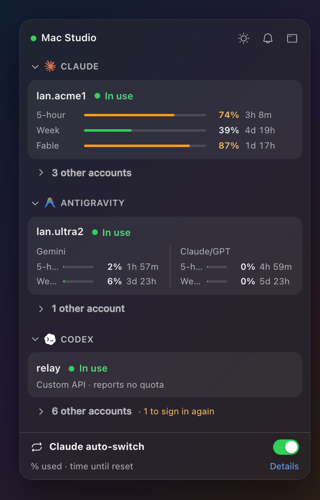
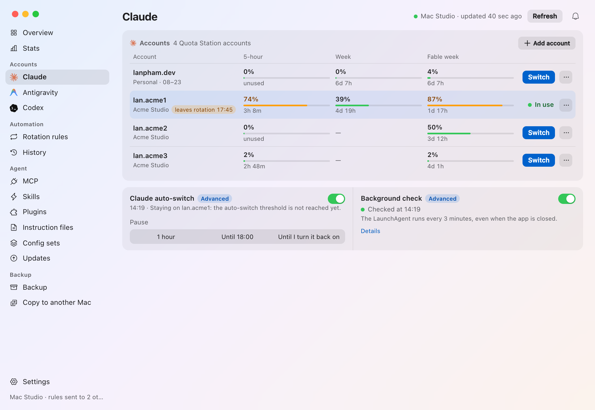
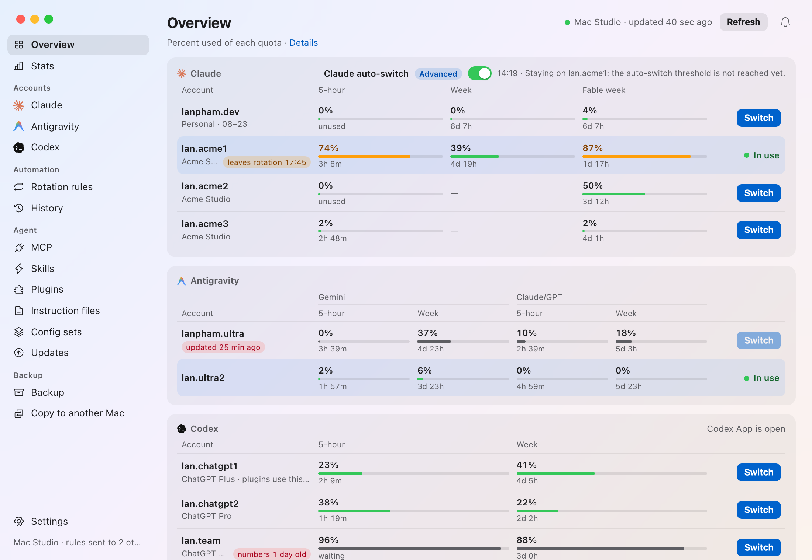
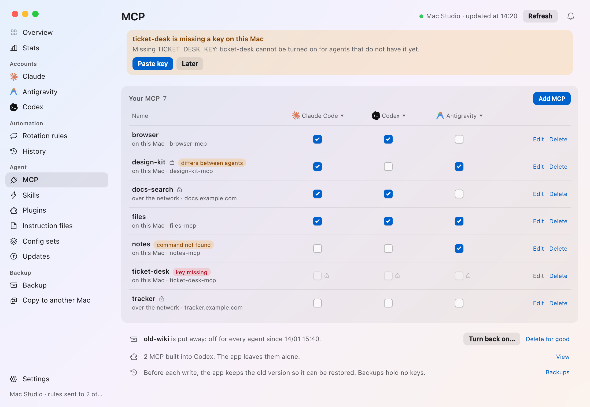

# Quota Station

**English** · [Tiếng Việt](README.vi.md)

Quota Station is a macOS menu bar and Windows system tray app for developers who use
**Claude Code**, **Codex** and **Antigravity**. It reads quota usage right on your computer,
switches between accounts in one click (or automatically when a Claude account runs out), and
manages the agents' MCP servers, skills, plugins and instruction files in one place. Available
in English and Vietnamese for macOS 13+ and Windows 10/11 (x64) — download from
[Releases](https://github.com/shin315/quota-station/releases/latest) or see [Install](#install).

<p align="center">
  <br>
  <sub><b>Popover</b> (opened by clicking the macOS menu bar or Windows system tray icon): quota bars and reset times for Claude, Antigravity and Codex, with <code>Auto-switch when quota runs out</code> at the bottom.</sub>
</p>

## Features

- **Auto-switch when quota runs out**: With two or more Claude accounts (Pro, Max or Team), turn
  on `Auto-switch when quota runs out` in the `Claude` tab or popover footer: when the active
  account hits 90% of its 5-hour or weekly window (`Settings › Services`), Claude Code moves to
  the account with the most quota left while running sessions keep going. Checks every 3 minutes,
  notifies you on each switch, and can be paused anytime (`Pause`).
- **Menu bar, popover and `Overview`**: The menu bar shows a compact gauge with the active
  account and percent used (`lan.acme1 74%`), and left-clicking opens the popover with every
  quota window. The main window's `Overview` tab lists all Claude, Antigravity and Codex accounts
  in one place with `Switch` on each inactive account.
- **Claude, Codex and Antigravity accounts**: Add and switch between multiple Claude accounts
  (browser sign-in, current Claude Code login, or setup-token), multiple ChatGPT accounts and
  custom API providers from `config.toml` for Codex (keeping ChatGPT plugins working, plus
  scheduled `Wake ChatGPT`), and multiple Google accounts for Antigravity.app and `agy`
  (signing in uses the OAuth client of the Antigravity installed on the same computer, so there
  is nothing to set up; [details](docs/how-it-works.md#the-oauth-client-file)).
- **MCP servers, skills, plugins and instruction files**: Toggle MCP servers and skills per
  agent (`Claude Code`, `Codex`, `Antigravity`) in one shared table, install or update skills
  from GitHub, view installed `Plugins`, and track `CLAUDE.md`, `AGENTS.md` and `GEMINI.md`
  (`Instruction files`). Changes are previewed together, written with automatic backups, and can
  be undone.
- **Config sets and Backup**: Save groups of MCP servers and skills as `Config sets` to apply or
  undo across the Mac in one step. Back up your setup to iCloud Drive (or a chosen folder) and
  restore item by item on any Mac—API keys are never stored in a backup pack.
- **Stats, Agent updates, History and Notifications**: View local Claude Code and Codex token
  usage and equivalent API cost (`Stats`), check and run updates for the agent CLIs (`Updates`),
  review switch `History`, and get notifications when quota runs low, an account must sign in
  again, or an env var (such as `ANTHROPIC_API_KEY`) overrides a login.
- **Themes, screenshot privacy and Advanced tools**: Pick light or dark mode, six theme packs,
  and turn off `Show emails` for screenshots. `Settings › Advanced › Show advanced features` adds
  `Auto-switch accounts` (your own auto-switch rules), syncing rules and agent configs to other
  Macs over SSH (`Copy to another Mac`), and `Update from source`.

<p align="center">
  <br>
  <sub><b>Main window › Claude tab</b>: four Claude accounts with 5-hour, Week and Fable week windows, and <code>Auto-switch when quota runs out</code> below.</sub>
</p>

<p align="center">
  <br>
  <sub><b>Main window › Overview tab</b>: all Claude, Antigravity and Codex accounts in one view, with the navigation sidebar on the left.</sub>
</p>

<p align="center">
  <br>
  <sub><b>Main window › MCP tab</b>: every MCP server across Claude Code, Codex and Antigravity with per-agent checkboxes, batch preview and undo.</sub>
</p>

<sub>All screenshots use synthetic test data, never real accounts. Full feature guide: <a href="docs/features.md">docs/features.md</a>.</sub>

## Install

Download from the [latest release](https://github.com/shin315/quota-station/releases/latest) for
**macOS 13+** (Apple Silicon or Intel) or **Windows 10/11 (x64)**.

- **macOS (Homebrew)**:

  ```sh
  brew install --cask shin315/tap/quota-station
  ```

- **macOS (DMG)**: Download `Quota.Station_<version>_universal.dmg`, open it and drag `Quota
  Station` to `Applications` (Developer ID signed and notarized by Apple; choose `Open` on first
  launch).
- **macOS (from source)**: On a Mac with Rust 1.85+ and Node.js 20+, clone the repo and run
  `scripts/install.sh` ([docs/development.md](docs/development.md#build-and-run)):

  ```sh
  git clone https://github.com/shin315/quota-station.git
  cd quota-station
  scripts/install.sh
  ```

- **Windows**: Download `Quota.Station_<version>_x64-setup.exe` and run it (installs per user, no
  admin rights needed). Because the installer is not signed, choose `Keep` (`Keep anyway` in
  Edge) if the browser warns, and in SmartScreen click `More info` › `Run anyway`.

Turn on `Settings › General › Open at login` to start Quota Station with your computer. Moving
from an older Claude switcher? See the [cutover guide](docs/claude-accounts.md#cutover).

## Privacy and safety

- Quota is read on your computer from each service's own endpoint using the agents' existing
  sign-ins—no Quota Station account, no telemetry, and no server of the app's own.
- Nothing is written to an agent's config files without a preview and confirmation first; every
  write keeps a backup and stops if the file changed since the preview.
- Tokens and API keys live in the macOS Keychain (or user-only / Windows-sealed folders) and
  never appear in windows, logs or backup packs.

Details and terms-of-service notes are in [SECURITY.md](SECURITY.md) and
[docs/how-it-works.md](docs/how-it-works.md).

## Update

Downloaded builds check GitHub Releases daily (`Settings › General › Updates`) and notify you
when a new version is out. From the first release after 1.1.1, `Download and install` downloads
it, checks its signature, installs it over the running copy and offers to reopen (on Windows the
installer closes the app and opens the new version). Copies on 1.1.1 or older install the new
`.dmg` or `.exe` from the browser over the old copy once more (quit first on macOS).

Homebrew installs update with Homebrew; the app shows the command:

```sh
brew upgrade --cask shin315/tap/quota-station
```

Source builds update with `Update from source` in `Settings › Advanced` or:

```sh
git pull --ff-only && scripts/install.sh
```

Nothing installs until you press the button. Source builds never install a downloaded release.

## Uninstall

Turn off `Open at login` (`Settings › General`) and `Auto-switch when quota runs out` (`Claude`
tab), then quit Quota Station. On **macOS**, move `/Applications/Quota Station.app` to the Trash,
or run:

```sh
brew uninstall --cask quota-station
```

On **Windows**, uninstall `Quota Station` in `Settings › Apps › Installed apps`. To also remove
saved settings, account folders and Keychain / Credential Manager items, see
[Uninstalling and removing data](docs/how-it-works.md#uninstalling-and-removing-data).

## Documentation

- [docs/features.md](docs/features.md) — Every feature and screen in detail
- [docs/how-it-works.md](docs/how-it-works.md) — Quota readers, account storage, CLI, files read/written, OAuth client file and uninstall cleanup
- [docs/development.md](docs/development.md) — Building from source, build features, browser preview and tests
- [docs/claude-accounts.md](docs/claude-accounts.md) · [docs/themes.md](docs/themes.md) · [docs/ui-guidelines.md](docs/ui-guidelines.md) · [docs/releasing.md](docs/releasing.md) · [SECURITY.md](SECURITY.md)

---

<sub>MIT, except the optional Antigravity accounts component (CC BY-NC-SA 4.0). Licenses and third-party credits are in <a href="NOTICE">NOTICE</a>, <a href="LICENSE">LICENSE</a>, <a href="LICENSES/">LICENSES/</a> and <a href="THIRD_PARTY.md">THIRD_PARTY.md</a>.</sub>
