# Quota Station

**English** · [Tiếng Việt](README.vi.md)

A macOS menu bar app that shows how much of your Claude Code, Codex and
Antigravity quota is used, switches between your accounts, and keeps the
agents' MCP servers, skills and instruction files in order. The interface is in
English and Vietnamese.

<p align="center">
  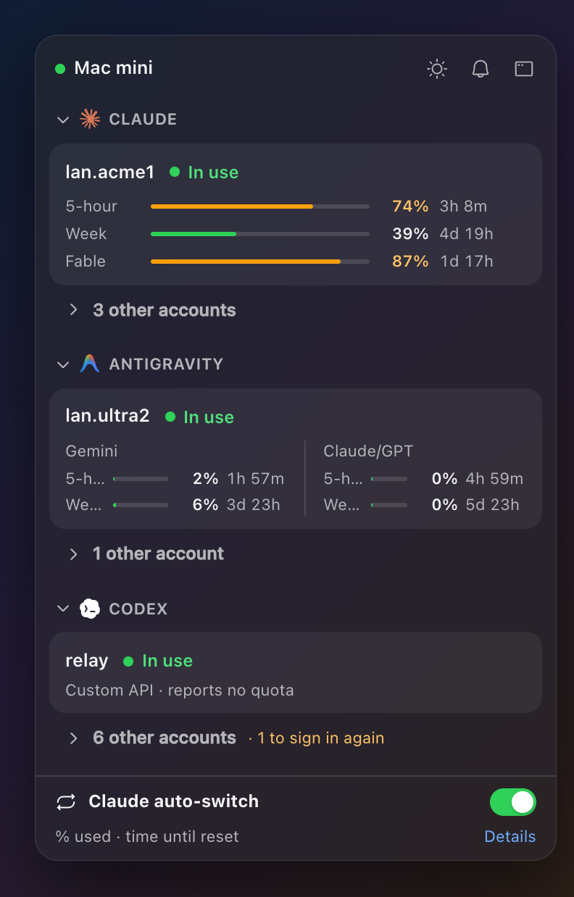
</p>

<p align="center">
  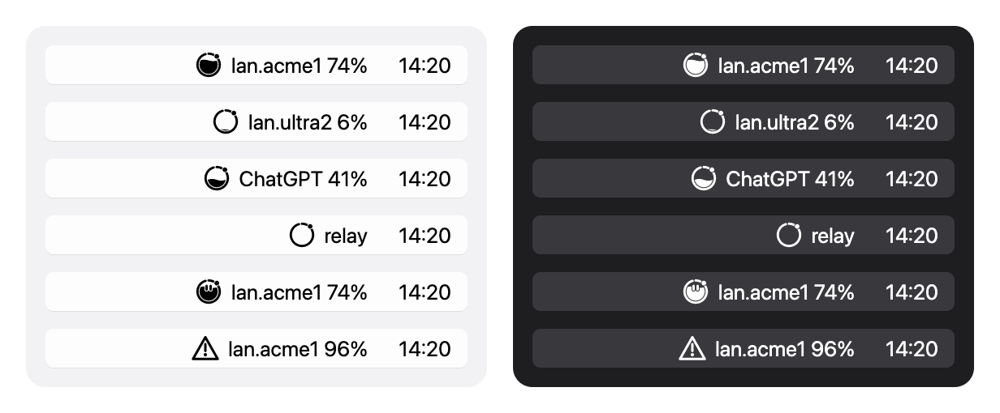
</p>

Quota Station reads the quota itself, on your Mac, with readers ported from
[quota-axi](https://github.com/kunchenguid/quota-axi); it needs no other
program for the numbers. Every image on this page uses made-up test data, never
real accounts.

> **Status.** macOS 13 or later. There is no release on GitHub yet, so you
> install it [from source](#install). A Windows build is in progress and not
> usable yet.

## Contents

- [What it does](#what-it-does)
- [Privacy and safety](#privacy-and-safety)
- [Requirements](#requirements)
- [Install](#install)
- [Update](#update)
- [Uninstall](#uninstall)
- [Documentation](#documentation)
- [Terms of service](#terms-of-service)

## What it does

### The menu bar and the popover

The menu bar shows a small gauge and the account in use with its share used,
such as `lan.acme1 74%`. You pick which service it follows (Claude, Gemini or
Codex) and which window it shows (5-hour, week, Fable week, or the one used the
most). A left click opens the popover: one section per service, each opening
on the account in use with every quota window and its reset time, the other
accounts one click away. The bars turn amber from 70 % and red from 90 %. A
right click gives a short menu.

### The main window

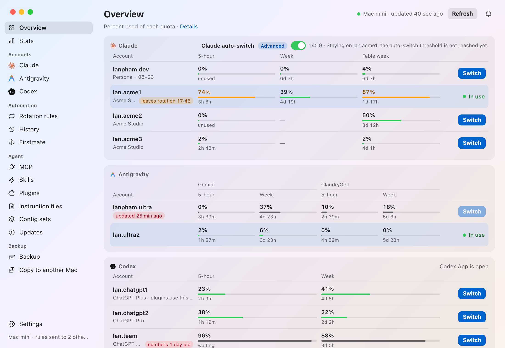

`Overview` puts every account of the three services in one place, with
`Switch` on each account not in use. The sidebar groups the rest: `Stats`, the
`Claude`, `Antigravity` and `Codex` accounts, `History`, the agent tools (`MCP`,
`Skills`, `Plugins`, `Instruction files`, `Config sets`, `Updates`), `Backup`
and `Settings`. The bell at the top right of every page holds the
notifications.

### Claude accounts

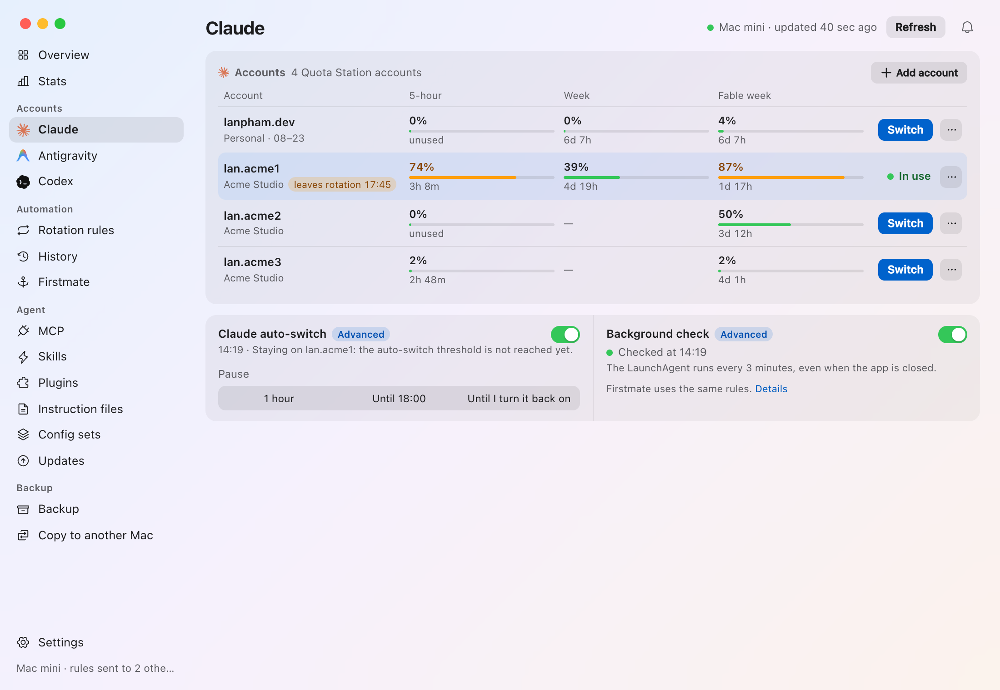

Quota Station keeps several Claude accounts and switches Claude Code between
them itself: add one by signing in with the browser, taking the account Claude
Code is signed in to, or pasting a setup-token. A switch first shows how many
running Claude Code sessions will rebuild their prompt cache, then checks that
it landed. An automatic rotation between Team accounts, with a pause, is one of
the [author's tools](#for-the-authors-macs).

### Codex

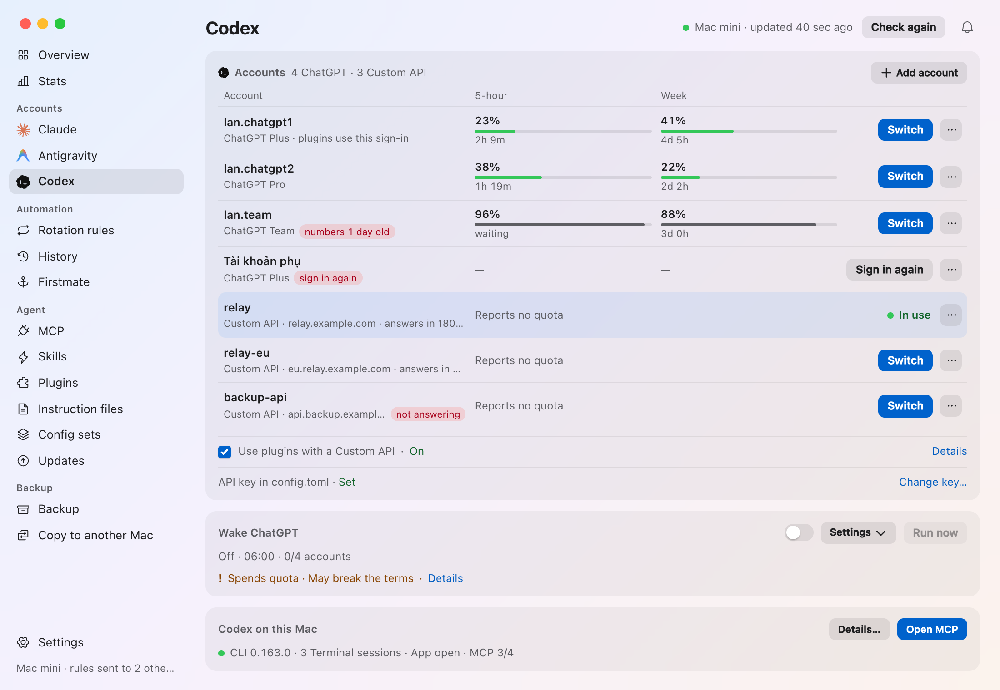

Keep several ChatGPT accounts for Codex, and custom API providers from its
`config.toml`, and switch between them; the ChatGPT sign-in stays in place so
Codex App's plugins keep working on a custom provider. Every switch shows what
changes first, writes one file with a backup, and never sends your sign-in to a
provider. `Wake ChatGPT` can start an account's five-hour window early, on a
schedule you set.

### Antigravity

The Antigravity row shows the Gemini and Claude/GPT quota of the account signed
in. A build with the Antigravity accounts can also sign several Google accounts
in and switch the one Antigravity.app and `agy` use.

### MCP servers, skills, plugins and instruction files

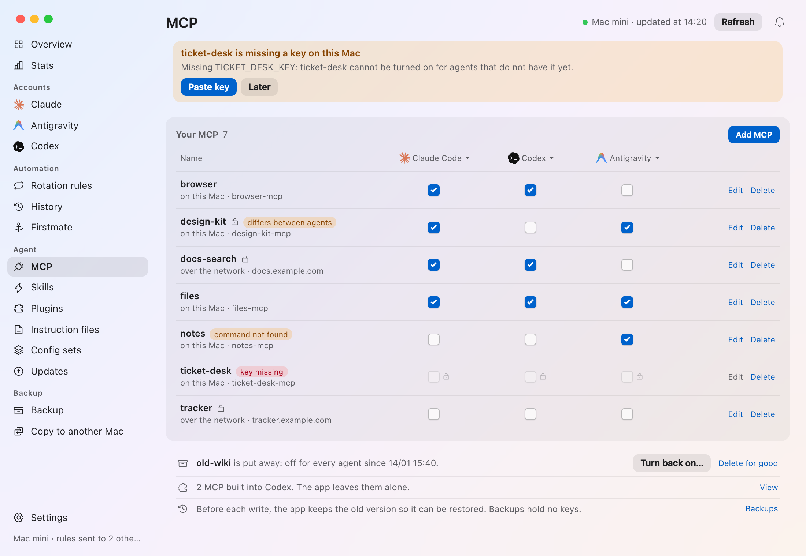

One table for every MCP server of Claude Code, Codex and Antigravity, with a
checkbox per agent. Ticks are collected, shown in one preview, written once with
a backup, and can be undone. Keys stay in the Keychain and never show.

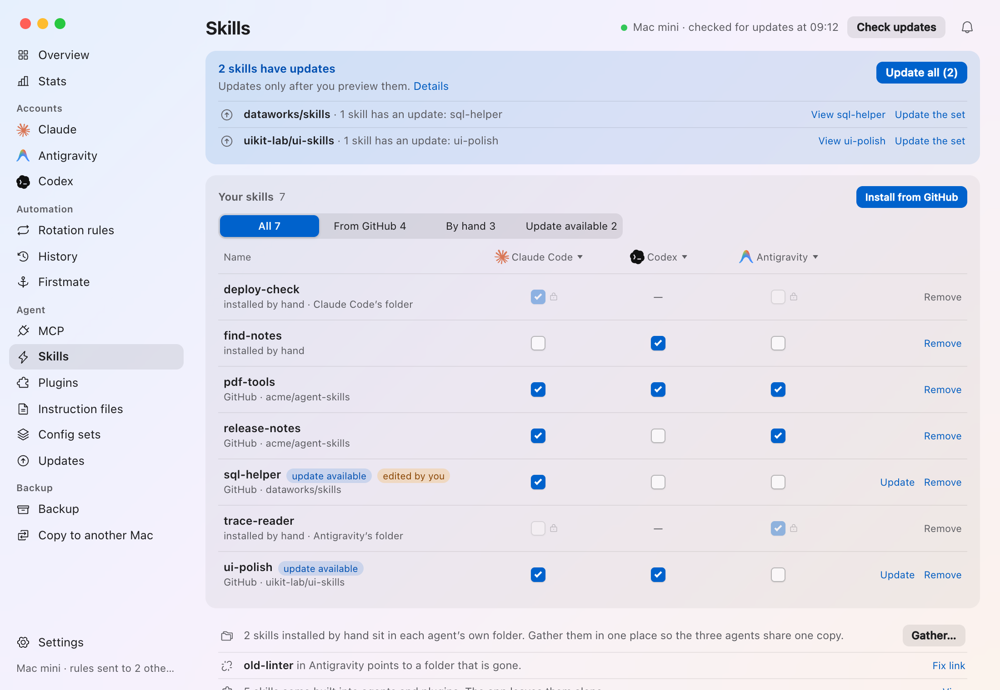

The `Skills` tab does the same for skills, installs them from GitHub and tells
you when one has a newer version. `Plugins` lists what each agent has
installed, and `Instruction files` follows CLAUDE.md, AGENTS.md and GEMINI.md.

### Config sets

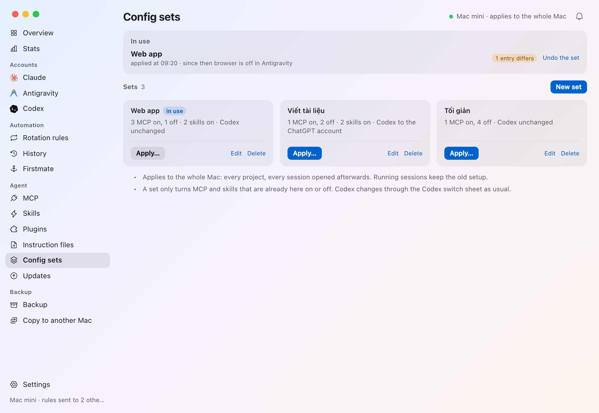

A set turns a chosen group of MCP servers and skills on or off for the whole
Mac in one go, after one preview, and can switch Codex too. It tells you when
the Mac has drifted from it, and can be undone.

### Backup and restore

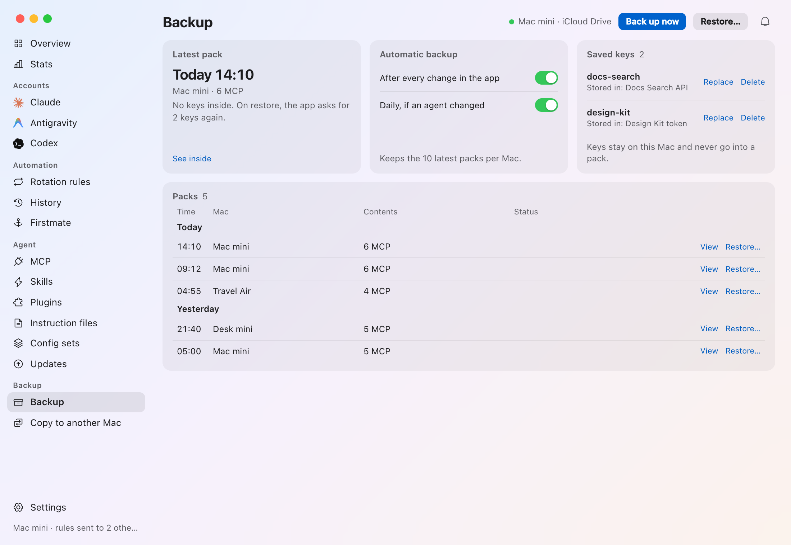

Back the MCP servers, skills, plugins and instruction files up to iCloud Drive
(or a folder you pick) and restore them on any of your Macs, item by item.
A pack never holds a key: the restore asks for them again.

### Stats

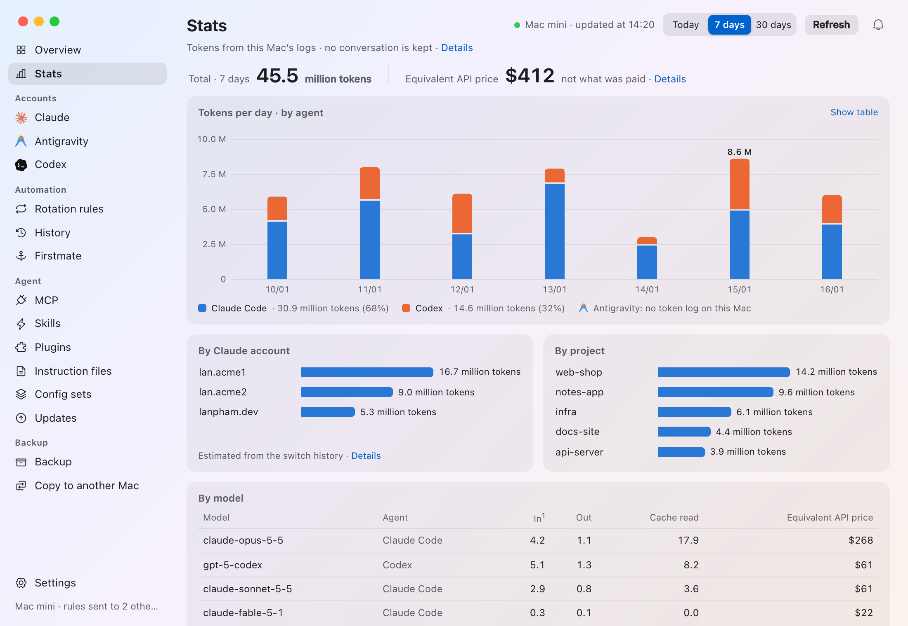

The tokens Claude Code and Codex used on this Mac, read from their own session
logs (counts only, never the conversation): by day or hour, by Claude account,
project and model, with what they would cost at API prices.

### Agent updates

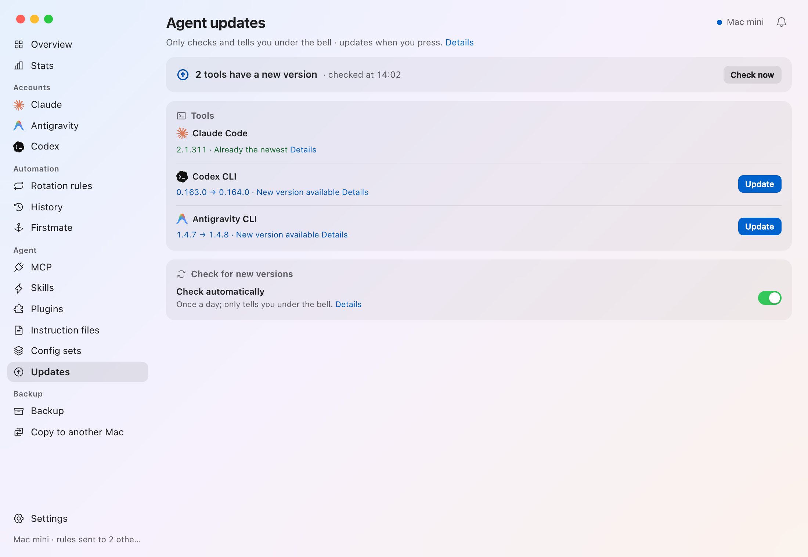

Checks whether Claude Code, the Codex CLI and the Antigravity CLI are the
newest, and runs a tool's own update only when you press `Update`.

### Notifications

Notifications come when the quota in the rotation is running out, an account
must sign in again, an Antigravity switch was undone, a skill or a tool has a
new version, or an environment variable (such as `ANTHROPIC_API_KEY` in
`~/.zshrc`) overrides an agent's sign-in. Each comes once, as a macOS card with
buttons, and stays under the bell. The cards' own text is in Vietnamese for
now, whatever the app's language, so this page shows no picture of them; the
[Vietnamese README](README.vi.md#thông-báo) does.

### Settings, themes and language

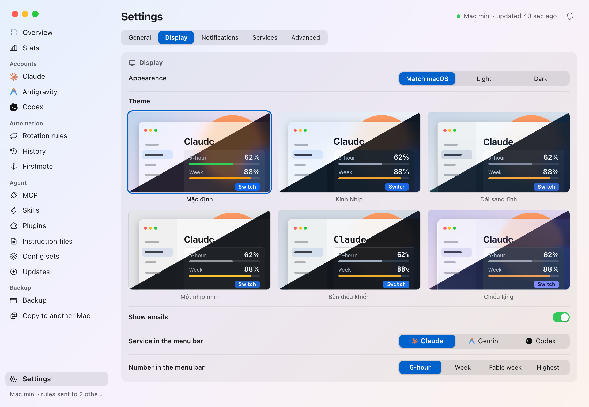

Settings has five tabs: `General` (language, open at login, backup folder, app
updates), `Display` (light or dark, six theme packs, the menu bar),
`Notifications`, `Services` and, in the author's build, `Advanced`. Turn off
`Show emails` and accounts are named by place or number, for screenshots.

### First run

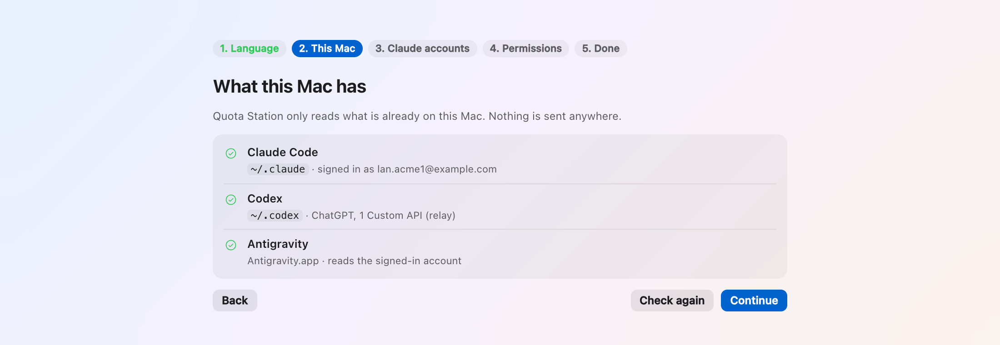

A new install opens on a short setup: language, what this Mac has, the Claude
accounts, permissions, done.

### More

- **History** of every account switch on this Mac.
- **App updates**: the app checks GitHub Releases for a newer version and tells
  you; it never installs one by itself.

### For the author's Macs

Some tools were made for the author's own Macs and are built only with the
`author-tools` feature (on in `scripts/install.sh`, off in a release build),
then shown with `Settings › Advanced`: the automatic Claude rotation with its
pause and rules editor, sending the rules to other Macs over SSH, `Copy to
another Mac`, `Firstmate`, and updating from a source clone.

Every part is described in full in [docs/features.md](docs/features.md).

## Privacy and safety

- The numbers are read on your Mac, from each service's own quota endpoint
  with the agents' own sign-ins, and sent nowhere else. No account, no
  telemetry, no server of the app's own.
- Nothing is written to an agent's files without a preview or a confirmation
  first, every write keeps a backup, and a file changed since the preview stops
  the write.
- The keys and sign-ins the app keeps live in the macOS Keychain (the extra
  ChatGPT accounts in folders only you can open). A key never appears in a
  window, a log or a backup pack, and goes to another Mac only if you tick
  `Also send keys over SSH`.

[SECURITY.md](SECURITY.md) has the details, and
[docs/how-it-works.md](docs/how-it-works.md) lists everything the app reads,
runs and writes.

## Requirements

- macOS 13 or later.
- To build: Rust stable (1.85 or later) and Node.js 20 or later. A Mac without
  them can install a copy built on another Mac.
- For the numbers, nothing else: Codex, `agy` or Antigravity.app, and Claude
  Code each only need to be signed in. quota-axi is not needed.
- To sign new Claude accounts in, and for `quota-station claude run`, Claude
  Code's `claude` command.
- To sign Antigravity accounts in (the Antigravity accounts build), the
  [OAuth client file](docs/how-it-works.md#the-oauth-client-file).
- For the author's tools that reach other Macs, an SSH alias to each that signs
  in without a prompt (a key, `BatchMode=yes`).

## Install

From a clone, on a Mac with Rust and Node.js:

```sh
git clone https://github.com/shin315/quota-station.git
cd quota-station
scripts/install.sh
```

The script builds the app, signs it (with your `Apple Development` identity, or
ad-hoc), copies it to `/Applications/Quota Station.app` and opens it. It never
adds a login item and never asks for `sudo`. It builds with the Antigravity
accounts and the author's tools; `QS_ANTIGRAVITY_ACCOUNTS=0` or
`QS_AUTHOR_TOOLS=0` leaves one out. `scripts/install.sh --help` lists the
options.

On a Mac that cannot build, make a package on one that can and copy it over:

```sh
scripts/install.sh --package ~/Desktop          # writes quota-station-<version>.zip
# on the other Mac, where the zip arrived:
ditto -x -k quota-station-0.1.0.zip . && ./quota-station-0.1.0/install.sh --app "./quota-station-0.1.0/Quota Station.app"
```

Then, on a Mac that signs Antigravity accounts in, put the
[OAuth client file](docs/how-it-works.md#the-oauth-client-file) in place, and
turn on `Settings › General › Open at login` if the app should start with the
Mac.

Moving from claude-swap or Cockpit Tools? Follow
[docs/cutover.md](docs/cutover.md).

## Update

From a terminal, in the clone:

```sh
git pull --ff-only && scripts/install.sh
```

In a build with the author's tools, `Settings › Advanced` can do the same: set
`Source code` to the clone and press `Update`. It pulls, builds and installs
when the clone has a new commit, then offers `Restart`; a clone with local
commits is never merged or reset, and a build longer than 30 minutes stops.

## Uninstall

1. In `Settings › General`, turn `Open at login` off (or remove Quota Station in
   System Settings › General › Login Items). If the app runs the Claude
   rotation, turn it off in the `Claude` tab (or run
   `quota-station claude rotation off`), and bring the older switcher back
   first if Claude should still rotate ([docs/cutover.md](docs/cutover.md)).
2. Quit Quota Station from its menu, then move
   `/Applications/Quota Station.app` to the Trash.
3. Optionally, its data: `~/Library/Application Support/com.shin315.quota-station/`
   (settings, the Claude accounts' folder, the Antigravity index and readings,
   history, notifications and `oauth-client.json`), and the app's own Keychain
   items, services `com.shin315.quota-station.claude` and
   `com.shin315.quota-station.antigravity`, in Keychain Access. Remove the
   Claude accounts in the app (all but the one in use) to delete their items;
   Claude Code keeps its own sign-in either way. Sign the Antigravity accounts
   out in the app first to delete those items. Leave the `gemini`/`antigravity`
   item alone: Antigravity.app and agy use it.

The pause flag and the rotation file belong to the switcher and stay.

## Documentation

| Page | What it covers |
|---|---|
| [docs/features.md](docs/features.md) | Every part of the app in full |
| [docs/how-it-works.md](docs/how-it-works.md) | The quota readers, the Claude and Antigravity accounts, the command line, what the app reads, runs and writes, the OAuth client file |
| [docs/cutover.md](docs/cutover.md) | Moving a Mac from claude-swap and Cockpit Tools |
| [docs/development.md](docs/development.md) | Building, build features, the browser preview, tests, code layout |
| [docs/claude-accounts.md](docs/claude-accounts.md) | The design of the Claude accounts |
| [docs/themes.md](docs/themes.md) | The six theme packs |
| [docs/ui-guidelines.md](docs/ui-guidelines.md) | Interface wording in Vietnamese and English |
| [docs/brand-icons.md](docs/brand-icons.md) | The app and menu bar icons |
| [SECURITY.md](SECURITY.md) | Keys, tokens, what is never read, and how to report a problem |

## Terms of service

Signing Antigravity accounts in with Antigravity's own OAuth client, and reading
the quota as Antigravity does, carries the same terms-of-service risk as using
Cockpit Tools, no more: the app makes the same calls, with the same user agent
and headers, no more often. `Wake ChatGPT` sends requests on a schedule, which
OpenAI's terms do not address: use it on your own accounts only.
[SECURITY.md](SECURITY.md) says what could happen and which changes would make
the risk larger.

---

<sub>MIT, except the optional Antigravity accounts part (adapted from Cockpit Tools, CC BY-NC-SA 4.0). Details in [LICENSE](LICENSE), [LICENSES/](LICENSES), [NOTICE](NOTICE) and [THIRD_PARTY.md](THIRD_PARTY.md).</sub>
