# Quota Station

A macOS menu bar app that shows how much Claude Code, Antigravity and Codex
quota is used on this Mac, as reported by [quota-axi](https://github.com/kunchenguid/quota-axi).
The interface is in Vietnamese.

**Personal, non-commercial project (cá nhân, phi thương mại).** It is shared
under CC BY-NC-SA 4.0. See [License](#license).

Based in part on [Cockpit Tools](https://github.com/jlcodes99/cockpit-tools)
(dựa một phần trên Cockpit Tools): its Antigravity login, quota reading and
account switch
are adapted from Cockpit's code. See [`NOTICE`](NOTICE).

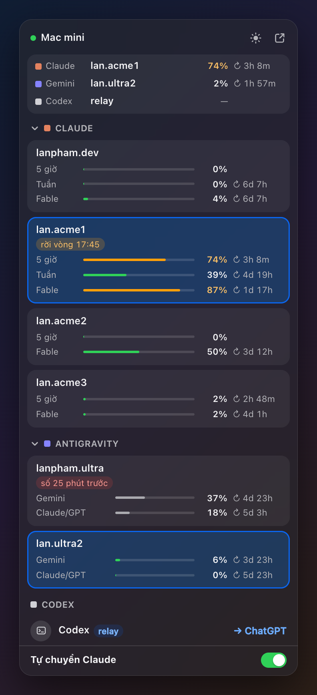

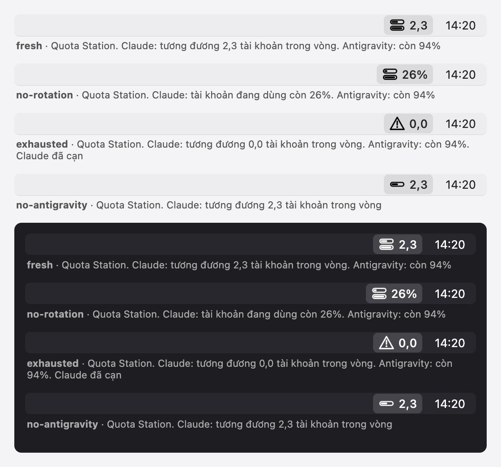

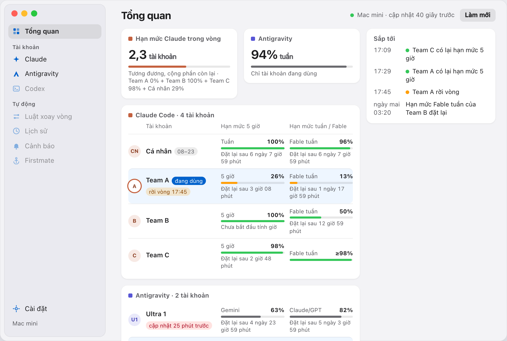

All three images use the synthetic test fixtures, not real accounts. The menu
bar image is drawn from the app's own glyph and title code, not captured from
the screen; the popover and window images are the browser preview.

## What it does

This is milestone M10, "Sao lưu và khôi phục" (backing the MCP servers up
to iCloud Drive and restoring them on any Mac), on top of M9, "MCP" (every
agent's MCP servers in one table), M8, "Chuyển Codex" (switching Codex between the ChatGPT
login and a custom API provider), M7, "Chuyển đổi" (installing,
updating and launching at login), M6, "Lịch sử, cảnh báo và Firstmate", M5 "Luật
xoay vòng", M3 "Chuyển Claude và tạm dừng", M2 "Cửa sổ chính chỉ đọc" and M1
"Khung và số", with M4a, "Đăng nhập Antigravity trong app", M4b, "App tự đọc
hạn mức Antigravity", and M4c, "Chuyển Antigravity không cần Cockpit", the
steps of taking over what Cockpit Tools does. The app reads, and acts in eight
ways, each started by the owner:
it switches the active Claude account through claude-swap, it pauses the
automatic switcher, it edits the switcher's rotation rules and copies them to
the owner's other Macs, it logs Antigravity accounts in and out on this Mac,
it switches the Antigravity account that Antigravity.app and agy use, it
switches the provider Codex uses, and it turns MCP servers on and off, adds,
edits and removes them for Claude Code, Codex and Antigravity, and it backs
those servers up and restores them (below). Five things it does on its own: it finishes that rotation copy (a Mac that could
not take the saved rules is tried again in the background), it reads the
quota of the Antigravity accounts logged in here, at Cockpit's pace or slower,
it keeps a history of the switches on this Mac, it backs the MCP servers up
when they change (after a write in the app and once a day), and it posts a macOS
notification card with buttons for five kinds of alert (below). A button on a
card does what the same button in the app does: a Claude switch still opens
the confirmation sheet first.

- **Menu bar item.** A template glyph with one bar for Claude and one for
  Antigravity, each filling as its account in use is used. Next to it is the
  account in use and its share used for one service, `lan.acme1 38%`, the way
  claude-swap's own menu bar named it. The service is Claude by default;
  `Thanh menu` in `Cài đặt` and `Thanh menu theo` in the right-click menu
  pick Gemini (Antigravity's Gemini models) or Codex instead, on each Mac.
  The number is the account's five-hour window by default; `Số trên thanh
  menu` in `Cài đặt` and in the right-click menu picks `Tuần`, `Fable tuần`
  (Claude only) or `Chặt nhất` (the window used the most, a tie naming the
  longer window) instead, on each Mac. A service without the window picked
  shows its five-hour window, and the window used the most without that
  either. Đang dùng shows the same window; which window it is shows on hover.
  The name is the part of the email before `@`, cut to 12 characters with
  `…`, or the account's place (`Team A`, `Ultra 1`) while names are hidden.
  Codex shows `ChatGPT` and that account's number on its ChatGPT login, and
  only the provider's name when it goes through a provider of its own,
  which reports no quota. Without a number (no read yet, quota-axi failing,
  a window waiting for its number after a reset) the title is the name and
  `–`; only the window shown needs a number, except for `Chặt nhất`, which
  needs every window. A Mac without Antigravity, or without Codex, follows
  Claude. The glyph's bars still fill with each account's window used the
  most. The tooltip and the VoiceOver label give every service in words,
  the window shown and its reset included. While automatic switching is paused, two small pause bars
  follow the glyph; an exhausted Claude rotation draws a warning triangle.
- **Popover** (left click). One header line with this Mac's name; how old
  the numbers are shows only when they are not fresh. On top, `Đang dùng`:
  one line per service (Claude, Gemini, Codex) with the account in use, its
  share used and when that resets, the window named on hover; Antigravity's
  Claude/GPT models join the Gemini line from 70 % used. Then a card per
  account, in the main window's order (the one in use keeps its place, its
  frame marks it): every Claude Code
  account with its `5 giờ`, `Tuần` and `Fable` windows (a Team seat with no
  week has no `Tuần` line), every Antigravity account with a `Gemini` and a
  `Claude/GPT` line, each the tighter of that group's two windows, each as
  the share **used** (the bar fills as the quota goes; amber from 70 %, red
  from 90 %) with when it resets. The `CLAUDE` and `ANTIGRAVITY` headers fold
  their group to the header alone, and a folded group stays folded the next
  time the popover opens. Every window, the organization and the hours stay
  in the cards' spoken labels and in the main window. It also has banners for
  stale numbers, an unavailable source, numbers waiting after a reset, an
  exhausted rotation, missing Keychain permission and a failing quota-axi.
  Every Claude account other than the one in use is a button that opens the
  switch sheet (below), and so is every Antigravity account logged in here
  once quota-axi lists the app's own accounts. The footer has the
  `Tự chuyển Claude` switch; the line that says why Claude is on its account
  shows only when there is something to act on (a pause or hold, waiting for
  quota, a switch coming, the switcher missing or failing), and the other
  Macs' line only when one of them is behind
  (`Mac B: 14:30 · Mac C: chưa tới được, sẽ thử lại`). Its header has
  two buttons: the moon (or sun) turns the look dark (or light) for both
  windows, and the box with an arrow opens the main window on `Tổng quan`.
- **Names.** Accounts go by the part of their email before `@` when every
  account shares one domain (the whole email otherwise, and always on hover),
  with the organization of a Team seat or `Cá nhân · 08–23` under it.
  Turning off `Hiện email` in `Cài đặt` names them by place instead (`Team A`,
  `Cá nhân`, `Ultra 1`), for screenshots, and then no email or organization
  reaches the windows at all.
- **Switching Claude** (F04). The confirmation sheet names the account, its
  allowances, and how many Claude Code sessions running on this Mac will
  rebuild their prompt cache on their next message, which costs quota. It
  offers a hold so the switcher does not switch straight back: 30 phút,
  1 giờ (the default), until the account's next five-hour reset, or none.
  Confirming runs `cswap switch N --json`, writes the pause flag when a hold
  was chosen (a hold never shortens a pause that is already on for longer),
  waits 5 seconds, reads the active account again without quota-axi's cache
  and reports what it finds: switched, switched back by the switcher (or by
  another switch), not yet confirmed, or claude-swap's error. When `cswap`
  times out or stops without an answer, the app reads the account in use
  before saying whether the switch landed. Outside the personal account's
  hours the sheet warns that the switcher will move away from it.
- **Pausing automatic switching** (F07). The switch opens a sheet to pause
  for 1 giờ, until 18:00 or until turned back on; while paused it resumes at
  once, and the banner offers `Thêm 1 giờ`. The why line shows the
  switcher's own decision from `--dry-run` and its last log line, or
  `Đang tạm dừng tới HH:MM: <lý do>` while the pause holds. Banners warn
  when claude-swap's own automatic switcher (`com.cswap.auto`) is loaded
  again, and when the switcher ignores the pause flag.
- **Short menu** (right click). `Mở cửa sổ chính` (main window), `Làm mới`
  (refresh), `Thanh menu theo` (Claude, Gemini or Codex, ticked; a service
  this Mac lacks is greyed out), `Số trên thanh menu` (`5 giờ`, `Tuần`,
  `Fable tuần` or `Chặt nhất`, ticked; `Fable tuần` is greyed out unless the
  title follows Claude), `Cài đặt…` (settings), `Thoát Quota Station`
  (quit).
- **Main window.** One sheet of glass, like the popover: macOS draws the
  popover's material behind the whole window, the sidebar sits on it with no
  panel of its own, and each group is a frosted panel (solid when Reduce
  transparency is on). The same numbers as the popover, from the same read, in
  these tabs:
  - `Tổng quan`: `Đang dùng`, a tile per service with the account in use,
    its share used large, the window and its reset, every Claude Code and Antigravity account in a table with fixed columns
    (`5 giờ · Tuần · Fable tuần` for Claude; `5 giờ` and `Tuần` under
    `Gemini` and `Claude/GPT` for Antigravity), each the share used, the
    `Tự chuyển Claude` switch with its one line, and `Sắp tới`, the resets
    and rotation ends of the next 24 hours as the readings give them.
  - `Claude`: the accounts, with a `Chuyển` button on each account not in
    use and a `Đang dùng` status (a dot and words, nothing to press) on the
    one in use; an old reading gets a chip by the name. Below it,
    `Tự chuyển` (the switch and the pause choices) and `Switcher` (one line;
    whether launchd runs it, `com.cswap.auto`, the pause, whether it reads
    the pause flag, and its last decision and log line as printed sit under
    `Chi tiết`). A switcher that launchd does not run gets a banner.
  - `Antigravity`: the accounts, with `Chuyển` and `Đăng xuất` on each one
    this app logs in and `Thêm tài khoản` in the card's header. A Mac without
    an account list or without Antigravity says so; a card for Cockpit Tools
    shows only where the accounts come from Cockpit Tools. The accounts
    this app logs in that quota-axi does not list yet stay in a short list
    under the table. Each account the app logs in shows `đang đọc…` while
    the app reads its quota and `đọc lỗi` (the reason on hover) when that
    read failed (below). Opening the tab reads every account.
  - `Luật xoay vòng`: the rotation editor (below).
  - `Lịch sử`, `Cảnh báo` and `Firstmate` (M6, below).
  - `Cài đặt`: the quota-axi path, either found automatically or set by hand,
    a one-time button that lets quota-axi ask macOS for Keychain access, the
    name shown for this Mac (empty uses the name macOS gives it),
    `Các Mac khác`: a name and an SSH alias for each other Mac, with
    `Thêm Mac`, `Bỏ` and `Thử SSH` (reads that Mac's rotation file and
    changes nothing), whether `oauth-client.json` is in place and usable,
    `Hiện email` (on by default; off names accounts by place), `Giao diện`
    (`Theo macOS`, `Sáng` or `Tối`), `Thanh menu` (the service the menu bar
    title follows: Claude, Gemini or Codex; one this Mac lacks is greyed out
    with the reason), `Số trên thanh menu` (the window the title shows:
    `5 giờ` by default, `Tuần`, `Fable tuần` or `Chặt nhất`; `Fable tuần` is
    greyed out unless the title follows Claude), `File của firstmate` (the path to
    Firstmate's `quota-pool.last`; nothing is built in, and only a file of
    that name is taken), `Thông báo` (whether macOS lets the cards show,
    `Gửi thử` and a switch for each kind of alert), and the app itself (M7):
    `Mở khi đăng nhập` (off by default; see [Install](#install)), `Mã nguồn`
    (the clone this Mac updates from) and `Phiên bản` (the version and the
    commit it was built from, with `Cập nhật từ mã nguồn`; see
    [Update](#update)). A settings file from before M5 with a single
    `sshAlias` moves into the list of other Macs.

  - `Codex` (M8, below).

  `Tổng quan` also has a small Codex card: the provider in use, whether the
  ChatGPT login is kept, and a button that opens the same sheet. `Cảnh báo` carries the number of cards nobody has answered yet. Under the
  machine name it says whether the other Macs have the rules.
- **Rotation rules** (F06). The editor shows the rotation file's six keys:
  the Team accounts in the rotation (chips; the number is the order), the
  personal account and its hours, the two thresholds (sliders), and when an
  account leaves the rotation. It marks what changed, previews what the
  switcher would decide with the edited rules (its `--dry-run` pointed at a
  draft copy), and saves with one button named for the Macs it reaches
  (`Lưu cho cả ba Mac` with two other Macs set, `Lưu cho máy này` with none).
  A save rewrites the six keys in place and keeps every other readable line
  (a line quota-axi cannot read stays only in the backup), puts a
  `# updated = <time> by <machine>` comment at the top, writes through a
  temporary file and a rename, and keeps the file before as
  `rotation.bak-<time>` (the newest 10 stay). quota-axi then reads the file;
  when it refuses it (a `rotation_…` reason) or cannot run, the file before
  goes back and nothing is sent. Then the file goes to each other Mac over
  SSH, the same way, and is read back to compare. The save bar has one line
  per Mac: `đã nhận 14:30`, `chưa tới được · thử lại 14:35`, `có bản mới hơn`.
  A Mac that could not take it is tried again every 5 minutes, also after a
  restart. When another Mac holds a newer copy (a later `updated`), or one
  edited by hand there (its content differs from its stamp, or it has no
  `updated` line), nothing is overwritten: the write itself checks the file
  is still the one just read, and the tab offers that copy,
  side by side with this Mac's, or keeping this Mac's (stamped again, so it
  is the newest). When a newer copy lands on this Mac during an edit, the
  editor says `Bản trên <máy> mới hơn, tải lại?` and saves over it only when
  told to. Leaving the tab, closing the window or quitting from the menu bar
  with unsaved changes asks first.

- **Switching Antigravity** (M4c). The sheet names the account and its
  allowances, says whether Antigravity.app runs, and that a running `agy`
  session keeps the old account until it restarts. While Antigravity.app
  runs it offers `Thoát app rồi chuyển` (quit the app politely, switch, open
  it again), `Chuyển, để app chạy` (switch now; the running app may write
  its old login back) and `Thôi`; when it does not run, only `Chuyển` and
  `Thôi`. The switch makes the token fresh and, while the token lacks a
  project or the GCP ToS mark, asks `loadCodeAssist` for them as the quota
  read does (60 seconds at most); it quits the app and waits up to 20
  seconds when asked (an app that does not quit stops the switch before the
  shared login is touched; `Chuyển` stops if the app runs again by then),
  writes the login Antigravity.app and agy share with Cockpit's own
  `security` command, then points quota-axi's binding at the new account
  and opens the app again. Five seconds later it reads Antigravity again and
  says `Đã chuyển`, that agy still uses the old account or could not be
  read, or why it did not switch. Antigravity.app older than 2.0 is named
  and refused, and one whose version cannot be read stops the switch
  before anything is written (`Missing` only when there is no
  Antigravity.app at all). A switch is refused, with a message, while an
  Antigravity login, logout or another switch runs, and a login is refused
  while a switch runs. For six hours after a switch, a reading that
  shows the old account back in use is counted as an overwrite and brings
  alert 4 (below); the `Antigravity` tab also shows the banner
  `Chuyển Antigravity bị ghi đè` with `Chuyển lại` and `Thôi`. The popover
  has no banner for it: the macOS card replaces it.

- **History** (F08, `Lịch sử`). Every switch on this Mac, newest first, a day
  at a time, filtered by `Tất cả`, `Claude` or `Antigravity`. Each line has
  its time, a tag, the accounts before and after, why, and where it comes
  from: `app` (a switch made in this app, Claude or Antigravity), `switcher`
  (a `switch to slot N` or `primed slot N` line in the switcher's log, read
  from its last 64 KB) or `quan sát` (the account in use changed between two
  reads and neither the app nor the switcher made it, or Antigravity.app
  wrote the old login back). The app keeps its own lines, at most 500, in
  `history/history.jsonl`; the Antigravity switches come from its own
  `antigravity/switch-log.jsonl`, never from Cockpit's switch history.
- **Alerts** (F09, `Cảnh báo`). After every read the app checks five rules
  and sends each new alert once, as a macOS card with buttons; the same card
  stays in the `Cảnh báo` tab, with the same buttons. A button pressed on
  either counts once, and the card then says what was chosen and how it
  went. Each alert has a key, so the same event never alerts twice.
  1. `Hạn mức Claude trong vòng sắp cạn` and `Claude đã có lại hạn mức`:
     Firstmate's rule on claude-swap's numbers. The rotation's accounts that
     have not left it (the personal one only inside its hours) count; the
     pool is dry when the account in use has 10% or less left and no other
     has 15% or more. Without quota-axi's rotation the app uses the rotation
     file, for this alert and the next. The card names the account in use
     and its share used, and when an account resets, and offers
     `Sang <tài khoản> (còn N%)`, which opens the switch sheet, and `Thôi`.
  2. `<tài khoản> rời vòng lúc HH:MM`: 30 minutes before an account leaves
     the rotation (`expire` in the rules). For the account in use it offers
     `Ổn` and `Chuyển ngay` (the switch sheet).
  3. `<tài khoản> cần đăng nhập lại`: claude-swap reports an error only a
     new login mends (`invalid_grant`, `no_refresh_token`, a relogin), or the
     login expires within 3 days, when quota-axi gives `loginExpiresAt`
     (today it does not, so only the error fires). `Nhắc ngày mai` asks again
     at 09:00 the next day. Antigravity accounts that need a new login or a
     verification get their own card, with `Đăng nhập lại` (the
     `Antigravity` tab) or `Mở trang xác minh`.
  4. `Antigravity đổi về tài khoản cũ`: the six-hour watch after an
     Antigravity switch saw the old account back. While it has happened at
     most twice the card offers `Thoát app rồi chuyển lại`, `Chuyển lại`
     (they switch back at once, as the sheet's buttons do) and `Thôi`;
     after that it only says so.
  5. `Firstmate đang chờ hạn mức Claude`: Firstmate's `quota-pool.last`,
     written within the last 30 minutes, says `pool=dry`. Off by default.

  `Gửi thử` sends a sample of each kind, marked as a test, whose buttons
  change nothing. A Mac where notifications are off for the app says so,
  with `Mở Cài đặt hệ thống`; the alerts still come to the tab. macOS asks
  once for leave to show cards, the first time the app runs. Only the
  packaged `.app` can post cards: `tauri dev` keeps the alerts in the tab.
  The cards name accounts as the app does, never by email. What was sent,
  answered and snoozed is kept in `alerts/alerts.json` (the newest 30 cards).
- **Firstmate** (F10). Whether Firstmate holds new Claude work, from the
  line its quota-pool watch writes, `quota-pool.last`, at the path set in
  `Cài đặt`: the account in use, what
  each account has left, the next reset, whether quota-axi has `+cswap` and
  whether Firstmate could read claude-swap, and when the file was written.
  A file older than 30 minutes says Firstmate may not be running, and a Mac
  without the file says so. Only the keys Firstmate writes are read.
- **Switching Codex** (M8). Codex can go through the official ChatGPT login
  or through a custom API provider that its `config.toml` already describes
  (a `[model_providers.<id>]` table with its own key). The app switches
  between the two and keeps the ChatGPT login in place, so Codex App's
  plugins and remote control keep working while Codex goes through the
  custom provider. The popover has a one-line `CODEX` row: the provider in use, its
  state as chips (the custom provider not answering, CC Switch also
  managing Codex, a change made outside the app, no ChatGPT login) and the
  way it would switch (`→ ChatGPT`). Pressing the row never switches: it
  opens a sheet with five facts (what changes, the sessions already running,
  the background process, the ChatGPT login, the one file written and its
  backup), plus any risk of the moment, and a `Khởi động lại tiến trình nền
  Codex sau khi chuyển` box, off by default. Ticking it restarts Codex's shared
  background process after the switch, with its own sheet first. A switch
  the app cannot make safely is refused with the reason under the row: no
  custom provider table, a table without a key of its own (the ChatGPT login
  would be sent to the provider), the placeholder key CC Switch leaves in a
  table it does not use, a profile that picks its own provider, or a table
  written inline. The custom provider's name, address and key always come
  from the file; nothing is built in.

  The `Codex` tab shows the provider (both sides, the address, how the key
  is given, and `requires_openai_auth`), Codex on this Mac (terminal
  sessions, Codex App, the background process, the version), the sessions
  that can be resumed by provider, the recent switches, how many MCP servers
  Codex has (the `MCP` tab turns them on and off), the file the app writes
  with its backups, and a step-by-step guide to stop using CC Switch. While
  CC Switch still runs and manages Codex, a banner says to switch Codex in
  one place only: CC Switch's next switch overwrites the provider choice.
  A change made to `config.toml` outside the app shows as a banner with
  `Xem thay đổi` and `Đã hiểu`; the app never writes it back. Every switch,
  and every change seen from outside, goes to `Lịch sử` under `Codex`.

  How the file is written: only `model_provider` (set to the custom
  provider's id, or removed for the ChatGPT login) and, in the custom
  provider's table, `requires_openai_auth` change. That key is on when the
  table's key comes from an environment variable or a bearer token and a
  ChatGPT login exists, and off for a key sent in its own header, as CC
  Switch decides it. Every other byte stays, comments included; a switch
  never writes `auth.json` or `[mcp_servers]`. Before writing, the app checks
  the file is still the one the sheet was built from (a SHA-256), keeps a
  backup with every key in it replaced by `<redacted>`, writes a temporary
  file and renames it, and reads the result. The
  Codex folder is `~/.codex` unless `Cài đặt › Thư mục Codex` says
  otherwise.

  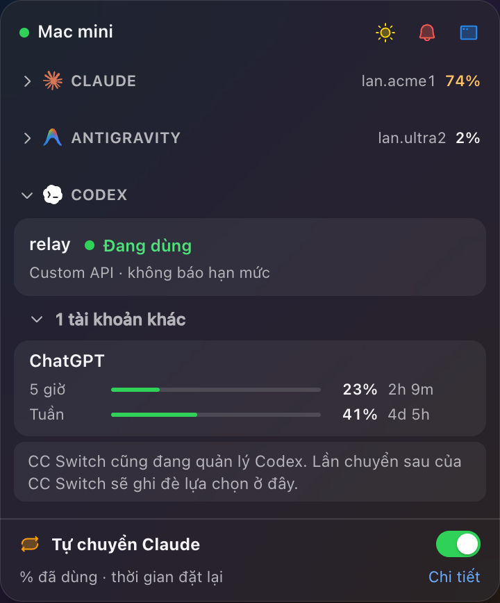 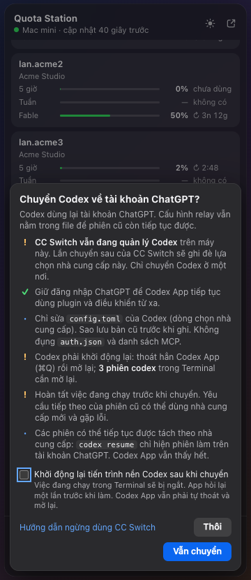

  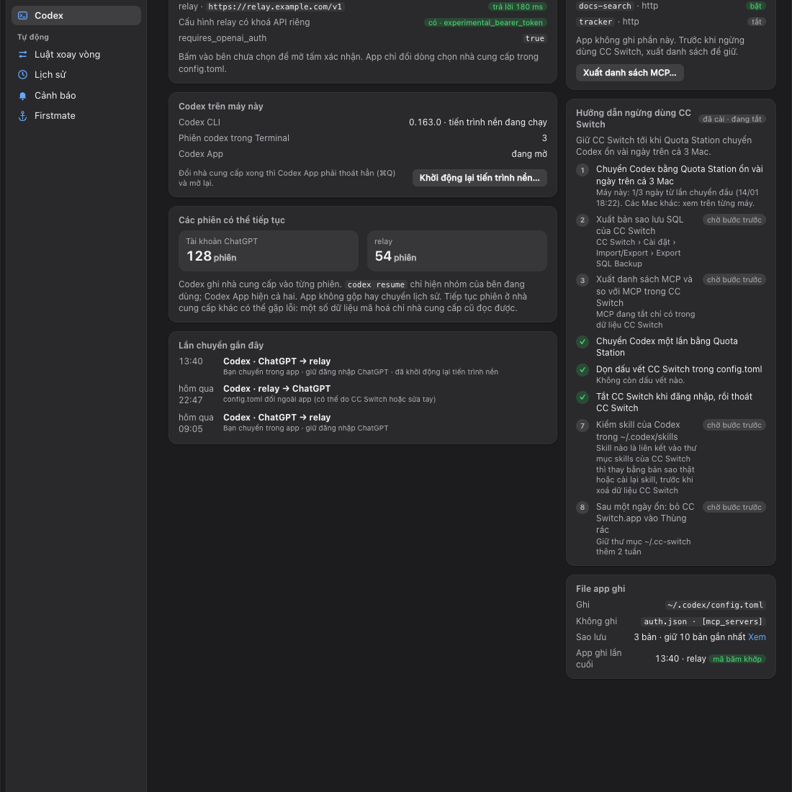

- **MCP** (M9). The `MCP` tab, under `Agent` in the sidebar, puts every MCP
  server of Claude Code, Codex and Antigravity in one table: a row per
  server, with the line `trên máy · <command>` or `qua mạng · <host>`, a
  small lock when it has a key, and chips only when something is the matter
  (`thiếu khoá`, `lệnh chưa cài`, `khác giữa các agent`); and a column of
  macOS checkboxes per agent, headed by the agent's own icon. A tick is not
  written at once: the box turns light blue with an amber dot and the bar
  under the table lists `N thay đổi chưa ghi`, so a tick taken back drops
  out. The icon at a column's head opens its menu: `Bật tất cả`,
  `Tắt tất cả` (both skip a box that cannot be ticked) and
  `Bỏ N thay đổi chưa ghi`. `Xem trước và ghi…` shows one preview for the
  whole batch, by agent: the lines each file gains and loses, the
  `claude mcp` commands for Claude Code, the backups and what to restart.
  Each file is written once, and the line after it offers `Hoàn tác` (the
  whole batch back) and `Bản lưu`. `Thêm MCP` fills one server in for every
  agent at once, by hand or by pasting the JSON or TOML a README gives;
  `Sửa` first compares a server that differs between agents (its keys only
  as `giống nhau` or `khác nhau`); `Xoá` turns it off everywhere and keeps
  it in the app's store to turn on again, or removes it for good. Under the
  table, one line each: the servers kept in the store, the ones Codex App
  and plugins bring themselves (shown, never edited), and the backups.

  Keys never show. A key typed or pasted goes to the app's own Keychain
  items, with the Bitwarden item it is in; the preview masks every key; a
  server short of its key keeps its boxes locked until `Dán khoá`. Codex is
  written in its `[mcp_servers.<name>]` tables (`enabled = false` turns one
  off), Antigravity in `~/.gemini/config/mcp_config.json`
  (`"disabled": true`), and Claude Code only through
  `claude mcp add-json`/`remove --scope user`, which writes `~/.claude.json`
  itself; Claude Code has no off, so the app keeps a server turned off there
  and puts it back when it is ticked again. A file that does not parse is
  shown and never written, and a file changed after the preview stops the
  batch. See [SECURITY.md](SECURITY.md) for what is kept where.

  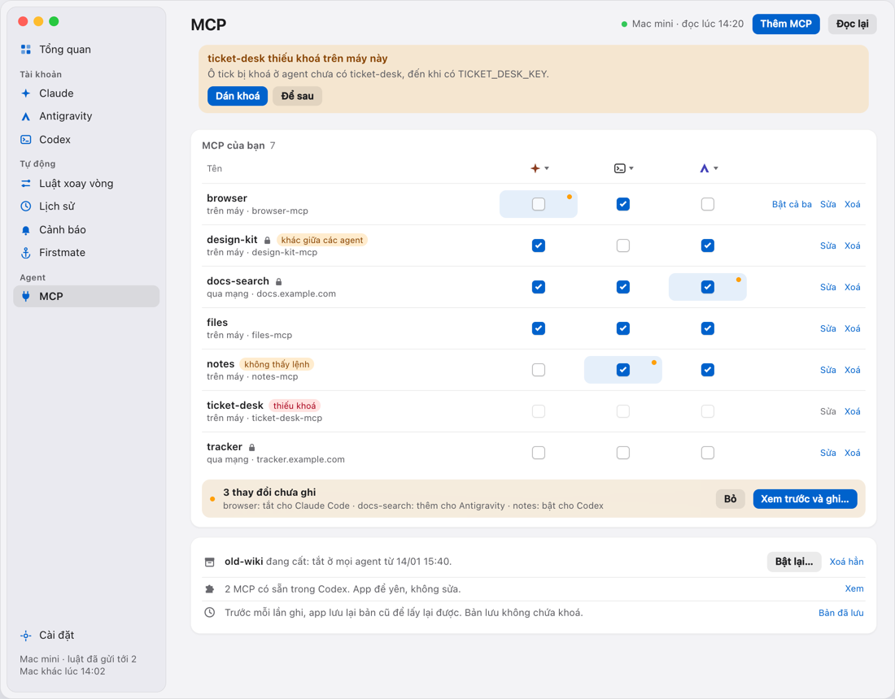

  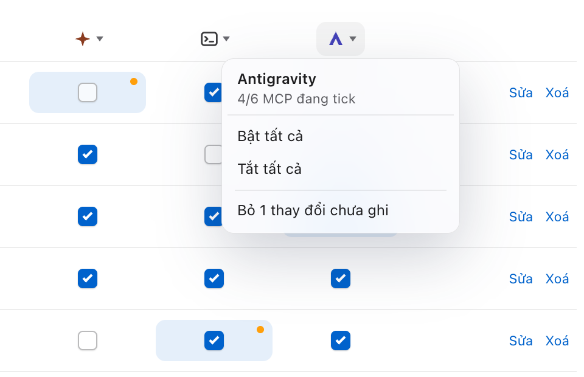 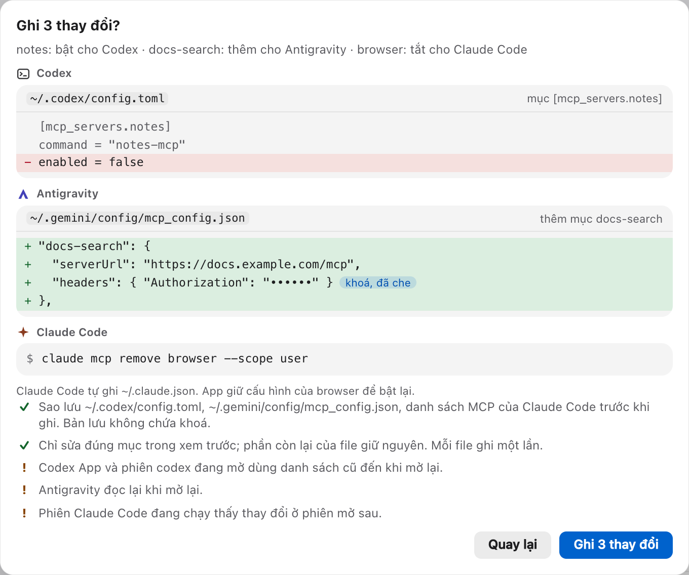

- **Skills, Plugin và File hướng dẫn** (M11). The `Skills` tab shows every
  skill of Claude Code, Codex and Antigravity in the MCP tab's table, a
  checkbox per agent, filtered by `Tất cả`, `Từ GitHub`, `Cài tay` and
  `Có bản mới`. Skills live once, in the shared folder `npx skills`
  installs into (`~/.agents/skills`): a tick for Claude Code or Antigravity
  is a link in that agent's folder, and for Codex, which reads the shared
  folder itself, an `enabled = false` entry under `[[skills.config]]` in
  `config.toml`. Ticks go through the same pending bar, preview, backups and
  `Hoàn tác` as the MCP tab, and turning a skill off never removes a folder.
  `Cài từ GitHub` takes a repository, lists its skills (with `Đọc SKILL.md`
  to read one first), lets the owner pick the agents and shows the
  `npx skills add` command before it runs; nothing in a skill runs on
  install. Skills installed by hand in one agent's folder can be gathered
  into the shared folder with `Gom về…`; skills Codex or a plugin brings are
  listed and left alone. Once a day the app asks GitHub, one question per
  repository in the skill lock file, whether a skill has a newer version,
  and says so above the table and in the Cảnh báo tab (a macOS card only if
  turned on in Cài đặt); it never updates on its own. `Cập nhật` shows what
  changed, warns when the skill was edited on this Mac, keeps a copy and
  keeps every agent's box; `Bỏ qua bản này` waits for the next version.

  The `Plugin` tab lists the plugins `claude plugin list` and
  `codex plugin list` report, what each brings and the marketplaces, and
  the agents' own commands a restore would run; it changes nothing. The
  `File hướng dẫn` tab lists CLAUDE.md, the rules under `~/.claude/rules`,
  AGENTS.md, GEMINI.md and any file added by hand, when each changed, how it
  stands against the newest backup pack (with a line-by-line `So sánh`) and
  whether it goes into the pack. The app never edits one, and a file with a
  line shaped like a key stays out of every pack, the value masked when it
  is shown. The backup pack now lists the skills (their source, not their
  content), the plugins and the instruction files; restoring them comes
  later. See [SECURITY.md](SECURITY.md#skills-plugins-and-instruction-files-m11).

  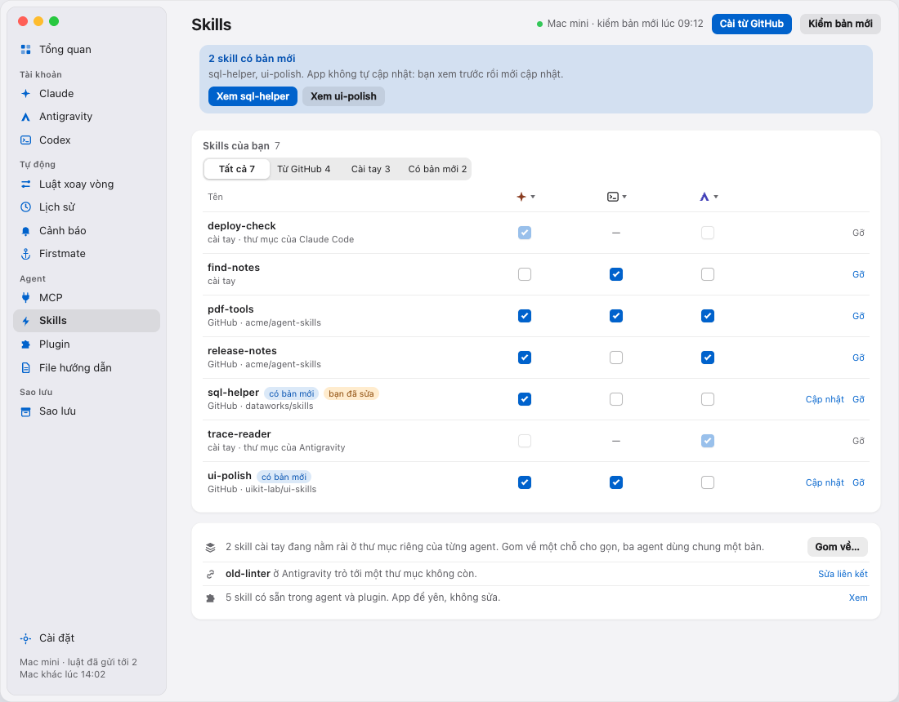

  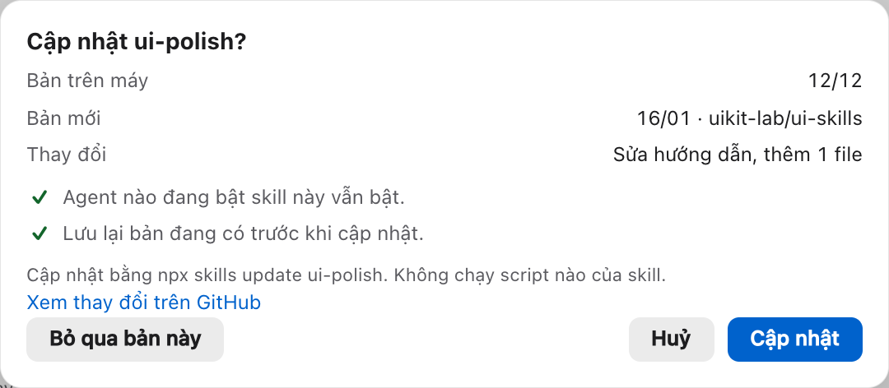

  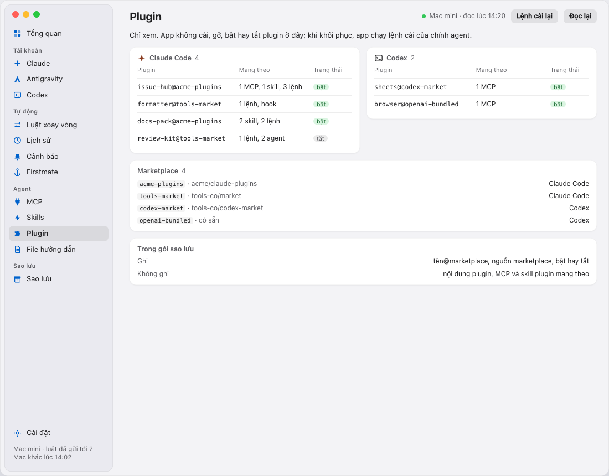

  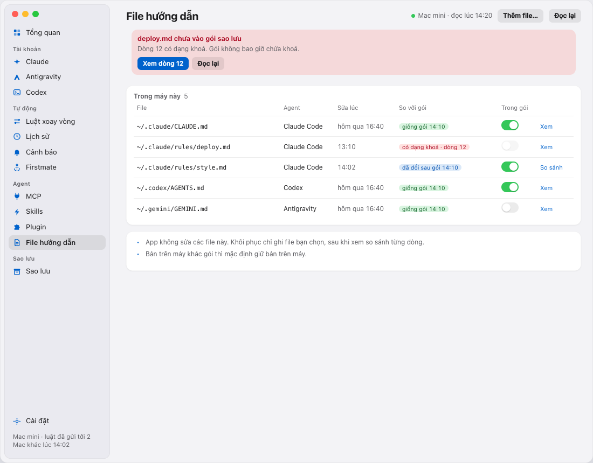

- **Sao lưu và khôi phục** (M10). The `Sao lưu` tab saves the MCP servers
  of the three agents, and which agent has each one on, to a pack in iCloud
  Drive, so any of the owner's Macs can restore it. It shows the newest
  pack, every Mac's packs (a pack iCloud has not downloaded yet says so and
  cannot be picked until it is), the two switches of `Tự sao lưu` (after
  each change in the app, and daily when something changed) and the keys
  the app keeps on this Mac, by name and Bitwarden item, to replace or
  delete; it keeps the newest 10 packs of each Mac. `Xem trong gói` says
  what a pack holds in plain words. A pack never holds a key, and paths in
  it are written from the home folder, so they change to the Mac that
  restores it.

  `Khôi phục…` opens a sheet in steps: pick a pack, then one preview of
  what changes on this Mac. Servers to add are ticked; one that differs from
  the pack is not, and `So sánh` shows the two side by side; the ones
  already the same are listed in one line. Next the keys the pack needs are
  asked for in password fields, with the Bitwarden item each is in. A server
  left without its key, or whose command is not installed here, is added
  turned off, and the result says what is left to do. The write is the MCP
  tab's checked write, so a file changed after the preview stops it, and a
  restore never touches a login, an account or Codex's provider. Once done,
  `Hoàn tác lần khôi phục` takes the whole restore back, asking first when a
  file was edited since. See [SECURITY.md](SECURITY.md#backup-packs-and-restore-m10).

  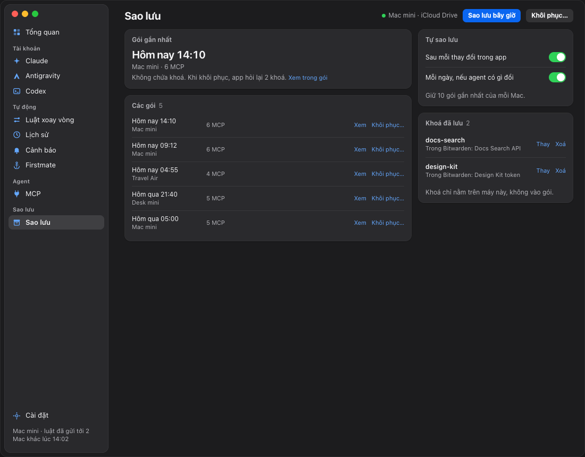

  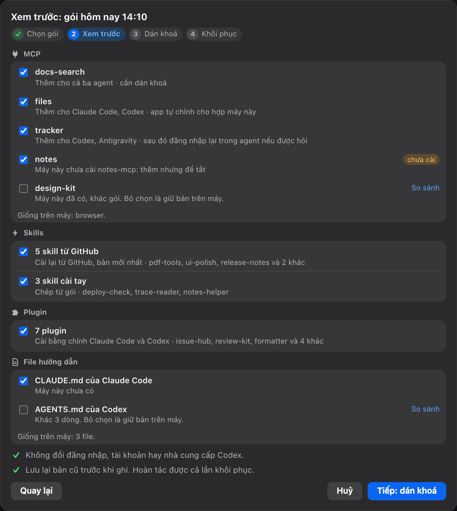 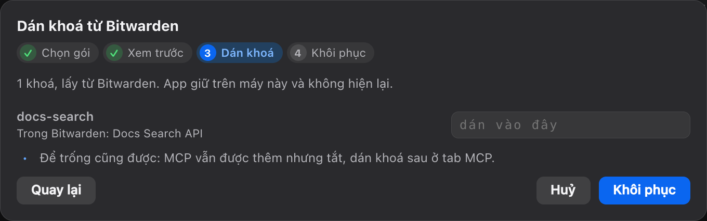

- **Antigravity logins** (M4a). `Thêm tài khoản` opens Google's consent
  screen in the default browser, with Antigravity's own OAuth client, so the
  screen names Antigravity, not Quota Station. The flow is Cockpit's: a
  loopback callback on a random port, a fresh `state`, a 10-minute wait, the
  code exchange, then userinfo for the email. A browser that cannot reach
  the app can paste the callback URL instead. The card lists the accounts by
  number (`Ultra 1`, `Ultra 2`, the order quota-axi will use) with
  `đã đăng nhập`, `cần đăng nhập lại` (Google refused the refresh token) or
  `cần xác minh` (Google asks for a verification), `Đăng nhập lại`, and
  `Đăng xuất` with a confirmation in the row. Logging out forgets the account
  in this app only: Antigravity.app and agy stay logged in. Without a usable
  `oauth-client.json` the card says what is missing and cannot add.
- **Antigravity quota** (M4b). The app reads the quota of the accounts logged
  in here itself, as Cockpit Tools does: the token, refreshed only when it
  has under five minutes left, then Cloud Code's `fetchAvailableModels` and
  `retrieveUserQuotaSummary` with Antigravity's user agent and headers
  (`antigravity/<version> darwin/<arch>`; the version is that of
  `/Applications/Antigravity IDE.app`, where Cockpit looks, or Cockpit's
  `1.20.5` without it). `loadCodeAssist`, which gives the account's project
  and whether it is a GCP ToS account, is asked after a login and while the
  token lacks either (unlike Cockpit, a failed answer ends the read like a
  failed quota call: the last reading stays, and a 429 or 5xx backs the
  account off); a GCP ToS account with a project is read from
  `cloudcode-pa.googleapis.com`, every other from
  `daily-cloudcode-pa.googleapis.com`. Each reading goes, in Cockpit's cache
  layout, to the app's `antigravity/` folder, which quota-axi (`+cswap.5`)
  reads before Cockpit's, so the windows and Firstmate see every account
  without Cockpit. The windows still draw every number from quota-axi.
  The pace is never denser than Cockpit's: the account in use with each
  quota-axi read, the others every 10 minutes and when the `Antigravity` tab
  opens, one account at a time, and no account twice within a minute (a
  reading younger than that is used as it is). A network error on
  `fetchAvailableModels` is tried three times, a second apart, as Cockpit
  does; after that, or after any other failure, the last numbers stay with
  their age. After a 429 or a 5xx the account waits at least 2 minutes,
  then 4, 8, 16 and at most 30. A 403 on `fetchAvailableModels` marks it
  `Google chặn` and stops its reads until a new login; an account that
  needs a new login is not read either. A Mac with no account logged in
  reads nothing.

Each Mac runs its own copy and switches only its own machine; there is no
switch button for another Mac. The only thing sent to another Mac is the
rotation file. Each Mac also keeps its own Antigravity logins, and nothing
assumes another Mac has any. Each Mac installs and updates its own copy
(below).

### What it reads and runs

- `quota-axi --provider claude --json --max-age 120s --no-credential-refresh`,
  and the same for `--provider agy`, and for `--provider codex` on a Mac with
  a Codex folder (its ChatGPT login's five-hour and weekly windows, for the
  menu bar and `Đang dùng`; when quota-axi has no stored login it may ask
  Codex's own read-only `app-server`, as quota-axi documents). The app reads every 60 seconds while the
  popover or the main window is open and every 5 minutes while both are
  hidden. It also reads when either opens, after the Mac wakes and on
  `Làm mới`. The check after a switch passes `--max-age 0` instead: a cached
  Claude reading may still be the account from before the switch.
- The Keychain button runs
  `quota-axi --provider claude --json --allow-keychain-prompt --no-credential-refresh`
  once. macOS shows its own prompt. The app itself never opens Claude's
  Keychain item or any other tool's credential file; the only Keychain items
  it opens are its own Antigravity ones (below).
- It ignores the identity fields in quota-axi's output (emails, ids). Each
  read also runs `cswap list --json`, which reads claude-swap's own cache
  and asks no server, for every Claude account's three windows, its email
  and its organization; they stay in memory, go to the windows only while
  `Hiện email` is on, and are never written to a file or a log. Without
  claude-swap, or when it fails, the accounts keep quota-axi's one number.
- Switching runs `cswap switch N --json` (claude-swap holds Claude Code's
  credential locks while it writes) and nothing else of claude-swap's. The
  app reads only the account numbers from its answer, takes email addresses
  out of its error messages, and looks for `cswap` in `~/.local/bin`,
  `/opt/homebrew/bin` and `/usr/local/bin`.
- Live sessions are counted from `~/.claude/sessions/*.json`: only the `pid`
  and `kind` fields are read, and a session counts when its process is alive.
- The switcher: `~/.local/bin/cswap-prefer-team --dry-run`, which switches
  nothing, the last line of `~/Library/Logs/cswap-prefer-team.log`, and
  `launchctl list` for `com.cswap.prefer-team` and `com.cswap.auto`. These
  run with each read while the popover or the main window is open, and after
  a switch or a pause; while both are hidden only the pause flag is read. The
  app never runs the switcher for real.
- The rotation editor's preview runs the same `--dry-run` with
  `CSWAP_ROTATION_FILE` pointing at a draft copy in the app's folder, which
  it deletes afterwards.
- Copying the rotation file runs `ssh -o BatchMode=yes -o ConnectTimeout=5
  -T <alias>` with one of two fixed scripts: one prints
  `~/.config/cswap-prefer-team/rotation`, the other takes the new file on
  stdin, keeps a backup, renames it into place and prints it back. Batch
  mode means SSH never asks for a password or a host key. An alias must be
  letters, digits and `. - _ @`, and cannot start with `-`. The `ssh` used
  is the first on `PATH`, else `/usr/bin/ssh`.
- Antigravity logins talk to Google when the owner presses
  `Thêm tài khoản` or `Đăng nhập lại`: the consent page opens in the browser
  (`open <url>`), then `https://oauth2.googleapis.com/token` and
  `https://www.googleapis.com/oauth2/v2/userinfo`. Before a quota read, a
  token with under five minutes left is refreshed at the same token URL.
  The tokens go to the app's own Keychain items through
  `/usr/bin/security add-generic-password`, `find-generic-password` and
  `delete-generic-password`, service `com.shin315.quota-station.antigravity`.
  [`SECURITY.md`](SECURITY.md) lists what the app never reads.
- Antigravity quota reads, at the pace above:
  `POST https://daily-cloudcode-pa.googleapis.com/v1internal:fetchAvailableModels`
  and `…/v1internal:retrieveUserQuotaSummary` (on `cloudcode-pa` for a GCP
  ToS account with a project), and `…/v1internal:loadCodeAssist` when the
  token lacks a project or the GCP ToS mark. The Antigravity version comes
  from the bundle's `product.json` or, through `/usr/bin/plutil -p`, its
  `Info.plist`; the bundle is only read.
- Switching Antigravity runs, when the owner confirms:
  `plutil -extract CFBundleShortVersionString raw` on Antigravity.app's
  `Info.plist`, `pgrep -f /Applications/Antigravity.app/Contents/MacOS/Antigravity`,
  `osascript -e 'tell application id "com.google.antigravity" to quit'` and
  `open -b com.google.antigravity` (only with `Thoát app rồi chuyển`),
  `…/v1internal:loadCodeAssist` while the token lacks a project or the GCP
  ToS mark,
  `security add-generic-password -U -s gemini -a antigravity -w go-keyring-base64:<…> -A`,
  and then `quota-axi --provider agy --json --max-age 0 --no-credential-refresh`.
  Opening the sheet runs only the `plutil` and `pgrep` questions.
- History and alerts (M6) read, after each read: the last 64 KB of the
  switcher's log, the rotation file (when quota-axi gives no rotation),
  the app's own Antigravity files, Firstmate's `quota-pool.last` at the path
  set in `Cài đặt` (at most 16 KB, a plain file of that name only), and,
  while an overwrite card waits for an answer, `pgrep` for Antigravity.app.
  The cards go through macOS's own notification center
  (`UNUserNotificationCenter`); `Mở Cài đặt hệ thống` runs
  `open x-apple.systempreferences:com.apple.Notifications-Settings.extension`.
- `Mở khi đăng nhập` (M7) registers and unregisters the app with macOS's
  `SMAppService.mainApp`, only when the switch is pressed; the settings tab
  asks macOS for the switch's state when it opens.
- `Cập nhật từ mã nguồn` (M7) runs, only when pressed,
  `git -C <clone> pull --ff-only` (with `GIT_TERMINAL_PROMPT=0` and
  `GIT_SSH_COMMAND="ssh -o BatchMode=yes"`, so git never waits for a
  password), `git -C <clone> rev-parse HEAD`, and then, unless this copy was
  built from that commit, `/bin/bash <clone>/scripts/install.sh --dest
  <the folder this app is in> --no-open`. `Mở lại` quits the app and has
  `/bin/sh` wait for it to end before `open` starts the new copy.
- Codex (M8), while the popover or the main window is open every 60
  seconds, every 5 minutes while both are hidden, and when the `Codex` tab
  opens: `config.toml` in the Codex folder; the shape of `auth.json` (which
  kind of login it holds; no value is kept, and the file is never written);
  `ps -ww -Ao tty=,command=` for terminal sessions, Codex App, the
  background process and CC Switch; `codex --version`; the first line of
  each `sessions/**/rollout-*.jsonl` for its provider; and whether
  `/Applications/CC Switch.app` and `~/.cc-switch` exist (nothing inside is
  read). It checks the custom provider answers with
  `GET <base_url>/models` with no key and no login, five seconds at most,
  three tries; any HTTP answer, a 401 included, counts. A switch writes
  `config.toml` as above; with the box ticked, or from the tab's own sheet,
  it runs `codex app-server daemon restart` with `CODEX_HOME` set.
- MCP (M9), when the `MCP` tab opens, on `Đọc lại`, and after each write:
  `~/.claude.json` (only its `mcpServers`), the Codex folder's `config.toml`
  (only `[mcp_servers]`) and `~/.gemini/config/mcp_config.json`; whether
  `claude` and each server's command are in the usual folders; and, for a
  server whose key must come from the app, whether its Keychain item is
  there (never its value until a write needs it). After a preview the owner
  confirmed it writes those two files and runs `claude mcp add-json` and
  `claude mcp remove` with `--scope user`.
- Backups (M10), when the `Sao lưu` tab opens, on `Kiểm lại`, after each
  MCP write and once a day: the `Quota Station Agents` folder at the top of
  iCloud Drive, each pack's `manifest.json` (and whether iCloud has
  downloaded it). A pack is three files there, `manifest.json`, `mcp.json`
  and `secrets-needed.json`, with no key; a restore reads them and writes
  the agent files as the MCP tab does, and keeps
  `agents/restore-last.json` (what `Hoàn tác` needs, no key) in the app's
  folder.
- Skills (M11), when the `Skills` tab opens and on `Đọc lại`: the shared
  folder `~/.agents/skills` and its lock file `~/.agents/.skill-lock.json`
  (read only), `~/.claude/skills`, `~/.gemini/config/skills`, the Codex
  folder's `skills` and the `[[skills.config]]` entries of its
  `config.toml`. After a preview the owner confirmed it makes or removes
  links in the two folders and writes those entries. `npx -y skills …` runs
  only on `Tìm skill`, `Đọc SKILL.md`, `Cài`, `Cập nhật` and `Gỡ hẳn`, in an
  empty folder of the app's. Once a day it asks
  `api.github.com/repos/<owner>/<repo>/git/trees/HEAD` once per repository
  in the lock file, with no token, and keeps what it found in
  `agents/skill-updates.json`.
- Plugins (M11), when the `Plugin` tab opens: `claude plugin list --json`,
  `claude plugin marketplace list --json` and `codex plugin list --json`,
  and each installed plugin's own folder. Nothing else of the two commands.
- Instruction files (M11), when the `File hướng dẫn` tab opens:
  `~/.claude/CLAUDE.md`, `~/.claude/rules/**/*.md`, the Codex folder's
  `AGENTS.md`, `~/.gemini/GEMINI.md` and the files added by hand; the
  choices made there are `agents/instructions.json`. It never writes them.
- It writes these files: its own settings file,
  `~/Library/Application Support/com.shin315.quota-station/settings.json`,
  with `rotation-sync.json` (where each other Mac stands) beside it; in the
  same folder, `update/install.log` (the last update's build output),
  `antigravity/accounts.json` (Cockpit's account index layout,
  no token), `antigravity/status.json` (accounts that need a new login or a
  verification, or that Google refused),
  `antigravity/cache/quota_api_v1_desktop/authorized/<SHA-256 of the email>.json`
  (each account's last quota reading in Cockpit's cache layout, no token),
  and after an Antigravity switch
  `antigravity/antigravity_legacy_instances.json` (the account bound to
  Antigravity.app, read by quota-axi), `antigravity/switch-log.jsonl` and
  `antigravity/watch.json`; `history/history.jsonl` and
  `alerts/alerts.json` (M6, no email or token); `codex/state.json` (the
  hash of the app's last write, to tell a change made outside the app),
  `codex/switch-log.jsonl` (the last 200 switches) and
  `backups/codex/config.toml.<time>` (the newest 10 copies of Codex's
  `config.toml` before each switch or MCP write, mode 600 in a folder only
  you can open, every key replaced by `<redacted>`); `backups/claude/` and
  `backups/antigravity/` (the same for Claude Code's MCP list and
  Antigravity's `mcp_config.json`), `agents/mcp-store.json` (the servers the
  app keeps, no key) and `agents/mcp-log.jsonl` (the last 200 MCP writes);
  the switcher's pause flag,
  `~/.config/cswap-prefer-team/pause`
  (`until = YYYY-MM-DDTHH:MM` in local time and `reason = …`; no `until`
  pauses until resumed); and the rotation file with its backups. Each is
  written through a temporary file and a rename. Resuming deletes the flag.

### The OAuth client file

The Antigravity login uses Antigravity's own OAuth client, the one Cockpit
Tools uses (its `src-tauri/src/modules/oauth.rs`). Its id and secret are not
in this repository. Put them in a file on each Mac that logs in, readable
only by you. With the real values in place of both `<…>`:

```sh
mkdir -p ~/Library/Application\ Support/com.shin315.quota-station
( umask 077
  cat > ~/Library/Application\ Support/com.shin315.quota-station/oauth-client.json <<'JSON'
{ "client_id": "<client id>.apps.googleusercontent.com", "client_secret": "<client secret>" }
JSON
)
```

The app refuses the placeholders, a file others can read (it must be mode
600), and anything that is not this JSON. `Cài đặt` shows whether the
file is usable, and the `Antigravity` tab says what is missing.

### Terms of service

Logging in with Antigravity's client and reading quota as Antigravity does
carries the same terms-of-service risk as using Cockpit Tools, no more: the
app makes the same calls, with the same user agent and headers, no more
often. [`SECURITY.md`](SECURITY.md) says
what could happen and which changes would make the risk larger.

### The pause flag and the switcher

The switcher decides on its own every three minutes; the app only asks it to
wait. That needs a guard at the top of the switcher: while the flag holds,
exit; once `until` has passed, delete the flag and go on, and print
`paused until <until>: <reason>` (or `paused indefinitely: <reason>`) on
`--dry-run`. The switcher script is not part of this repository. The app
compares `until` with the local time as text, the same rule as the guard, so
both agree on when a pause ends. When a dry run made while the flag holds
still prints a normal decision, the app reports that the switcher ignores the
flag and does not show Claude as paused.

### How the numbers relate to `quota-axi --tui`

- **5 giờ / Tuần.** For the active account, this is the tighter of the live
  five-hour and seven-day windows. A tie shows the week. For the other
  accounts it is claude-swap's effective percent, labelled by the window that
  limits it.
- **Fable tuần.** For the active account, this is the live Fable weekly
  window. For the other accounts, quota-axi's JSON gives claude-swap's Fable
  scope. When another window limits that account first, the scope is only a
  lower bound, so the app shows it as `≥98%` with no reset time.

## Requirements

- macOS 13 or later
- To build: Rust stable (1.85 or later) and Node.js 20 or later (CI uses
  24). A Mac without them installs a copy built on another Mac.
- quota-axi on the Mac, with JSON schema 5 or 6. The claude-swap, rotation and
  Cockpit sidecars come from the `+cswap` fork. Without them the app shows
  only the account in use.
- For switching, claude-swap (`cswap`) with `switch --json`. For pausing, the
  `cswap-prefer-team` switcher with the pause guard described above.
- For the other Macs, an SSH alias to each that logs in without a prompt
  (a key, `BatchMode=yes`).

The app looks for quota-axi in these places: `~/.local/bin`, nvm's Node
versions (newest first), `/opt/homebrew/bin` and `/usr/local/bin`. You can
also set the path in settings.

## Install

From a clone, on a Mac with Rust and Node.js:

```sh
git clone https://github.com/shin315/quota-station.git
cd quota-station
scripts/install.sh
```

`scripts/install.sh` runs `npm ci` when `package-lock.json` changed, makes a
release build (`cargo tauri build --bundles app` when the Tauri CLI is
installed with cargo, else the npm one), signs it with the first
`Apple Development` identity in the Keychain or ad-hoc when there is none
(`--identity <name>` picks one, `--identity -` forces ad-hoc), checks the
signature, copies it to `/Applications/Quota Station.app` (next to the old
copy first, then swapped, so a failed copy leaves the old one), clears the
quarantine mark and opens it. Options: `--dest <folder>` installs elsewhere,
`--no-open` does not open it, and `--help` lists them. It never adds a login
item and never asks for `sudo`. While the old copy runs it is not opened
again: quit it from its menu (`Thoát Quota Station`) and open the new one.

On a Mac that cannot build, make a package on one that can and copy it
over (with `scp`, AirDrop or a USB stick):

```sh
scripts/install.sh --package ~/Desktop          # writes quota-station-<version>.zip
# on the other Mac, where the zip arrived:
ditto -x -k quota-station-0.1.0.zip . && ./quota-station-0.1.0/install.sh --app "./quota-station-0.1.0/Quota Station.app"
```

The zip holds the signed app and `install.sh`. `--app` also takes the zip
itself. A copy given with `--app` must be Quota Station
(`com.shin315.quota-station`) with a valid signature; it is installed as it
is, not signed again, with the quarantine mark macOS puts on downloads and
AirDrop cleared.

Then, on a Mac that logs in to Antigravity, put `oauth-client.json` in place
([below](#the-oauth-client-file)), and in `Cài đặt` turn on `Mở khi đăng
nhập` if the app should start with the Mac. That switch uses macOS's own
login items (System Settings › General › Login Items); when macOS asks for
approval, the row says so and opens that page.

## Update

In `Cài đặt`, set `Mã nguồn` to the clone (a folder with `.git` and
`scripts/install.sh`), then press `Cập nhật từ mã nguồn`. The app runs
`git pull --ff-only` there, and when the clone's commit is not the one this
copy was built from, `scripts/install.sh --dest <the folder this app is in>
--no-open`. The row shows each step, and then `Đã là bản mới nhất`, the
version installed with `Mở lại` (quits and opens the new copy), or why it
stopped: a clone that cannot fast-forward, a build error (the full output is
in `update/install.log` in the app's folder), or a build longer than 30
minutes. A clone with local commits is never merged or reset. The version
and the commit show in the same row.

From a terminal, the same is:

```sh
cd quota-station && git pull --ff-only && scripts/install.sh
```

On a Mac that installs packages, install the newer package with `--app` as
above.

## Uninstall

1. In `Cài đặt`, turn `Mở khi đăng nhập` off (or remove Quota Station in
   System Settings › General › Login Items).
2. `Thoát Quota Station` from its menu, then move
   `/Applications/Quota Station.app` to the Trash.
3. Optionally, its data: `~/Library/Application Support/com.shin315.quota-station/`
   (settings, the Antigravity index and readings, history, alerts and
   `oauth-client.json`), and the app's own Keychain items, service
   `com.shin315.quota-station.antigravity`, in Keychain Access. Log the
   Antigravity accounts out in the app first to delete those items. Leave
   the `gemini`/`antigravity` item alone: Antigravity.app and agy use it.

The pause flag and the rotation file belong to the switcher and stay.

## Switching over, Mac by Mac

The goal is one menu bar icon on each Mac: Quota Station's. Do one Mac at a
time.

1. **Install** Quota Station as above and open it. Check that it reads both
   providers on this Mac, and on a Mac with Antigravity, that `oauth-client.json`
   is usable (`Cài đặt`) and the accounts this Mac uses are logged in, with
   fresh numbers and none that needs a new login.
2. **Check that Cockpit Tools is gone:**

   ```sh
   ls -d "/Applications/Cockpit Tools.app" ~/.cockpit_tools ~/.antigravity_cockpit
   lsof -i :19528
   launchctl list | grep -i cockpit
   ```

   and look for Cockpit in System Settings › General › Login Items. Before
   relying on the app alone, also check that
   `quota-axi --provider agy --json` reports `cockpit.status` `ok` with
   `source` `quota-station`, and that one Antigravity switch from the app,
   and one back, both say `Đã chuyển`.

   If Cockpit is found: quit it, remove it from Login Items (it starts
   itself through its autostart setting), and move
   `/Applications/Cockpit Tools.app` to the Trash. Keep `~/.cockpit_tools`
   for 7 days: it holds Cockpit's own copy of the logins, and reinstalling
   Cockpit with that folder in place brings them back. Delete it after that.
   Do not delete the `gemini`/`antigravity` Keychain item: Antigravity.app
   and agy use it.
3. **Turn off claude-swap's own menu bar**, when you decide to on this Mac:

   ```sh
   cswap menubar --uninstall-service
   ```

   Claude numbers stay fresh without it: the `cswap-prefer-team` switcher
   runs `cswap list --json` every three minutes, which refreshes
   claude-swap's cache that quota-axi reads.
4. **Confirm one icon:** the menu bar shows Quota Station and neither
   claude-swap's item nor Cockpit's.

A Mac without Antigravity (no Antigravity.app and no agy) has no Cockpit
step: its Antigravity tile and tab keep saying `không có trên máy này`.

## Build and run

```sh
npm install
npm run app            # dev: Vite and the Tauri app, with reload
```

To make a release `.app` without installing it, run these commands:

```sh
cargo install tauri-cli --version '^2' --locked   # once
cargo tauri build
# or, with the CLI from npm:
npm run app:build
```

The bundle is written to `target/release/bundle/macos/Quota Station.app`. It
is ad-hoc signed and is not installed anywhere. Open it from there to try it.
A copy run this way or with `npm run app` cannot launch at login or update
itself; `scripts/install.sh` installs it.

### Browser preview

`npm run dev` serves the popover at http://localhost:1420/ on the fixtures and
the fake Rust side the tests use. Query parameters: `state` (a file name in
`src/fixtures/snapshots/`), `view=window` with `tab` (`overview`, `claude`,
`agy`, `codex`, `rules`, `history`, `alerts`, `firstmate`, `mcp`, `skills`,
`plugins`, `instr`, `backup` or `settings`), `error` (an
error kind) and `theme` (`light` or `dark`).
For the rotation rules: `rotation` (`unreachable`, `newer`, `edited`,
`missing`, `invalid`, `refused` or `single`).
For switching: `switcher` (`held`, `noguard`, `auto`, `stopped` or
`missing`), `outcome` (`raced`, `failed`, `stopped` for a cswap timeout, or
`unconfirmed`; a switch lands by default) and `cswap=none`. For the
Antigravity login card: `agy` (`two`, `relogin`, `verify`, `noclient`,
`tooopen`, `invalid`, `broken`, or for the quota reads `reading`, `failing`
and `forbidden`), `login` (how a login ends, for example
`timeout`, `noRefreshToken` or `keychain`; it keeps the next account after
3 seconds by default) and `email=off` (names by place), `theme` (`light` or
`dark`). For switching Antigravity: `agyswitch`
(`on`, or `overwritten` for the banner), `agyapp` (`closed`, `missing`,
`old`, `unreadable` or `unknown`; Antigravity.app runs by default) and `agyoutcome`
(`unconfirmed`, `notquit` or `write`). For M6: `history=empty`, `alerts`
(`on`, the default on `tab=alerts`, `off` for notifications turned off,
`unbundled` or `empty`) and `firstmate` (`ok`, `holding`, `stale`,
`missing` or `unset`, the default). For M7, on `tab=settings`: `app` (`on`,
`approval`, `unavailable`, `nosource` or `unbundled`) and `update`
(`uptodate`, `pull`, `install` or `timeout`; an update installs 0.1.1 by
default). For M8: `codex` (`chatgpt` for the ChatGPT login in use,
`ccswitch`, `down`, `external`, `nologin`, `nokey`, `placeholder`,
`header`, `broken` or `none`; the custom provider is in use by default) and
`codexoutcome` (`changed` or `refused`; a switch lands by default). For M9,
on `tab=mcp`: `mcp` (`empty`, `parse` for a Codex file that does not parse,
`noagy`, `nocli` or `unread`) and `mcpoutcome=changed` (a write finds a
file changed). For M10, on `tab=backup`: `backup` (`empty`, `icloud` for a
pack not downloaded yet, `noicloud`, `restored` or `unread`) and
`restoreoutcome` (`changed` for a file changed after the preview,
`undochanged` for one edited after the restore). For M11: `skills` (`empty`,
`nonpx`, `offline` or `unread`) and `skillsoutcome=changed` on
`tab=skills`, `plugins=noclaude` on `tab=plugins` and `instr=clean` on
`tab=instr`. Nothing
is switched, no browser opens and no file is written: a
switch only waits 1.5 seconds, a save 1 second and each update step 1.5
seconds, and they update the fixture.

## Tests

```sh
cargo test --workspace   # parsing, snapshot rules, icon, runner, schedule, switching, rotation, other Macs, Antigravity login, quota and switch, history, alerts, Firstmate's file, install.sh, update, login item, Codex switch, MCP, backup packs and restore, skills, plugins and instruction files
npm test                 # Vitest: popover and main window views, switch and pause sheets, rules editor, login card and read states, Antigravity switch, Codex switch, history, alerts, Firstmate, MCP, Skills, Plugin, File hướng dẫn, backup and settings tabs, restore sheet
```

The install tests (`crates/quota-station-core/tests/install_script.rs`) run
`scripts/install.sh` with macOS's `/bin/bash` on a clean temporary folder: a
source tree holding only the script and the files it checks, a fake `cargo`
whose `tauri build` writes a small bundle, and an Applications folder in the
same folder. The real `codesign`, `ditto`, `xattr` and `plutil` work on
those files; `open`, `security`, `npm` and `npx` are fakes that record their
arguments, and so are `launchctl`, `osascript` and `sfltool`, which must
never run. They check the build output, the ad-hoc and the Apple
Development signature, the copy and the swap with an old copy, the
quarantine mark cleared, `open` called once (or not with `--no-open`), a
failed build that leaves the old copy, `npm ci` after a lock file change,
the commit passed to the build, and a package that installs with `--app` on
a Mac without `cargo` or `npm`, from the folder or the zip.

The update tests (`tests/update.rs`) run real git on temporary repositories
(a bare origin, the clone, and a second clone that pushes) with a temporary
HOME and no git config, and a fake `install.sh` that records its arguments:
a new commit pulled and installed, nothing new, a clone that cannot
fast-forward (left as it is), an origin that is gone, a failed install, and
what counts as a clone. The login item tests (`tests/login_item.rs`) use a
fake backend that keeps the state macOS would: on, off, waiting for
approval, not a packaged app, and refused. Reading the switch never
registers anything. No test opens an app, registers a login item or writes
to `/Applications`.

The Antigravity login tests never reach Google or the Keychain. They run
against a local fake Google (a consent page that redirects to the app's
callback with a code and a state, `/token` and `/userinfo`), a fake browser
that records the URL it is asked to open and follows the redirect, and a
fake `security` that records its arguments and keeps items in a temporary
folder. They cover a wrong `state`, a consent without a code, no refresh
token, `invalid_grant` on the exchange and on a refresh, the 10-minute
timeout, a pasted callback URL, a cancel, a Keychain that refuses (the index
stays unwritten), logging out, and the `oauth-client.json` checks. The spy
test is described in [`SECURITY.md`](SECURITY.md).

The Antigravity quota tests
(`crates/quota-station-core/tests/antigravity_quota.rs`) run against the
same fake Google, which also answers `loadCodeAssist`,
`fetchAvailableModels` and `retrieveUserQuotaSummary` with fixtures in
Cockpit's cache format
(`crates/quota-station-core/tests/fixtures/cloud-code/`), under a `daily`
and a `prod` path; the hosts can be changed only in a test build. They compare
the headers, bodies and user agents with Cockpit's, with and without a fake
Antigravity bundle on disk; check that the cache file is the record Cockpit
writes, byte for byte; and cover the 60-second reuse, one account at a time
with the one in use first, a refresh that is due, `invalid_grant`, 401, 403,
429 and 5xx, network failures, and a verification request. One more test
runs the real quota-axi fork on the files they write, with a temporary
`HOME`, a `PATH` holding only node and a fake `agy`, `ps` and `lsof`, and
`QUOTA_AXI_COCKPIT_DIR` pointed at the folder, then without it, and expects
`cockpit.status` `ok` with both accounts. It needs a built fork, so it runs
only when asked:

```sh
QUOTA_STATION_QUOTA_AXI=/path/to/quota-axi/dist/bin/quota-axi.js \
  cargo test -p quota-station-core --test antigravity_quota -- --ignored
```

The Antigravity switch tests never touch the Keychain, Antigravity.app or
quota-axi. A fake `security` checks that the shared login is written with
Cockpit's exact arguments, keeps the old item when the write fails and is
stopped when it hangs (the two tests ported from Cockpit). Antigravity.app
is a shell process behind fake `plutil`, `pgrep`, `osascript` and `open`:
one that quits, one that stays (the shared login is not touched and it keeps
running), one opened again before a plain `Chuyển`, one whose plist cannot
be read, one older than 2.0 and none at all; the fake `open` also records
that the new login was in place before the app came back. A fake quota-axi
answers the check with the new account, the old one, no answer, or Cockpit's
numbering. The project lookup before a switch is the quota read's
`loadCodeAssist`, against the same fake Google. They also cover a token
refreshed before the write, an account that needs a new login or is logged
out while it is prepared, the 60-second preparation and one that breaks,
one switch at a time, a reopen that fails, and the six-hour watch on
synthetic readings.

The switching tests never touch a real account. They run a fake `cswap` (a
shell script in a temporary HOME) that switches, fails with an error, or is
switched back by a fake switcher writing its log; a fake quota-axi answers
the read after the switch. Session counting runs on session files in a
temporary folder, and the pause flag tests write it there with an `until`
ahead, passed, malformed or missing.

The rotation tests write rotation files in temporary folders and check them
with a fake quota-axi that prints a fixture: one that accepts, one that
refuses a key (the backup comes back), and one without the rotation block.
The other-Mac tests put a fake `ssh` first on `PATH`; it runs the fixed
scripts in a temporary home per alias, and has an alias that cannot be
reached and one that reads back something else. They cover a Mac with no
file, an older copy (replaced, backup kept, ten newest kept), the copy
already there, the 5-minute retry, a newer copy that wins, and a copy edited
by hand.

The history and alert tests (`crates/quota-station-core/tests/history.rs`
and `tests/alerts.rs`) run on synthetic quota-axi reports, switcher logs and
app folders in temporary directories, with a fake notification center that
records each card, its buttons and what was withdrawn, and presses a button.
They step through readings: the pool going dry and coming back, an account
leaving the rotation in 30 minutes (and not for an account that left
already), a login expiring in 3 days and a claude-swap login error,
Antigravity accounts that need a new login or a verification, an overwrite
within 6 hours (offering to switch back twice, then only saying so), and
Firstmate's `pool=dry`, fresh and stale. They check that each event alerts
once, that a switched-off kind sends nothing, that `Nhắc ngày mai` comes back
at 09:00, that a test card changes nothing, and that a press counts once on
either card. The history tests merge the app's journal, its Antigravity
switch log and the switcher's log, and keep a change nothing explains as
`quan sát` only once. Nothing posts a real notification.

The quota-axi fixtures in `crates/quota-station-core/tests/fixtures/` are
synthetic, with made-up ids and values. The popover and window tests use JSON snapshots
in `src/fixtures/snapshots/`, which the Rust side builds from those fixtures.
After changing the snapshot rules, regenerate them with this command:

The Codex tests (`crates/quota-station-core/tests/codex.rs`) work on a
temporary Codex folder filled from `tests/fixtures/codex/` (fake providers,
fake keys and fake logins) and a temporary app folder. They check that a
switch either way changes only the owned lines and leaves every other byte,
`auth.json` (bytes and modification time) and the MCP list as they were;
that switching there and back gives the original file; that
`requires_openai_auth` follows the rule for each kind of key, with and
without a login; that each refusal writes nothing; that a file changed
after the sheet opened, or between the check and the rename, is not
replaced; that a symlinked file stays a symlink; the backups and their
mode; the record of the app's own write; the login shapes; the process
table; the restart command and its `CODEX_HOME` (a fake `codex`); and the
reachability check against a local server, which sees no key. No test
reads the real `~/.codex`, runs the real Codex or touches a login.

The MCP tests (`crates/quota-station-core/tests/agents_mcp.rs`) work on a
temporary home holding a Codex `config.toml` and an Antigravity
`mcp_config.json` from fixtures, a fake `claude` that keeps
`~/.claude.json` and records its arguments, and a fake `security`. They
check that one preview leads to one write per file that changes only the
entries in the batch, byte for byte, and that `Hoàn tác` gives back the
files as they were; that a file changed after the preview stops the whole
batch; that a file that does not parse is never written; Claude Code's off,
putting a server away and bringing it back, editing, and adding with a
typed or pasted key; and that the trap keys in the fixtures show up nowhere
the app keeps or sends anything. The Vitest tests check the checkboxes'
roles and keys, the column menus (roles, arrows, Esc, focus back on the
icon), the pending bar and the preview, write and undo on a fake Rust side.

The backup tests (`crates/quota-station-core/tests/agents_backup.rs`) make
packs in a temporary iCloud Drive folder from the same kind of temporary
home, and restore them on another one. They check that no pack holds a
trap key and that a pack that would is refused; that a restore asks for the
keys, adds a server short of one turned off and changes paths to the new
home; that servers already the same are left alone and one that differs is
not ticked; that a file changed after the preview stops the restore; that
`Hoàn tác` takes the whole restore back, asking when a file changed since;
a pack not downloaded yet; the 10 packs kept; and that a restore leaves
Codex's provider and the logins as they were. The Vitest tests walk the tab
and the sheet on a fake Rust side and check that a pasted key never stays
in the page.

```sh
UPDATE_UI_FIXTURES=1 cargo test -p quota-station-core --test ui_fixtures
```

## Layout

- `crates/quota-station-core/` is plain Rust. It runs and parses quota-axi,
  turns its output into a snapshot, holds the icon rules and glyph, and
  schedules reads. It also runs `cswap switch`, counts live sessions, reads
  and writes the pause flag, and reads the switcher's dry run and log. It
  reads, checks and writes the rotation file, and copies it over SSH. Its
  `antigravity/` module logs Antigravity accounts in and out, reads their
  quota, paces those reads, and switches the account Antigravity.app and
  agy use. `history`, `alerts` and `firstmate` keep the switch history, run
  the five alert rules and read Firstmate's `quota-pool.last`. `update`
  pulls the clone and runs its install script; `login_item` holds the rule
  of the `Mở khi đăng nhập` switch. `codex` reads and switches Codex's
  provider: the file and its edit, the login's shape, the safe write and
  backups, the process table and the restart, the reachability check, the
  resumable sessions and the switch log. `agents` is the MCP tab: each
  agent's list, the edits of one entry, the batch, the safe write it shares
  with `codex`, the backups without keys, the app's store and its Keychain
  items; `agents/pack.rs` makes, lists and reads the backup packs and
  `agents/restore.rs` plans, runs and undoes a restore. `agents/skills.rs`
  reads and writes the Skills tab's links and `[[skills.config]]` entries,
  `skill_ops.rs` and `npx.rs` install, update and remove through
  `npx skills`, `skill_updates.rs` asks GitHub for newer versions,
  `plugins.rs` reads the agents' plugin lists and `instructions.rs` the
  instruction files.
- `src-tauri/` is the Tauri 2 shell: the tray item, the popover and the main
  window, the read loop, the Antigravity quota thread, the macOS
  notification center (`notify.rs`), the login item (`login_item.rs`), the
  update (`install.rs`), the Codex thread (`codex.rs`), the MCP tab's
  commands (`agents.rs`), the backup tab's (`backup.rs`), the Skills, Plugin
  and File hướng dẫn tabs' (`skills.rs`) and the other commands.
- `scripts/install.sh` builds, signs, installs and packages the app.
- `src/` is the React and TypeScript frontend; `src/agents/` holds the MCP
  tab and its `CheckMatrix`, which the Skills tab reuses, the Plugin and
  File hướng dẫn tabs, and
  `src/backup/` the backup tab and the restore sheet. Its `styles/tokens.css` and
  `styles/components.css` come from the approved prototype.

## License

Copyright © 2026 Shin315.

This work is licensed under the
[Creative Commons Attribution-NonCommercial-ShareAlike 4.0 International License](https://creativecommons.org/licenses/by-nc-sa/4.0/).
The full text is in [`LICENSE`](LICENSE). Code adapted from Cockpit Tools,
also CC BY-NC-SA 4.0, and code ported from CC Switch (MIT) are credited in
[`NOTICE`](NOTICE). The tools it talks
to are listed in [`THIRD_PARTY.md`](THIRD_PARTY.md).
