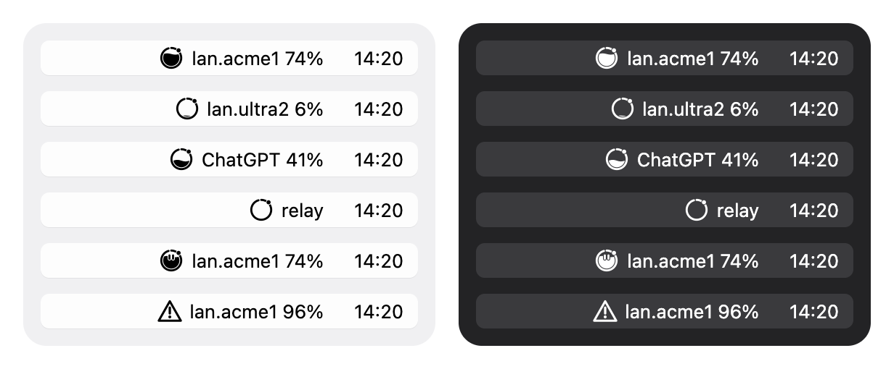
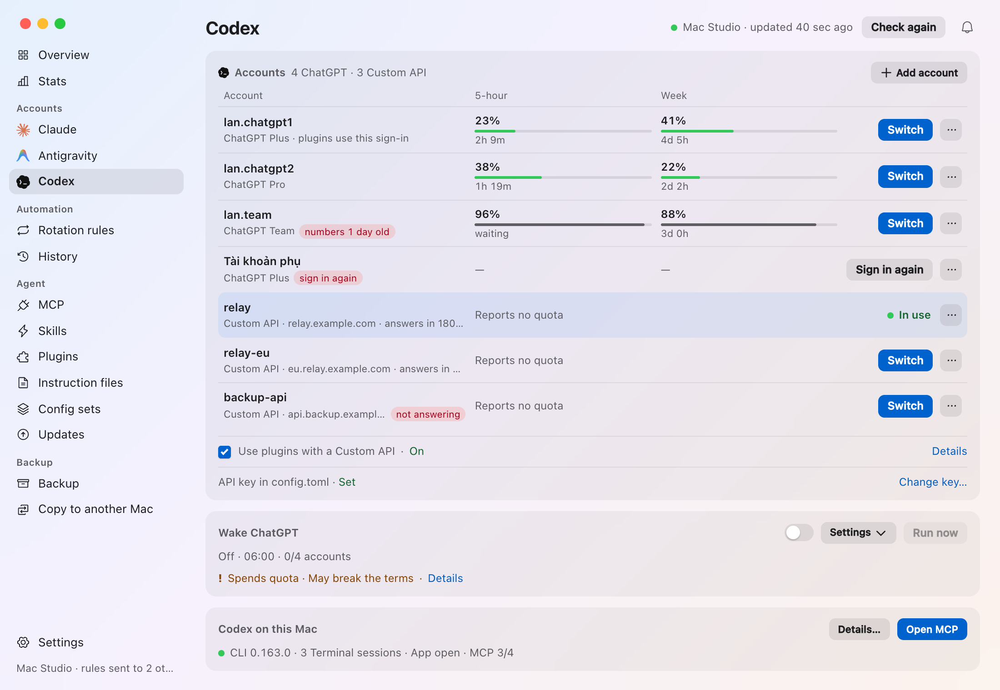
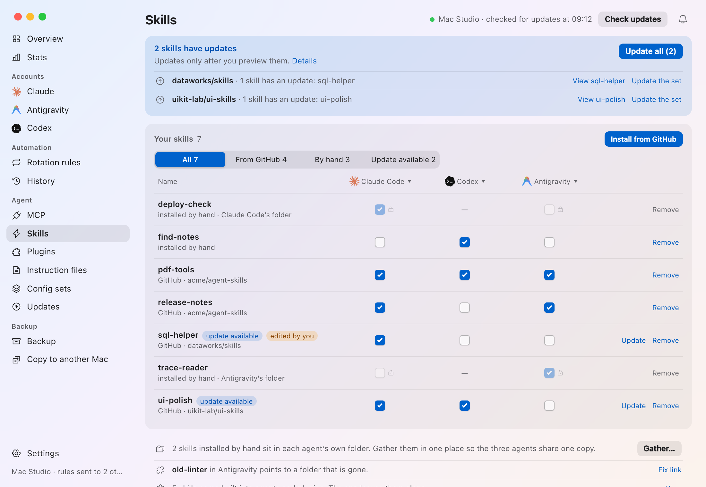
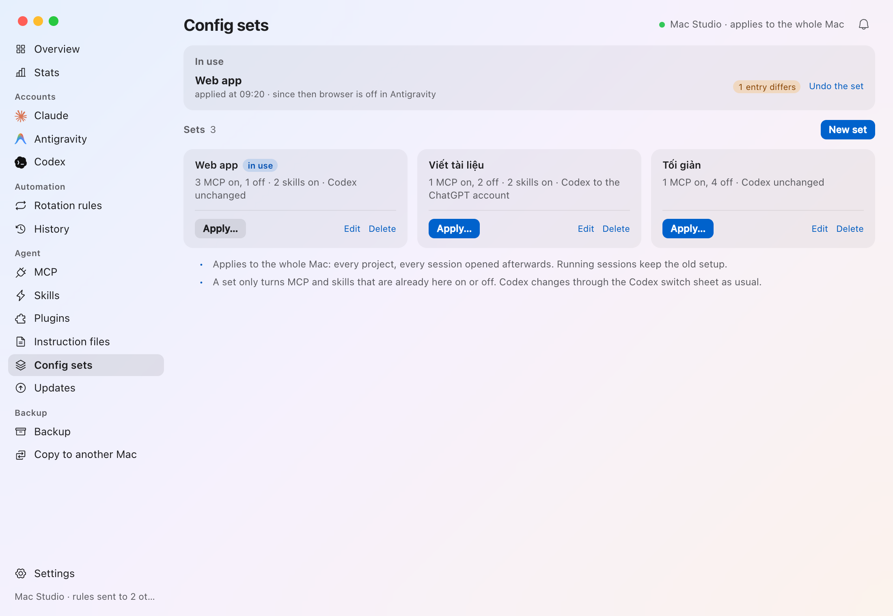
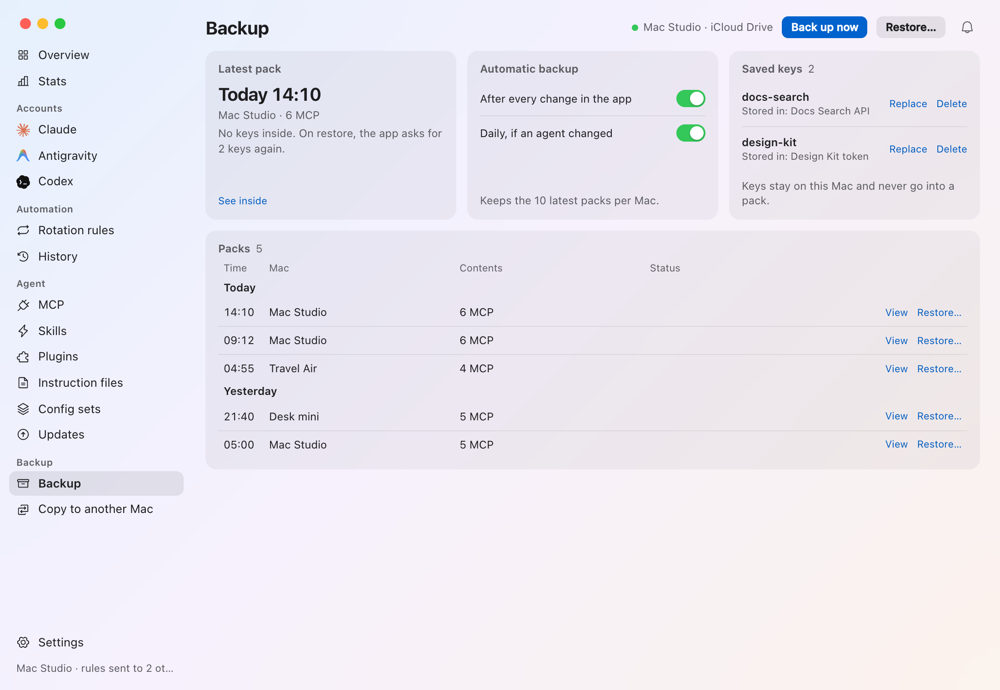
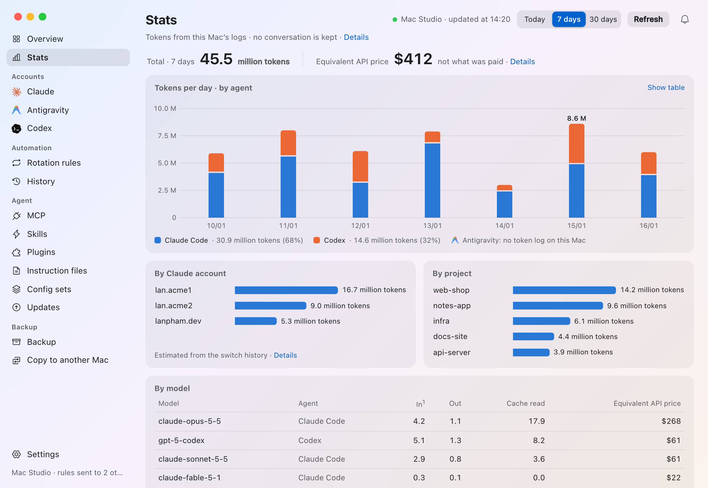
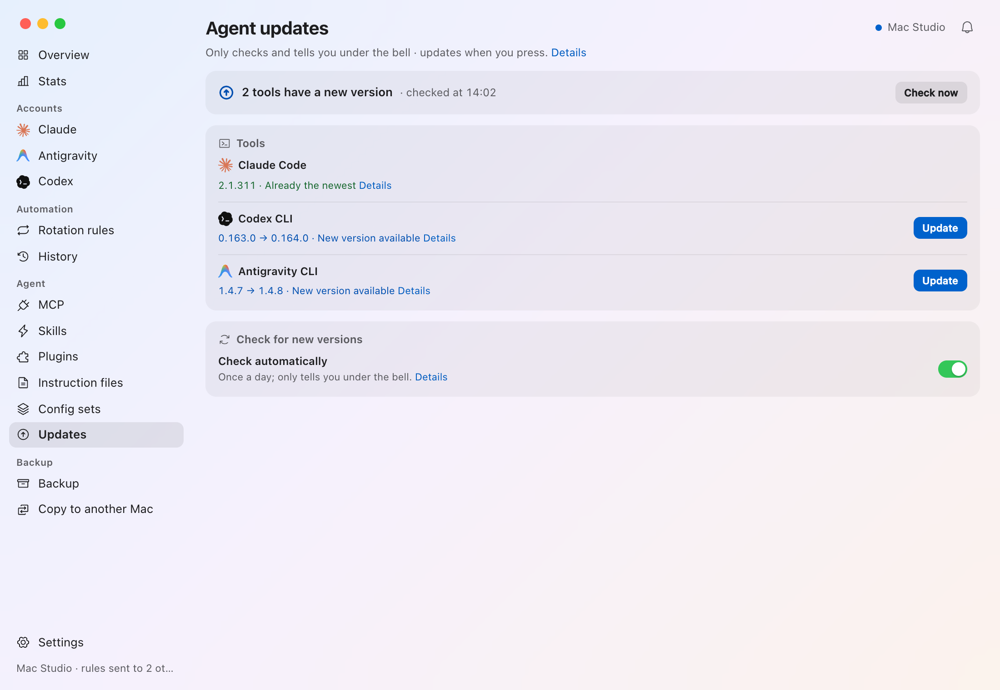
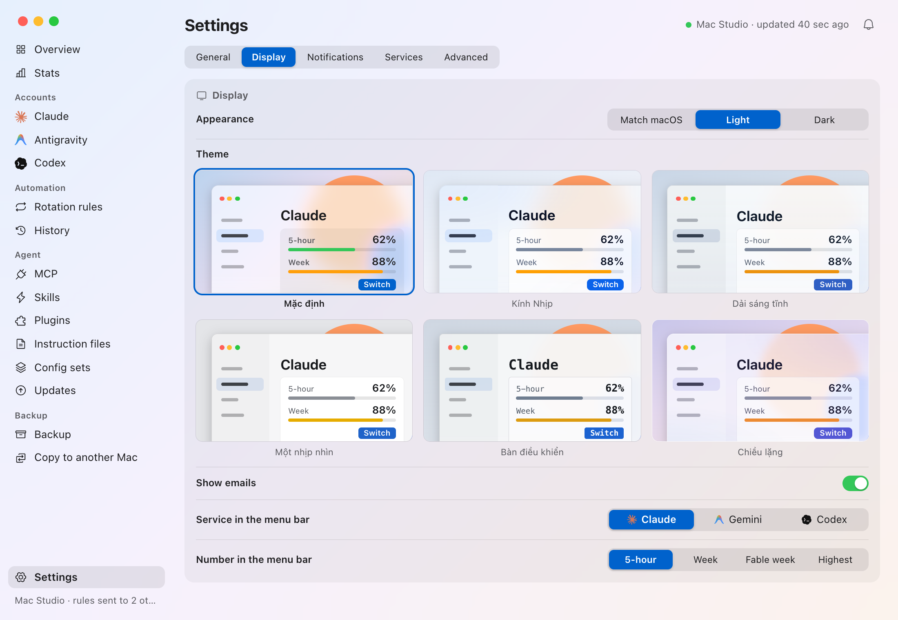
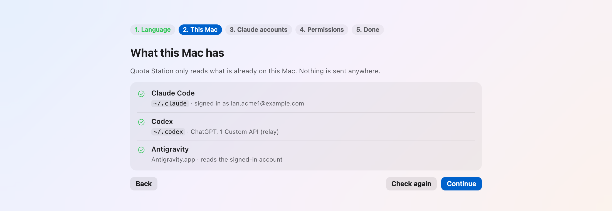

# Quota Station

**English** · [Tiếng Việt](README.vi.md)

An app for the macOS menu bar and the Windows system tray that shows how much
of your Claude Code, Codex and Antigravity quota is used, switches between your
accounts, and keeps the agents' MCP servers, skills and instruction files in
order. With two or more Claude accounts, it can automatically switch Claude
Code to another account when the one in use runs out of quota, while running
Claude Code sessions keep going. The interface is available in English and
Vietnamese.

<p align="center">
  
</p>

<p align="center">
  
</p>

Quota Station reads the quota itself, right on your computer; it needs no other
program to get the data.

Every image on this page uses made-up test data, never real accounts.

> **Status.** For macOS 13 or later and Windows 10 or 11 (x64). Download it
> from [Releases](https://github.com/shin315/quota-station/releases/latest);
> see [Install](#install) for instructions.

## Contents

- [What it does](#what-it-does)
  ([Auto-switch when quota runs out](#auto-switch-when-quota-runs-out))
- [Privacy and safety](#privacy-and-safety)
- [Requirements](#requirements)
- [Install](#install)
- [Update](#update)
- [Uninstall](#uninstall)
- [Documentation](#documentation)
- [Terms of service](#terms-of-service)

## What it does

### Auto-switch when quota runs out


Many people keep two or three Claude accounts (Pro, Max or Team) and sign out
and in again whenever the one in use runs out. Quota Station does it for you:
turn on `Auto-switch when quota runs out` in the `Claude` tab or at the foot of
the popover, and when the account in use reaches 90% of its 5-hour or weekly
window, Claude Code moves to the account with the most quota left in that
window. Accounts that must sign in again, or are nearly out too, are skipped;
with none left it keeps the account in use and tells you. A switch keeps
running Claude Code sessions alive: they go on, and only rebuild their prompt
cache once.

It checks every 3 minutes (via a LaunchAgent on a Mac, so it runs even when the
app is closed; via the app's own timer on Windows), sends a notification after
each switch, and has a `Pause` button (1 hour, until 18:00, or until you turn
it back on). When you switch by hand, you can hold the new account in place for
a while. The threshold is in `Settings › Services`. It is off on a new install,
and appears as soon as there are two accounts.

### The menu bar and the popover

The menu bar shows a small gauge and the account in use with its percent used,
such as `lan.acme1 74%`. You pick which service it follows (Claude, Gemini or
Codex) and which window it shows (5-hour, week, Fable week, or the one used the
most). A left click opens the popover: one section per service, each opening
on the account in use with every quota window and its reset time, and the other
accounts one click away. The bars turn amber from 70% and red from 90%. A
right click opens a short menu.

### The main window


`Overview` puts every account of the three services in one place, with
`Switch` on each account not in use. The sidebar groups the rest: `Stats`, the
`Claude`, `Antigravity` and `Codex` accounts, `History`, the agent tools (`MCP`,
`Skills`, `Plugins`, `Instruction files`, `Config sets`, `Updates`), `Backup`
and `Settings`. The bell at the top right of every page holds the
notifications.

### Claude accounts

Quota Station manages several Claude accounts and switches Claude Code between
them directly: add one by signing in with the browser, taking the account
Claude Code is signed in to, or pasting a setup-token. Before switching, it
shows how many running Claude Code sessions will rebuild their prompt cache,
then checks that the switch landed.

Automatic switching is covered in
[Auto-switch when quota runs out](#auto-switch-when-quota-runs-out) and works
with every kind of account. Custom rotation rules (Team accounts in a set
order, a personal account only during set hours, accounts that leave rotation
on a given date) are part of the [advanced tools](#advanced).

### Codex



Keep several ChatGPT accounts for Codex, along with custom API providers from
its `config.toml`, and switch between them; the ChatGPT sign-in stays in place
so Codex App's plugins keep working on a custom provider. Every switch shows
what changes first, writes one file with a backup, and never sends your sign-in
to a provider. `Wake ChatGPT` can start an account's 5-hour window early, on a
schedule you set.

### Antigravity

The Antigravity row shows the Gemini and Claude/GPT quota of the signed-in
account. It can also sign in to several Google accounts and switch which one
Antigravity.app and `agy` use: downloaded releases and builds from source with
`scripts/install.sh` include this multi-account support, and only
`QS_ANTIGRAVITY_ACCOUNTS=0` leaves it out.

### MCP servers, skills, plugins and instruction files


One table for every MCP server of Claude Code, Codex and Antigravity, with a
checkbox per agent. Ticks are collected, shown in one preview, written once with
a backup, and can be undone. Keys stay in the Keychain and are never shown.



The `Skills` tab does the same for skills, installs them from GitHub and tells
you when one has a newer version. `Plugins` lists what each agent has
installed, and `Instruction files` tracks CLAUDE.md, AGENTS.md and GEMINI.md.

### Config sets



A set turns a chosen group of MCP servers and skills on or off for the whole
Mac in one go, after a single preview, and can switch Codex too. The app tells
you when the Mac has drifted from the active set, and applying a set can be
undone.

### Backup and restore



Back up your MCP servers, skills, plugins and instruction files to iCloud Drive
(or a folder you pick) and restore them on any of your Macs, item by item.
A backup pack never holds keys: restoring asks for them again.

### Stats



The tokens Claude Code and Codex used on this Mac, read from their own session
logs (token counts only, never the conversation): by day or hour, and by Claude
account, project and model, along with what they would cost at API prices.

### Agent updates



Checks whether Claude Code, the Codex CLI and the Antigravity CLI are up to
date, and runs each tool's own update command only when you press `Update`.

### Notifications

Notifications arrive when Claude's quota is running out, auto-switch moves
Claude to another account, an account must sign in again, an Antigravity switch
is overwritten, a skill or tool has a new version, or an environment variable
(such as `ANTHROPIC_API_KEY` in `~/.zshrc`) overrides an agent's sign-in. Each
is sent once, as a macOS notification with buttons, and stays under the bell.
The notifications' own text is in Vietnamese for now, whatever the app's
language.

This page shows no picture of them; the
[Vietnamese README](README.vi.md#thông-báo) does.

### Settings, themes and language



Settings has `General` (language, open at login, backup folder, app updates),
`Display` (light or dark, six theme packs, the menu bar), `Notifications` and
`Services`. Turn off `Show emails` to name accounts by place or number, for
screenshots.

Settings also has `Advanced`, which shows the [advanced tools](#advanced).

### First run



A new install opens with a short setup: language, what this Mac has, the Claude
accounts, permissions, done.

### More

- **History** of every account switch on this Mac.
- **App updates**: the app checks GitHub Releases for a newer version and tells
  you; it never installs one by itself.

### Advanced

`Settings › Advanced › Show advanced features`, off on a new install, adds the
rotation rules editor (Team accounts in a set order, a personal account in set
hours, end dates, priming)—which replaces the threshold of
[Auto-switch when quota runs out](#auto-switch-when-quota-runs-out) once rules
are saved—along with the rotation's background check details, sending the rules
to other Macs over SSH, `Copy to another Mac`, and updating from a source
clone.

Every part is described in full in [docs/features.md](docs/features.md).

## Privacy and safety

- Quota data is read on your Mac, from each service's own quota endpoint using
  the agents' own sign-ins, and sent nowhere else. No account, no telemetry, no
  server of the app's own.
- Nothing is written to an agent's files without a preview or confirmation
  first, every write keeps a backup, and the write stops if a file has changed
  since the preview.
- The keys and sign-ins the app keeps live in the macOS Keychain (the extra
  ChatGPT accounts in folders only you can open). A key never appears in a
  window, a log or a backup pack.
  It goes to another Mac only if you tick `Also send keys over SSH`.

[SECURITY.md](SECURITY.md) has the details, and
[docs/how-it-works.md](docs/how-it-works.md) lists everything the app reads,
runs and writes.

## Requirements

- macOS 13 or later (Apple Silicon or Intel), or Windows 10 or 11 on x64.
- To build from source: Rust stable (1.85 or later) and Node.js 20 or later.
  The downloads need neither, and a Mac without them can also install a copy
  built on another Mac.
- To read quota, nothing else: Codex, `agy` or Antigravity.app, and Claude
  Code each only need to be signed in.
- To sign new Claude accounts in, and for `quota-station claude run`: Claude
  Code's `claude` command.
- To sign Antigravity accounts in (included in the downloads and in builds with
  `scripts/install.sh`; `QS_ANTIGRAVITY_ACCOUNTS=0` leaves this out):
  the [OAuth client file](docs/how-it-works.md#the-oauth-client-file), which
  you make yourself with the ID and secret of Antigravity's OAuth client—on a
  Mac at
  `~/Library/Application Support/com.shin315.quota-station/oauth-client.json`
  (mode 600), and on Windows at
  `%APPDATA%\com.shin315.quota-station\oauth-client.json` (the guide has a
  PowerShell command for it).
- For the advanced tools that reach other Macs: an SSH alias to each that
  signs in without a prompt (a key, `BatchMode=yes`).

## Install

Download the app from the
[latest release](https://github.com/shin315/quota-station/releases/latest): the
disk image for macOS, or the installer for Windows. Building from source is for
macOS.

### macOS

Download `Quota.Station_<version>_universal.dmg`, open it and drag
`Quota Station` to `Applications`. The single disk image runs on both Apple
Silicon and Intel. The app is signed with a Developer ID and notarized by
Apple, so the first launch only asks the usual question about an app downloaded
from the Internet: choose `Open`.

With Homebrew: `brew install --cask shin315/tap/quota-station` (update with
`brew upgrade --cask quota-station`).

### Windows

Download `Quota.Station_<version>_x64-setup.exe` and run it. The installer is
not signed, so Windows warns about it:

1. The browser may say the file is not commonly downloaded: choose `Keep` (in
   Edge, from the `…` menu next to the download; it may ask once more:
   `Keep anyway`).
2. SmartScreen says "Windows protected your PC": click `More info`, then
   `Run anyway`.

It installs for your Windows user only and needs no administrator rights.
Quota Station then sits in the system tray at the right of the taskbar; Windows
may first put it under the `^` arrow, from where you can drag it onto the
taskbar.

To check that the installer matches the release, download `SHA256SUMS.txt` from
the same release into the same folder and run in PowerShell:

```powershell
$sum = (Select-String '_x64-setup.exe' .\SHA256SUMS.txt).Line.Split(' ')[0]
(Get-FileHash .\Quota.Station_<version>_x64-setup.exe).Hash -eq $sum
```

`True` means it matches. The same sums are at the foot of the release notes.

### From source (macOS)

From a clone, on a Mac with Rust and Node.js:

```sh
git clone https://github.com/shin315/quota-station.git
cd quota-station
scripts/install.sh
```

The script builds the app, signs it (with your `Apple Development` identity, or
ad-hoc), copies it to `/Applications/Quota Station.app` and opens it. It never
adds a login item and never asks for `sudo`. It builds with Antigravity account
support; `QS_ANTIGRAVITY_ACCOUNTS=0` leaves it out. `scripts/install.sh --help`
lists the options.

On a Mac that cannot build, make a package on one that can and copy it over:

```sh
scripts/install.sh --package ~/Desktop          # writes quota-station-<version>.zip
# on the other Mac, where the zip arrived:
ditto -x -k quota-station-<version>.zip . && ./quota-station-<version>/install.sh --app "./quota-station-<version>/Quota Station.app"
```

### After installing

On a Mac or PC that signs Antigravity accounts in, put the
[OAuth client file](docs/how-it-works.md#the-oauth-client-file) in place, and
turn on `Settings › General › Open at login` if the app should start with the
computer.

Moving from another account switcher? See the
[cutover guide](docs/claude-accounts.md#cutover).

## Update

A downloaded copy checks GitHub Releases once a day while
`Check for app updates` in `Settings › General › Updates` is on, and tells you
when a new version is out: a banner in `Overview` and a line in the popover.
`Download and install` opens the new disk image or installer in the browser;
install it just like the first time, over the old copy (quit the app first on a
Mac). The app never downloads or installs anything by itself.

A copy built from source is told about a new version too, but updates from
its clone. From a terminal, in the clone:

```sh
git pull --ff-only && scripts/install.sh
```

`Settings › Advanced` can do the same, with `Show advanced features` on: set
`Source code` to the clone and press `Update from source`. It pulls, builds and
installs when the clone has a new commit, then offers `Restart`; a clone with
local commits is never merged or reset, and a build that takes longer than 30
minutes is stopped.

## Uninstall

1. In `Settings › General`, turn `Open at login` off (or remove Quota Station in
   System Settings › General › Login Items on a Mac, or in Task Manager's
   `Startup apps` on Windows).
   If `Auto-switch when quota runs out` is on, turn it off in the `Claude` tab
   (or run `quota-station claude rotation off`).
   To have the older switcher rotate Claude again, load its plist again
   ([cutover](docs/claude-accounts.md#cutover)).
2. Quit Quota Station from its menu. On a Mac, move
   `/Applications/Quota Station.app` to the Trash. On Windows, open Settings ›
   Apps › Installed apps (Apps & features on Windows 10), then `…` next to
   Quota Station › `Uninstall`.
3. Optionally, remove its data. On a Mac:
   `~/Library/Application Support/com.shin315.quota-station/` (settings, the
   Claude accounts' folder, the Antigravity index and quota readings, history,
   notifications and `oauth-client.json`), and the app's own Keychain items,
   services `com.shin315.quota-station.claude` and
   `com.shin315.quota-station.antigravity`, in Keychain Access. Remove the
   Claude accounts in the app (all but the one in use) to delete their items;
   Claude Code keeps its own sign-in either way. Sign the Antigravity accounts
   out in the app first to delete those items. Leave the `gemini`/`antigravity`
   item alone: Antigravity.app and `agy` use it.
   On Windows: `%APPDATA%\com.shin315.quota-station\` (settings, accounts,
   quota readings, history, notifications and `oauth-client.json`) and
   `%LOCALAPPDATA%\com.shin315.quota-station\` (what stays on this PC,
   including the app's own keys, sealed by Windows); deleting both folders
   removes them. Claude Code keeps its own sign-in either way. Leave the
   `gemini:antigravity` credential in Credential Manager alone: Antigravity and
   `agy` use it.

The older switcher's rotation file is shared with that switcher and stays.

## Documentation

| Page | What it covers |
|---|---|
| [docs/features.md](docs/features.md) | Every part of the app in full |
| [docs/how-it-works.md](docs/how-it-works.md) | The quota readers, the Claude and Antigravity accounts, the command line, what the app reads, runs and writes, the OAuth client file |
| [docs/development.md](docs/development.md) | Building, build features, the browser preview, tests, code layout |
| [docs/releasing.md](docs/releasing.md) | The release workflow and the one-time setup it needs |
| [docs/claude-accounts.md](docs/claude-accounts.md) | The design of the Claude accounts |
| [docs/themes.md](docs/themes.md) | The six theme packs |
| [docs/ui-guidelines.md](docs/ui-guidelines.md) | Interface wording in Vietnamese and English |
| [SECURITY.md](SECURITY.md) | Keys, tokens, what is never read, and how to report a problem |

## Terms of service

Signing Antigravity accounts in with Antigravity's own OAuth client, and reading
the quota as Antigravity does, carries no more terms-of-service risk than
Antigravity's own use: the app makes the same calls, with the same user agent
and headers, no more often. `Wake ChatGPT` sends requests on a schedule, which
OpenAI's terms do not address: use it on your own accounts only.
[SECURITY.md](SECURITY.md) explains what could happen and which changes would
increase the risk.

---

<sub>MIT, except the optional Antigravity accounts part (CC BY-NC-SA 4.0). Licenses and third-party credits are in [LICENSE](LICENSE), [LICENSES/](LICENSES), [NOTICE](NOTICE) and [THIRD_PARTY.md](THIRD_PARTY.md).</sub>
