# Quota Station

A macOS menu bar app that shows how much Claude Code, Antigravity and Codex
quota is used on this Mac. It reads the quota itself, with readers ported
from [quota-axi](https://github.com/kunchenguid/quota-axi) (MIT), and needs
no other program for the numbers. The interface is in Vietnamese.

MIT licensed, except the Antigravity accounts (logging in and switching
several Antigravity accounts), which are adapted from
[Cockpit Tools](https://github.com/jlcodes99/cockpit-tools) (dựa một phần
trên Cockpit Tools) and stay under CC BY-NC-SA 4.0, personal and
non-commercial. They are built only with the `antigravity-accounts` feature.
See [License](#license) and [`NOTICE`](NOTICE).

The tools made for the author's own Macs (`Cài đặt › Nâng cao` and what it
holds) are built only with the `author-tools` feature, which a release build
leaves out; see [The author's tools](#the-authors-tools-author-tools).


All three images use the synthetic test fixtures, not real accounts. The menu
bar image is drawn from the app's own glyph and title code, not captured from
the screen; the popover and window images are the browser preview.

## What it does

This is milestone M16, "Thống kê" (the tokens Claude Code and Codex used
on this Mac, counted from their own session logs, which the app reads for
the counts only), on top of M15, "Bộ cấu hình" (named sets of MCP servers and skills
turned on or off, applied to the whole Mac in one go after one preview),
M14, "Biến môi trường đè đăng nhập" (saying when an
environment variable in a shell file or launchd overrides an agent's
login, by its name, never its value), M13, "Chép sang Mac khác"
(copying the MCP servers, skills, plugins and instruction files to or from
another Mac over SSH, item by item), M12, the rest of "Sao lưu và khôi phục" (skills, plugins
and instruction files in the backup pack, restored with the MCP servers),
M11, "Skills, Plugin, File hướng dẫn", M10, "Sao lưu và khôi phục"
(backing the MCP servers up to iCloud Drive and restoring them on any Mac),
M9, "MCP" (every agent's MCP servers in one table), M8, "Chuyển Codex" (switching Codex between the ChatGPT
login and a custom API provider), M7, "Chuyển đổi" (installing,
updating and launching at login), M6, "Lịch sử, cảnh báo và Firstmate", M5 "Luật
xoay vòng", M3 "Chuyển Claude và tạm dừng", M2 "Cửa sổ chính chỉ đọc" and M1
"Khung và số", with M4a, "Đăng nhập Antigravity trong app", M4b, "App tự đọc
hạn mức Antigravity", and M4c, "Chuyển Antigravity không cần Cockpit", the
steps of taking over what Cockpit Tools does. The app reads, and acts in eight
ways, each started by the owner:
it keeps the Claude accounts and switches the active one itself, it pauses the
automatic switcher, it edits the switcher's rotation rules and copies them to
the owner's other Macs, it logs Antigravity accounts in and out on this Mac,
it switches the Antigravity account that Antigravity.app and agy use, it
switches the provider Codex uses, and it turns MCP servers on and off, adds,
edits and removes them for Claude Code, Codex and Antigravity, and it backs
those servers, the skills, the plugins and the instruction files up,
restores them and copies them to or from the owner's other Macs, and applies
a set of them for the whole Mac (below). Six things it does on its own: it reads
the usage of the Claude accounts it keeps and, once the owner turns it on,
runs their rotation from its own LaunchAgent, it finishes that rotation copy (a Mac that could
not take the saved rules is tried again in the background), it reads the
quota of the Antigravity accounts logged in here, at Cockpit's pace or slower,
it keeps a history of the switches on this Mac, it backs the MCP servers up
when they change (after a write in the app and once a day), and it posts a macOS
notification card with buttons for five kinds of alert (below). A button on a
card does what the same button in the app does: a Claude switch still opens
the confirmation sheet first.

- **Menu bar item.** The C04 circular template gauge with a rim bead
  and liquid fill. Next to it is the account in use and its share used for
  one service, `lan.acme1 38%`, the way
  claude-swap's own menu bar named it. The service is Claude by default;
  `Dịch vụ trên thanh menu` in `Cài đặt` and `Thanh menu theo` in the
  right-click menu pick Gemini (Antigravity's Gemini models) or Codex
  instead, on each Mac.
  The number is the account's five-hour window by default; `Số trên thanh
  menu` in `Cài đặt` and in the right-click menu picks `Tuần`, `Fable tuần`
  (Claude only) or `Cao nhất` (the window used the most, a tie naming the
  longer window) instead, on each Mac. A service without the window picked
  shows its five-hour window, and the window used the most without that
  either. Đang dùng shows the same window; which window it is shows on hover.
  The name is the part of the email before `@`, cut to 12 characters with
  `…`, or the account's place (`Team A`, `Ultra 1`) while names are hidden.
  Codex shows `ChatGPT` and that account's number on its ChatGPT login, and
  only the provider's name when it goes through a provider of its own,
  which reports no quota. Without a number (no read yet, a read that failed,
  a window waiting for its number after a reset) the title is the name and
  `–`; only the window shown needs a number, except for `Cao nhất`, which
  needs every window. A Mac without Antigravity, or without Codex, follows
  Claude. The gauge fills with the same service and window as the title;
  without a number its reservoir is empty. The tooltip and the VoiceOver
  label give every service in words, the window shown and its reset included.
  While automatic switching is paused, two small pause bars sit inside the
  gauge; an exhausted Claude rotation draws a warning triangle.
- **Popover** (left click). One header line with this Mac's name; how old
  the numbers are shows only when they are not fresh. Then a section per
  service, `CLAUDE`, `ANTIGRAVITY` and `CODEX`, each opening on its account
  in use, marked `Đang dùng`, with every window: a Claude Code account's
  `5 giờ`, `Tuần` and `Fable` (a Team seat with no week has no `Tuần`
  line), an Antigravity account's `Gemini` and `Claude/GPT` columns with
  their five hours and week, each as the share **used** (the bar fills as
  the quota goes; amber from 70 %, red from 90 %) with when it resets.
  Right under it, one line (`3 tài khoản khác`) opens the other accounts, in
  the main window's order, each with its shorter lines (Antigravity's
  `Gemini` and `Claude/GPT`, each the tighter of that group's two windows).
  A section's header folds it to the header alone, which then says the
  account in use and its number; folds and open lists stay as they were the
  next time the popover opens, and every line is a button with
  `aria-expanded`. The popover writes no notes on the accounts: an old
  number is drawn grey with its age on hover, and the rotation's notes stay
  in the main window. Only an account that must sign in again says so, in
  one short line (and on the closed line, `· 1 cần đăng nhập lại`). Every
  window, the organization and the hours stay in the accounts' spoken labels
  and in the main window. It also has banners for stale numbers, an
  unavailable source, numbers waiting after a reset, an exhausted rotation
  and missing Keychain permission.
  Every other Claude account is a button that opens the switch sheet
  (below), and so is every other Antigravity account logged in here once the
  Antigravity row lists the app's own accounts. The footer, outside the
  scrolling part, has the
  `Tự chuyển Claude` switch; the line that says why Claude is on its account
  shows only when there is something to act on (a pause or hold, waiting for
  quota, a switch coming, the switcher missing or failing), and the other
  Macs' line only when one of them is behind
  (`Mac B: 14:30 · Mac C: chưa tới được, sẽ thử lại`). Its header has
  three buttons: the bell, with the red count of notifications not read
  yet, opens the main window with its `Thông báo` panel open; the moon (or
  sun) turns the look dark (or light) for both windows; and the app window
  (`Mở Quota Station`) opens the main window on `Tổng quan`.
- **Names.** Accounts go by the part of their email before `@` when every
  account shares one domain (the whole email otherwise, and always on hover),
  with the organization of a Team seat or `Cá nhân · 08–23` under it.
  Turning off `Hiện email` in `Cài đặt` names them by place instead (`Team A`,
  `Cá nhân`, `Ultra 1`), for screenshots, and then no email or organization
  reaches the windows at all.
- **Switching Claude** (F04). The confirmation sheet names the account, its
  allowances, and how many Claude Code sessions running on this Mac will
  rebuild their prompt cache on their next message, which costs quota. It
  offers a hold so the switcher does not switch straight back: 30 phút,
  1 giờ (the default), until the account's next five-hour reset, or none.
  Confirming switches with the app's own switch ([The Claude
  accounts](#the-claude-accounts)), writes the pause flag when a hold was
  chosen (a hold never shortens a pause that is already on for longer),
  waits 5 seconds, reads the active account again without the app's cache
  and reports what it finds: switched, switched back by the rotation (or by
  another switch), not yet confirmed, or why nothing changed (Claude Code
  held its login locks, the account needs a new login, Claude Code is on a
  login the app does not keep, or an older switcher is still loaded).
  Outside the personal account's hours the sheet warns that the rotation
  will move away from it.
- **Pausing automatic switching** (F07). The switch opens a sheet to pause
  for 1 giờ, until 18:00 or until turned back on; while paused it resumes at
  once, and the banner offers `Thêm 1 giờ`. The why line shows the
  rotation's decision from a dry run and its last log line, or
  `Đang tạm dừng tới HH:MM: <lý do>` while the pause holds. Banners warn
  when an older switcher (`com.cswap.prefer-team` or `com.cswap.auto`) is
  still loaded, and when a switcher ignores the pause flag.
- **Short menu** (right click). `Mở cửa sổ chính` (main window), `Làm mới`
  (refresh), `Thanh menu theo` (Claude, Gemini or Codex, ticked; a service
  this Mac lacks is greyed out), `Số trên thanh menu` (`5 giờ`, `Tuần`,
  `Fable tuần` or `Cao nhất`, ticked; `Fable tuần` is greyed out unless the
  title follows Claude), `Cài đặt…` (settings), `Thoát Quota Station`
  (quit).
- **Main window.** One sheet of glass, like the popover: macOS draws the
  popover's material behind the whole window, the sidebar sits on it with no
  panel of its own, and each group is a frosted panel (solid when Reduce
  transparency is on). Every page's title row ends with the bell
  (`Thông báo`, below), beside the Mac's name, how fresh the numbers are and
  `Làm mới`. The same numbers as the popover, from the same read, in
  these tabs:
  - `Tổng quan`: `Đang dùng`, a tile per service with the account in use,
    its share used large, the window and its reset, every Claude Code and Antigravity account in a table with fixed columns
    (`5 giờ · Tuần · Fable tuần` for Claude; `5 giờ` and `Tuần` under
    `Gemini` and `Claude/GPT` for Antigravity), each the share used, the
    `Tự chuyển Claude` switch with its one line, and `Sắp tới`, the resets
    and rotation ends of the next 24 hours as the readings give them.
  - `Claude`: the accounts, with a `Chuyển` button on each account not in
    use and a `Đang dùng` status (a dot and words, nothing to press) on the
    one in use; an old reading gets a chip by the name. Below it,
    `Tự chuyển` (the switch and the pause choices), `Switcher` (one line;
    whether launchd runs the rotation, an older switcher still loaded, the
    pause, whether it reads the pause flag, and its last decision and log
    line as printed sit under `Chi tiết`) and `Tài khoản Quota Station giữ`
    ([The Claude accounts](#the-claude-accounts)). A rotation that launchd
    does not run gets a banner.
  - `Antigravity`: the accounts, with `Chuyển` and `Đăng xuất` on each one
    this app logs in and `Thêm tài khoản` in the card's header. A Mac without
    an account list or without Antigravity says so. The accounts this app
    logs in that the row does not list yet stay in a short list under the
    table. Each account the app logs in shows `đang đọc…` while
    the app reads its quota and `đọc lỗi` (the reason on hover) when that
    read failed (below). Opening the tab reads every account.
  - `Luật xoay vòng`: the rotation editor (below).
  - `Lịch sử` and `Firstmate` (M6, below).
  - `Cài đặt`: a one-time button that lets the app ask macOS for access to
    Claude Code's Keychain item (on a Mac where the app keeps no Claude
    account), the
    name shown for this Mac (empty uses the name macOS gives it),
    `Các Mac khác`: a name and an SSH alias for each other Mac, with
    `Thêm Mac`, `Bỏ` and `Thử SSH` (reads that Mac's rotation file and
    changes nothing), whether `oauth-client.json` is in place and usable,
    `Hiện email` (on by default; off names accounts by place), `Giao diện`
    (`Theo macOS`, `Sáng` or `Tối`), `Chủ đề` (the theme pack every window
    is drawn in, each shown as the window in small in its own glass,
    colours and type, light and dark split across it while the windows
    follow macOS: `Mặc định`, `Kính Nhịp`, `Dải sáng tĩnh`, `Một nhịp
    nhìn`, `Bàn điều khiển` or `Chiều lặng`; a pack changes colours, glass,
    type and corners, never what is shown; see
    [docs/themes.md](docs/themes.md)), `Dịch vụ trên thanh menu` (the
    service the menu bar title follows: Claude, Gemini or Codex; one this
    Mac lacks is greyed out with the reason), `Số trên thanh menu` (the window the title shows:
    `5 giờ` by default, `Tuần`, `Fable tuần` or `Cao nhất`; `Fable tuần` is
    greyed out unless the title follows Claude), `File của firstmate` (the path to
    Firstmate's `quota-pool.last`; nothing is built in, and only a file of
    that name is taken), `Thông báo` (whether macOS lets the cards show,
    `Gửi thử` and a switch for each kind of notification), and the app itself (M7):
    `Mở khi đăng nhập` (off by default; see [Install](#install)), `Mã nguồn`
    (the clone this Mac updates from) and `Phiên bản` (the version and the
    commit it was built from, with `Cập nhật từ mã nguồn`; see
    [Update](#update)). A settings file from before M5 with a single
    `sshAlias` moves into the list of other Macs.

    The page is in five tabs, in a bar under its title that stays at the
    top while the page scrolls: `Chung` (the language, this Mac's name,
    `Mở khi đăng nhập` and `Thư mục sao lưu`, then the `Cập nhật` card: the
    version and new releases, the skills' checks and, in a build that has
    it, `Thông tin chẩn đoán`), `Hiển thị`, `Thông báo`, `Dịch vụ`
    (Keychain, Codex's folder and the Antigravity OAuth client, with the
    `Biến môi trường đè đăng nhập` card) and `Nâng cao` (only in builds
    that have it). Only the tab picked shows, `Chung` at first; the app
    keeps the one picked last while it runs, and a link from elsewhere
    opens the one it is about (`Mở Cài đặt` in `Firstmate` and `Chép sang
    Mac khác` opens `Nâng cao`, a variable's banner or notification opens
    `Dịch vụ`, and `Cài đặt thông báo` under the bell opens `Thông báo`). The
    arrow keys, Home and End move along the bar; where the window is too
    narrow for every tab, the bar scrolls sideways, faded at the end with
    more past it.

    `Ngưỡng sắp cạn`, right under alert 1 in `Thông báo`, sets its two
    thresholds (10% and 15% by default), and `Thư mục sao lưu` the folder
    the backup packs go to (empty is iCloud Drive's `Quota Station
    Agents`). `Nâng cao`, the last
    tab, holds what was made for the author's own Macs: `Hiện phần nâng
    cao` shows the `Luật xoay vòng`, `Firstmate` and `Chép sang Mac khác`
    tabs, automatic switching with its pause (`Đến 18:00` among them), the
    Switcher card, alerts 2 and 5, the Cá nhân/Team and Ultra names, and
    the rows `Các Mac khác`, `Mã nguồn` and `Cập nhật từ mã nguồn`; its
    `Firstmate` switch shows the Firstmate tab, its file and alert 5. A new
    install starts with `Nâng cao` off, no rotation rules and accounts named
    `Tài khoản N`; a Mac that already had the app (a settings file or any
    file in the app's folder) gets it on, with `Firstmate`, so nothing
    changes there. Only a build with the `author-tools` feature has
    `Nâng cao` ([The author's tools](#the-authors-tools-author-tools)).

  - `Codex` (M8, below).

  `Tổng quan` also has a small Codex card: the provider in use, whether the
  ChatGPT login is kept, and a button that opens the same sheet. Under the
  machine name in the sidebar it says whether the other Macs have the rules.
- **Rotation rules** (F06). The editor shows the rotation file's six keys:
  the Team accounts in the rotation (chips; the number is the order), the
  personal account and its hours, the two thresholds (sliders), and when an
  account leaves the rotation. It marks what changed, previews what the
  switcher would decide with the edited rules (its `--dry-run` pointed at a
  draft copy), and saves with one button named for the Macs it reaches
  (`Lưu cho cả ba Mac` with two other Macs set, `Lưu cho máy này` with none).
  A save first checks the rules as quota-axi reads the file (all six keys,
  each in its form; a `rotation_…` reason otherwise, and nothing is written
  or sent), since Firstmate's quota-axi reads the same file. It rewrites the
  six keys in place and keeps every other readable line (a line quota-axi
  cannot read stays only in the backup), puts a
  `# updated = <time> by <machine>` comment at the top, writes through a
  temporary file and a rename, and keeps the file before as
  `rotation.bak-<time>` (the newest 10 stay). Then the file goes to each other Mac over
  SSH, the same way, and is read back to compare. The save bar has one line
  per Mac: `đã nhận 14:30`, `chưa tới được · thử lại 14:35`, `có bản mới hơn`.
  A Mac that could not take it is tried again every 5 minutes, also after a
  restart. When another Mac holds a newer copy (a later `updated`), or one
  edited by hand there (its content differs from its stamp, or it has no
  `updated` line), nothing is overwritten: the write itself checks the file
  is still the one just read, and the tab offers that copy,
  side by side with this Mac's, or keeping this Mac's (stamped again, so it
  is the newest). When a newer copy lands on this Mac during an edit, the
  editor says `Bản trên <máy> mới hơn, tải lại?` and saves over it only when
  told to. Leaving the tab, closing the window or quitting from the menu bar
  with unsaved changes asks first.

- **Switching Antigravity** (M4c). The sheet names the account and its
  allowances, says whether Antigravity.app runs, and that a running `agy`
  session keeps the old account until it restarts. While Antigravity.app
  runs it offers `Thoát app rồi chuyển` (quit the app politely, switch, open
  it again), `Chuyển, để app chạy` (switch now; the running app may write
  its old login back) and `Thôi`; when it does not run, only `Chuyển` and
  `Thôi`. The switch makes the token fresh and, while the token lacks a
  project or the GCP ToS mark, asks `loadCodeAssist` for them as the quota
  read does (60 seconds at most); it quits the app and waits up to 20
  seconds when asked (an app that does not quit stops the switch before the
  shared login is touched; `Chuyển` stops if the app runs again by then),
  writes the login Antigravity.app and agy share with Cockpit's own
  `security` command, then points the app's account index and binding at
  the new account and opens the app again. Five seconds later it reads Antigravity again and
  says `Đã chuyển`, that agy still uses the old account or could not be
  read, or why it did not switch. Antigravity.app older than 2.0 is named
  and refused, and one whose version cannot be read stops the switch
  before anything is written (`Missing` only when there is no
  Antigravity.app at all). A switch is refused, with a message, while an
  Antigravity login, logout or another switch runs, and a login is refused
  while a switch runs. For six hours after a switch, a reading that
  shows the old account back in use is counted as an overwrite and brings
  alert 4 (below); the `Antigravity` tab also shows the banner
  `Chuyển Antigravity bị ghi đè` with `Chuyển lại` and `Thôi`. The popover
  has no banner for it: the macOS card replaces it.

- **History** (F08, `Lịch sử`). Every switch on this Mac, newest first, a day
  at a time, filtered by `Tất cả`, `Claude` or `Antigravity`. Each line has
  its time, a tag, the accounts before and after, why, and where it comes
  from: `app` (a switch made in this app, Claude or Antigravity), `switcher`
  (a `switch to slot N` or `primed slot N` line in the switcher's log, read
  from its last 64 KB) or `quan sát` (the account in use changed between two
  reads and neither the app nor the switcher made it, or Antigravity.app
  wrote the old login back). The app keeps its own lines, at most 500, in
  `history/history.jsonl`; the Antigravity switches come from its own
  `antigravity/switch-log.jsonl`, never from Cockpit's switch history.
- **Notifications** (F09, `Thông báo`). After every read the app checks five rules
  and sends each new notification once, as a macOS card with buttons; the
  same card stays under the bell at the right of every page's title row,
  with the same buttons. The bell carries a red count of the notifications
  that came since its panel was last opened (none at zero, `9+` past nine),
  and opening the panel reads them. The panel lists the recent ones a day at
  a time, the newest five first and the rest behind `Xem tất cả`, and ends
  with `Cài đặt thông báo`, which opens `Cài đặt` at its `Thông báo` group;
  Esc or a click outside closes it. A macOS card pressed on itself, and the
  popover's bell, open the main window with the panel open. A button pressed
  on either counts once, and the card then says what was chosen and how it
  went. Each notification has a key, so the same event never comes twice.
  The files keep their names (`alerts/alerts.json`), so what was sent and
  set before stays.

  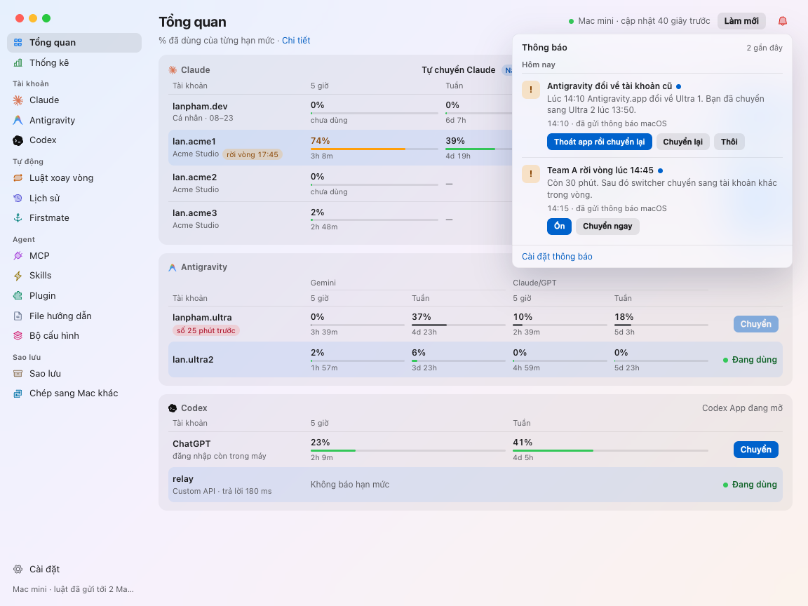

  1. `Hạn mức Claude trong vòng sắp cạn` and `Claude đã có lại hạn mức`:
     Firstmate's rule on the accounts' numbers. The rotation's accounts that
     have not left it (the personal one only inside its hours) count; the
     pool is dry when the account in use has 10% or less left and no other
     has 15% or more (both set in `Cài đặt`; without `Nâng cao` every
     account counts and the title is `Hạn mức Claude sắp cạn`). Where the
     app keeps no Claude account it reads the rotation file, for this alert
     and the next. The card names the account in use
     and its share used, and when an account resets, and offers
     `Sang <tài khoản> (còn N%)`, which opens the switch sheet, and `Thôi`.
  2. `<tài khoản> rời vòng lúc HH:MM`: 30 minutes before an account leaves
     the rotation (`expire` in the rules). For the account in use it offers
     `Ổn` and `Chuyển ngay` (the switch sheet).
  3. `<tài khoản> cần đăng nhập lại`: the usage read reports an error only a
     new login mends (`invalid_grant`, `no_refresh_token`, a relogin).
     `Nhắc ngày mai` asks again
     at 09:00 the next day. Antigravity accounts that need a new login or a
     verification get their own card, with `Đăng nhập lại` (the
     `Antigravity` tab) or `Mở trang xác minh`.
  4. `Antigravity đổi về tài khoản cũ`: the six-hour watch after an
     Antigravity switch saw the old account back. While it has happened at
     most twice the card offers `Thoát app rồi chuyển lại`, `Chuyển lại`
     (they switch back at once, as the sheet's buttons do) and `Thôi`;
     after that it only says so.
  5. `Firstmate đang chờ hạn mức Claude`: Firstmate's `quota-pool.last`,
     written within the last 30 minutes, says `pool=dry`. Off by default.

  `Gửi thử` sends a sample of each kind, marked as a test, whose buttons
  change nothing. A Mac where notifications are off for the app says so,
  with `Mở Cài đặt hệ thống`; the notifications still come to the bell. macOS asks
  once for leave to show cards, the first time the app runs. Only the
  packaged `.app` can post cards: `tauri dev` keeps the notifications under the bell.
  The cards name accounts as the app does, never by email. What was sent,
  answered and snoozed is kept in `alerts/alerts.json` (the newest 30 cards).
- **Firstmate** (F10). Whether Firstmate holds new Claude work, from the
  line its quota-pool watch writes, `quota-pool.last`, at the path set in
  `Cài đặt`: the account in use, what
  each account has left, the next reset, whether Firstmate's quota-axi has
  `+cswap` and whether it could read claude-swap, and when the file was
  written.
  A file older than 30 minutes says Firstmate may not be running, and a Mac
  without the file says so. Only the keys Firstmate writes are read.
- **Switching Codex** (M8). Codex can go through the official ChatGPT login
  or through a custom API provider that its `config.toml` already describes
  (a `[model_providers.<id>]` table with its own key). The app switches
  between the two and keeps the ChatGPT login in place, so Codex App's
  plugins and remote control keep working while Codex goes through the
  custom provider. The popover's `CODEX` section is laid out as Claude's: what
  Codex uses now (the ChatGPT account with its `5 giờ` and `Tuần`, or the
  custom provider), the ChatGPT accounts under `n tài khoản khác`, and the
  custom provider's own `Custom API` line. Its state (the custom provider
  not answering, CC Switch also managing Codex, a change made outside the
  app, no ChatGPT login) is on hover and in the note or banner under it, not
  in chips. Pressing the account or the line it would switch to never switches: it
  opens a sheet with five facts (what changes, the sessions already running,
  the background process, the ChatGPT login, the one file written and its
  backup), plus any risk of the moment, and a `Khởi động lại tiến trình nền
  Codex sau khi chuyển` box, off by default. Ticking it restarts Codex's shared
  background process after the switch, with its own sheet first. A switch
  the app cannot make safely is refused with the reason under the row: no
  custom provider table, a table without a key of its own (the ChatGPT login
  would be sent to the provider), the placeholder key CC Switch leaves in a
  table it does not use, a profile that picks its own provider, or a table
  written inline. Under the two notes about a missing key, `Dán khoá…` opens
  the key sheet. The custom provider's name and address come from the file,
  and its key from the file or from the owner's paste; nothing is built in.

  Several Codex accounts: the Codex tab's `Tài khoản` card lists every
  ChatGPT account the app keeps, then every provider table of
  `config.toml`, each with its `5 giờ` and `Tuần` (a provider has no quota:
  its answer time instead), `Chuyển` and a `⋯` menu (`Chi tiết và tên
  gọi…`, `Đăng nhập lại…`, `Xoá khỏi máy này…`). `Thêm tài khoản` signs a
  ChatGPT account in with the browser (`codex login` run with a new folder
  of its own as `CODEX_HOME`, so the Codex in use stays signed in; it waits
  up to 10 minutes) or adds a custom provider (name, address, key,
  `Kiểm tra`, then a preview of the table it appends). Each ChatGPT account
  waits in its own folder in the app's folder (`codex/accounts/<n>/`, owner
  only, out of Time Machine); `Chuyển` moves its `auth.json` into the Codex
  folder and the one there back to its own folder, never copying one, and
  drops `model_provider` when Codex went through a provider. The sign-in
  Codex already has joins the list as it is. An account whose token ran out
  while it waited shows its last numbers, `số … trước`, until it is used.
  Nicknames are the app's own; removing a ChatGPT account deletes its
  folder, after `codex logout` in it when ticked. `Thêm tài khoản › Nhập
  file đăng nhập (JSON)` takes Codex's `auth.json` or CLIProxyAPI's
  `codex-*.json`, picked in the system's file picker or pasted, shows who
  each sign-in is and what importing it does (new, renews an account that
  must sign in again, already here, refresh token only), and never renews
  or sends one. `Tự đánh thức tài khoản ChatGPT` (off until turned on) runs
  `codex exec "hi"` in each chosen account's folder, each day at a time or
  as a five-hour window resets, so the window starts early; it can also
  wake an account whose token ran out while it waited, so Codex renews it.
  OpenAI says nothing of requests sent on a schedule: use it on your own
  accounts only.

  `Dán khoá…` (or `Đổi khoá…`) puts the owner's key in the custom
  provider's table as `experimental_bearer_token`, the way CC Switch's
  direct switch keeps it. The key goes in a password field; a paste with
  `Bearer `, quotes or the `NAME=` it was copied with gives the key alone.
  When the table still points at CC Switch's local proxy
  (`127.0.0.1:15721`), the same sheet takes the provider's real address. A
  preview shows the lines that change, the key only as `sk-…abcd`; the
  write keeps a backup with the key left out and refuses a file changed
  since the preview. `Hoàn tác` puts CC Switch's placeholder (or no key) and
  the old address back while the file is the one the write left; a key
  written over another key cannot be undone, since the app never keeps a
  key, and the preview says so. A table that reads its key from `env_key`
  gets the steps to set the variable, and nothing is written. CC Switch's
  `model_catalog_json` is only reported: Codex does not start without that
  file. The key never reaches a window, the log, `Lịch sử`, a backup, the
  copy to another Mac or a configuration set.

  `Dùng plugin khi chạy Custom API (giữ đăng nhập ChatGPT)` is a checkbox,
  ticked by default and kept in the settings. Ticked, a switch to the
  custom provider keeps the ChatGPT login in use, as above. Unticked, it
  writes `requires_openai_auth = false`: Codex leaves the ChatGPT login
  alone under the custom provider, and the plugins' parts that need it
  (apps, connectors, the online catalogue) are off. `auth.json` is never
  written either way, so the way back to ChatGPT is instant. Changing the
  box while Codex is on the custom provider offers `Áp dụng ngay`, with the
  same confirmation, backup and reopen-Codex-App note as a switch, and
  rewrites only that one key. The switch sheet's login line follows the
  box, and the box is on that sheet too.

  The `Codex` tab reads like the Claude and Antigravity tabs: one table with
  the two sides (`Chuyển` on the one not in use, `Dán khoá…` on the custom
  provider), the plugins box, and the technical detail (`auth.json`, the
  address, how the key is given, `requires_openai_auth`, the file written
  and its backups, the sessions that can be resumed by provider, the recent
  switches) behind `Chi tiết`. Below, Codex on this Mac in a line (CLI,
  terminal sessions, Codex App, the MCP count, `Khởi động lại tiến trình
  nền…`). While CC Switch still runs and manages
  Codex, a banner says to switch Codex in one place only: CC Switch's next
  switch overwrites the provider choice. A change made to `config.toml`
  outside the app shows as a banner with `Xem thay đổi` and `Đã hiểu`; the
  app never writes it back. Every switch, and every change seen from
  outside, goes to `Lịch sử` under `Codex`. Opening or installing the app
  changes nothing in Codex's files: every write follows a confirmation.

  How the file is written: only `model_provider` (set to the custom
  provider's id, or removed for the ChatGPT login) and, in the custom
  provider's table, `requires_openai_auth` change. That key is on when the
  table's key comes from an environment variable or a bearer token, a
  ChatGPT login exists and the plugins box is ticked, and off for a key
  sent in its own header, as CC Switch decides it. `Dán khoá` writes only
  the table's `experimental_bearer_token` and, when asked, its `base_url`.
  Every other byte stays, comments included; the app never writes
  `auth.json`, and a switch never writes `[mcp_servers]` or `profiles`.
  Before writing, the app checks the file is still the one the sheet was
  built from (a SHA-256), keeps a backup with every key in it replaced by
  `<redacted>`, writes a temporary file and renames it, and reads the
  result. The Codex folder is `~/.codex` unless `Cài đặt › Thư mục Codex`
  says otherwise.

   

   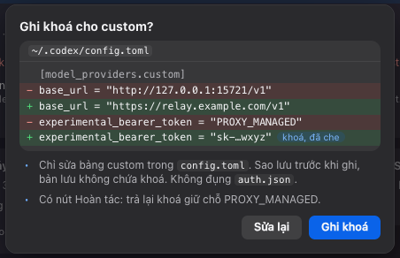

- **MCP** (M9). The `MCP` tab, under `Agent` in the sidebar, puts every MCP
  server of Claude Code, Codex and Antigravity in one table: a row per
  server, with the line `trên máy · <command>` or `qua mạng · <host>`, the
  service's logo before the name when its name, package or host names a
  service the app knows (GitHub, Notion, Figma, Slack, Linear and others;
  the Plugin tab's plugins and the MCP an agent or a plugin brings get one
  the same way), a small lock when it has a key, and chips only when
  something is the matter (`thiếu khoá`, `lệnh chưa cài`,
  `khác giữa các agent`); and a column of macOS checkboxes per agent,
  headed by the agent's own logo. A tick is not
  written at once: the box turns light blue with an amber dot and the bar
  under the table lists `N thay đổi chưa ghi`, so a tick taken back drops
  out. The logo at a column's head opens its menu: `Bật tất cả`,
  `Tắt tất cả` (both skip a box that cannot be ticked) and
  `Bỏ N thay đổi chưa ghi`. `Xem trước và ghi…` shows one preview for the
  whole batch, by agent: the lines each file gains and loses, the
  `claude mcp` commands for Claude Code, the backups and what to restart.
  Each file is written once, and the line after it offers `Hoàn tác` (the
  whole batch back) and `Bản lưu`. `Thêm MCP` fills one server in for every
  agent at once, by hand or by pasting the JSON or TOML a README gives;
  `Sửa` first compares a server that differs between agents (its keys only
  as `giống nhau` or `khác nhau`); `Xoá` turns it off everywhere and keeps
  it in the app's store to turn on again, or removes it for good. Under the
  table, one line each: the servers kept in the store, the ones Codex App
  and plugins bring themselves (shown, never edited), and the backups.

  Keys never show. A key typed or pasted goes to the app's own Keychain
  items, with a note of where the owner keeps it (a password manager's
  item, say); the preview masks every key; a
  server short of its key keeps its boxes locked until `Dán khoá`. Codex is
  written in its `[mcp_servers.<name>]` tables (`enabled = false` turns one
  off), Antigravity in `~/.gemini/config/mcp_config.json`
  (`"disabled": true`), and Claude Code only through
  `claude mcp add-json`/`remove --scope user`, which writes `~/.claude.json`
  itself; Claude Code has no off, so the app keeps a server turned off there
  and puts it back when it is ticked again. A file that does not parse is
  shown and never written, and a file changed after the preview stops the
  batch. See [SECURITY.md](SECURITY.md) for what is kept where.

  

   

- **Skills, Plugin và File hướng dẫn** (M11). The `Skills` tab shows every
  skill of Claude Code, Codex and Antigravity in the MCP tab's table, a
  checkbox per agent, filtered by `Tất cả`, `Từ GitHub`, `Cài tay` and
  `Có bản mới`. Skills live once, in the shared folder `npx skills`
  installs into (`~/.agents/skills`): a tick for Claude Code or Antigravity
  is a link in that agent's folder, and for Codex, which reads the shared
  folder itself, an `enabled = false` entry under `[[skills.config]]` in
  `config.toml`. Ticks go through the same pending bar, preview, backups and
  `Hoàn tác` as the MCP tab, and turning a skill off never removes a folder.
  `Cài từ GitHub` takes a repository, lists its skills (with `Đọc SKILL.md`
  to read one first), lets the owner pick the agents and shows the
  `npx skills add` command before it runs; nothing in a skill runs on
  install. Skills installed by hand in one agent's folder can be gathered
  into the shared folder with `Gom về…`; skills Codex or a plugin brings are
  listed and left alone. Once a day the app asks GitHub, one question per
  repository in the skill lock file, whether a skill has a newer version,
  and says so above the table and under the Thông báo bell (a macOS card only if
  turned on in Cài đặt); it never updates on its own. `Cập nhật` shows what
  changed, warns when the skill was edited on this Mac, keeps a copy and
  keeps every agent's box; `Bỏ qua bản này` waits for the next version.
  `Cập nhật tất cả` (beside `Kiểm bản mới`) and `Cập nhật cả bộ` (for each
  repository with a newer version, under `Bản mới theo bộ`) do the same for
  several skills in one preview: each skill with its versions, the ones
  edited on this Mac left unticked, a copy of every folder kept before the
  first update, then one update at a time with the one at hand shown, and
  a line saying which updated and which failed, and why.

  The `Plugin` tab lists the plugins `claude plugin list` and
  `codex plugin list` report, what each brings and the marketplaces, and
  the agents' own commands a restore would run; it changes nothing. The
  `File hướng dẫn` tab lists CLAUDE.md, the rules under `~/.claude/rules`,
  AGENTS.md, GEMINI.md and any file added by hand, when each changed, how it
  stands against the newest backup pack (with a line-by-line `So sánh`) and
  whether it goes into the pack. The app never edits one, and a file with a
  line shaped like a key stays out of every pack, the value masked when it
  is shown. The backup pack lists the skills (their source, and the files
  of those installed by hand), the plugins and the instruction files, and a
  restore puts them back (M12, below). See [SECURITY.md](SECURITY.md#skills-plugins-and-instruction-files-m11).

  

  

  

  

- **Sao lưu và khôi phục** (M10). The `Sao lưu` tab saves the MCP servers
  of the three agents, and which agent has each one on, to a pack in iCloud
  Drive, so any of the owner's Macs can restore it. It shows the newest
  pack, every Mac's packs (a pack iCloud has not downloaded yet says so and
  cannot be picked until it is), the two switches of `Tự sao lưu` (after
  each change in the app, and daily when something changed) and the keys
  the app keeps on this Mac, by name and where each is kept, to replace or
  delete; it keeps the newest 10 packs of each Mac. `Xem trong gói` says
  what a pack holds in plain words. A pack never holds a key, and paths in
  it are written from the home folder, so they change to the Mac that
  restores it.

  `Khôi phục…` opens a sheet in steps: pick a pack, then one preview of
  what changes on this Mac. Servers to add are ticked; one that differs from
  the pack is not, and `So sánh` shows the two side by side; the ones
  already the same are listed in one line. Next the keys the pack needs are
  asked for in password fields, with where each is kept. A server
  left without its key, or whose command is not installed here, is added
  turned off, and the result says what is left to do. The write is the MCP
  tab's checked write, so a file changed after the preview stops it, and a
  restore never touches a login, an account or Codex's provider. Once done,
  `Hoàn tác lần khôi phục` takes the whole restore back, asking first when a
  file was edited since. See [SECURITY.md](SECURITY.md#backup-packs-and-restore-m10).

  Since M12 the pack also holds the skills (those from GitHub by their
  source, those installed by hand with their files, unless a file has a
  line shaped like a key), the plugins and the instruction files, and the
  same preview shows them by group after the servers: skills from GitHub
  are installed again with `npx skills`, the newest version; skills
  installed by hand are copied from the pack; plugins are installed by
  Claude Code's and Codex's own commands; an instruction file this Mac has
  not got is written, and one that differs is not ticked, with `So sánh`,
  so the Mac's own stays unless the owner ticks it. Each agent's box is set
  as the pack had it. One part failing (a plugin that needs a login, GitHub
  out of reach, a skill iCloud has not downloaded) leaves the others to run,
  and the result offers `Thử lại` for it; `Hoàn tác lần khôi phục` takes all
  of it back. See [SECURITY.md](SECURITY.md#restoring-skills-plugins-and-instruction-files-m12).

  

  

  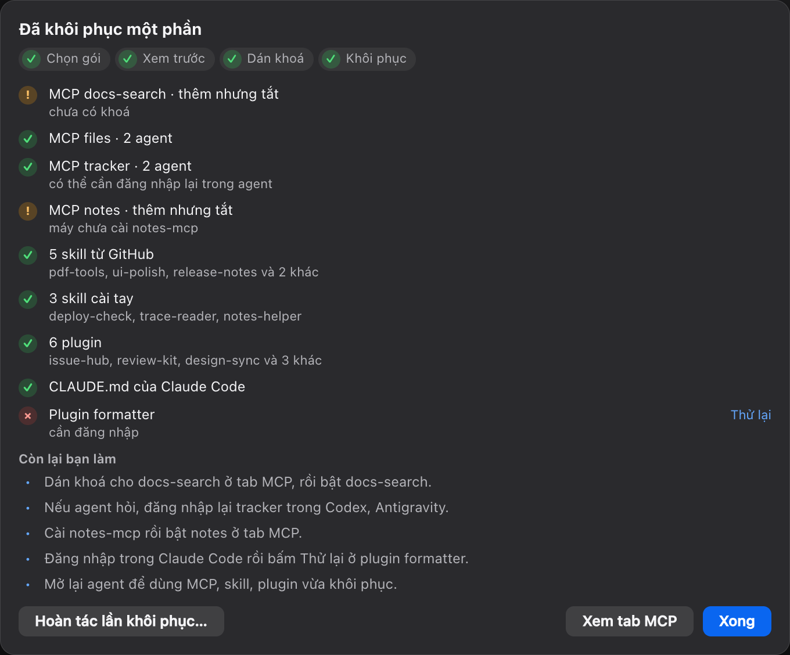

  

- **Chép sang Mac khác** (M13). The tab copies MCP servers, skills,
  plugins and instruction files between this Mac and one of `Cài đặt › Các
  Mac khác`, either way (`Từ máy này sang …` or `Lấy từ … về`). `So sánh`
  reads the other Mac through its own Quota Station over SSH (names,
  configuration and hashes, never a key) and lists what differs by group:
  what only one Mac has, a server whose configuration differs (a command at
  another path is not a difference), a skill of another version, a file of
  other text. What only the sending Mac has starts ticked; what both have
  but not alike starts unticked, and `Xem` shows it on both Macs side by
  side. `Chép N mục` shows what will happen, and the Mac that receives the
  items writes them itself, as a restore of only those items: the same
  checked write, backups first, and `Hoàn tác trên …` runs on that Mac.
  `Gửi cả khoá qua SSH` is off by default: a server that needs a key is
  then added turned off and that Mac asks for the key. A Mac that does not
  answer, or whose app is still version 1, is never written to. Codex's
  provider, logins and accounts are never part of a copy. See
  [SECURITY.md](SECURITY.md#copying-to-another-mac-m13).

  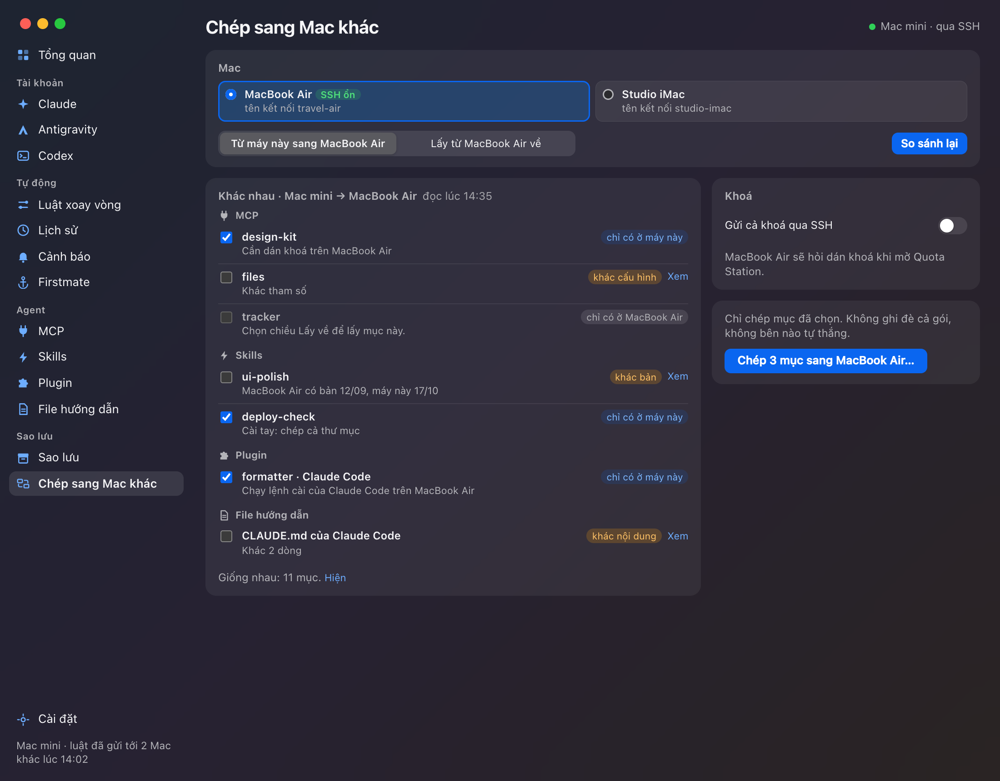

  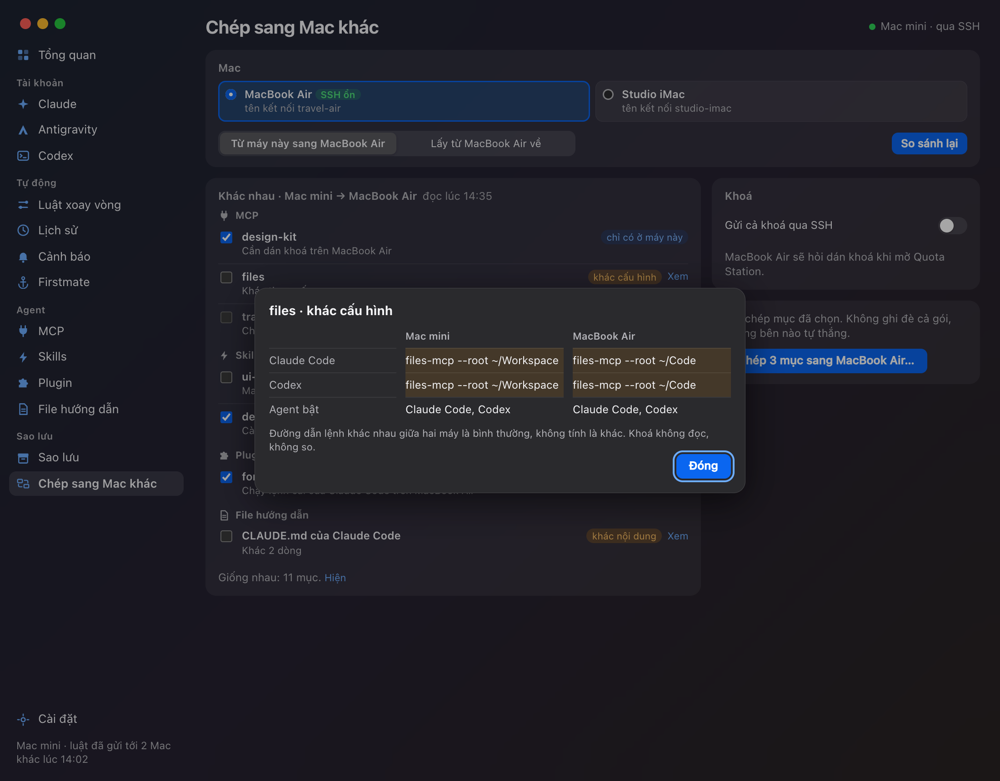 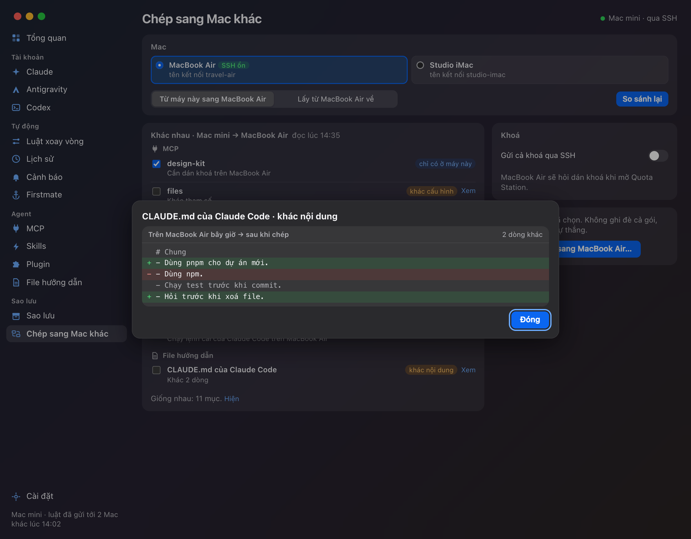

  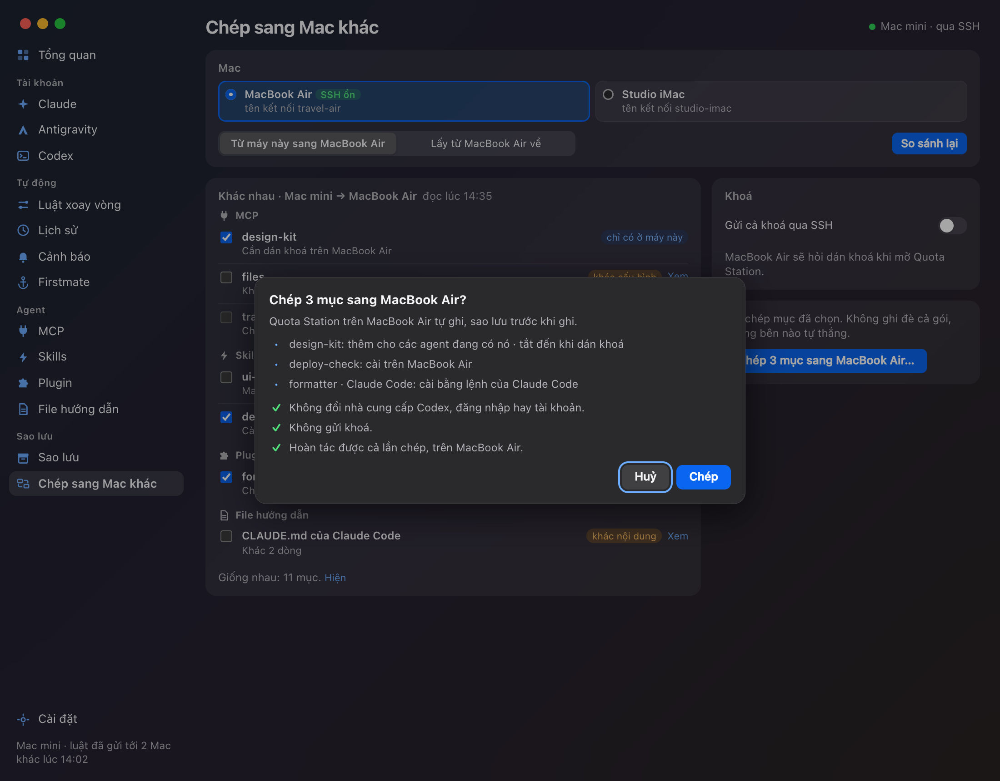

  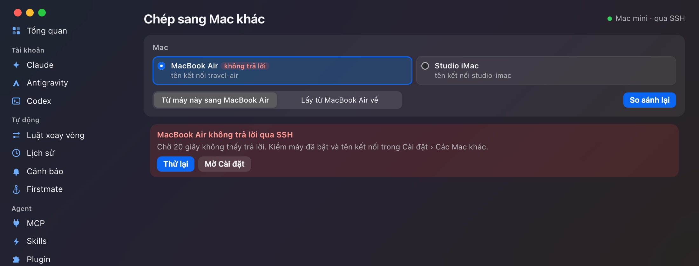 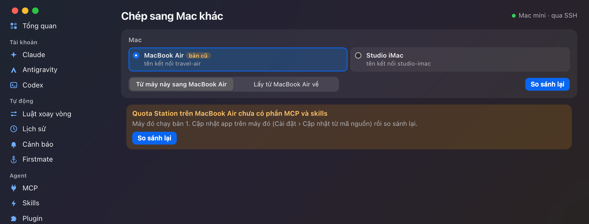

- **Biến môi trường đè đăng nhập** (M14). An `ANTHROPIC_API_KEY` in
  `~/.zshrc` makes Claude Code in Terminal use that key, whatever account
  the app switches to. The app looks for eleven such names
  (`ANTHROPIC_API_KEY`, `ANTHROPIC_AUTH_TOKEN`, `ANTHROPIC_BASE_URL`,
  `CLAUDE_CODE_OAUTH_TOKEN`, `CLAUDE_CONFIG_DIR`, `OPENAI_API_KEY`,
  `OPENAI_BASE_URL`, `CODEX_HOME`, `GEMINI_API_KEY`, `GOOGLE_API_KEY`,
  `GOOGLE_CLOUD_PROJECT`) in six places: `~/.zshenv`, `~/.zprofile`,
  `~/.zshrc`, `~/.bash_profile`, `~/.profile` and launchd (what apps opened
  from the Dock get). It learns only whether each is set, in which file and
  on which line, never its value, and never runs a shell file. The
  `Biến môi trường đè đăng nhập` card in `Cài đặt › Dịch vụ` (the first
  tab, and its first card, while a variable is set) names each variable,
  the agent it overrides, the file
  and line and what it does, with `Mở file` (in Visual Studio Code, Cursor
  or Zed at the line when one is installed, else the default text editor)
  and `Bỏ qua`, which has `Hoàn tác`; with none, one green line.
  `Xem danh sách` lists the names and the places. A variable that overrides
  Claude Code also puts a red banner at the top of the `Claude` tab, and
  each variable gets one card under the `Thông báo` bell, in the app only, sent again
  only when it is set somewhere new. The app checks at most every 10
  minutes after a read, when `Cài đặt` opens and on `Kiểm lại`; it never
  edits a shell file and never unsets anything.

  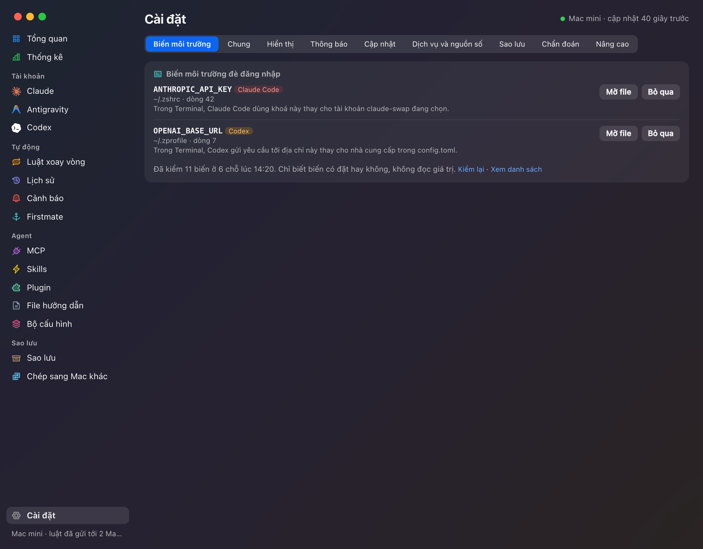

  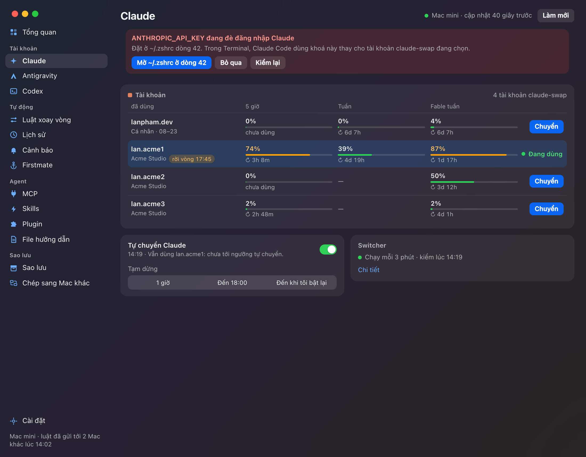

  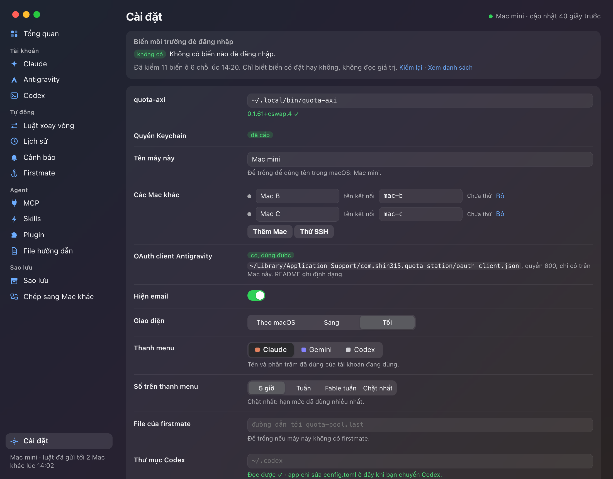

- **Bộ cấu hình** (M15). A set is named after a project (`Web app`,
  `Viết tài liệu`) and says, for each MCP server and skill, `Bật`, `Tắt` or
  `Không đổi`, and for Codex `Giữ nguyên` or a side of the Codex switch. It
  applies to the whole Mac, every project and every session opened after;
  nothing is written into a project's folder. `Tạo bộ` lists every server
  and skill of the MCP and Skills tables; `Lấy từ cấu hình hiện tại` sets
  `Bật` for an entry on in every agent that has it, `Tắt` for one off in all
  of them and `Không đổi` for the rest, so the set changes nothing applied
  straight away. `Áp…` reads the files now and lists, agent by agent, what
  changes: a server for every agent that has it (a box that is locked, or an
  entry this Mac has not got, is skipped and said), a skill for every agent
  whose box can be ticked; it says how many Claude Code and Codex sessions
  run now, which keep the old configuration until they are opened again, and
  `Xem từng dòng sẽ ghi` shows the MCP and Skills tabs' own previews.
  `Áp bộ` writes exactly that through the MCP and Skills tabs' checked
  batches: each file read again, backed up without secrets, written once,
  only the set's entries changed, and nothing at all when a file changed
  since the preview. A set that wants Codex on the other side then opens the
  Codex switch's own sheet as step 2; the set never changes Codex's provider
  itself, and `Thôi` leaves Codex as it is, with `Chuyển Codex` on the line
  to open the sheet again later. `Đang dùng` names the set applied last and
  says `đã lệch N mục` with what no longer is as the set says (Codex on the
  other side included), or `đúng như bộ`. `Hoàn tác bộ` puts back every
  entry the apply changed that is still as the apply left it; an entry
  changed or removed since stays as it is and is named, and when step 2
  switched Codex the line offers the Codex switch back. `Xoá` removes a set
  (with `Hoàn tác`) and changes no agent file. A set is never applied on its
  own.

  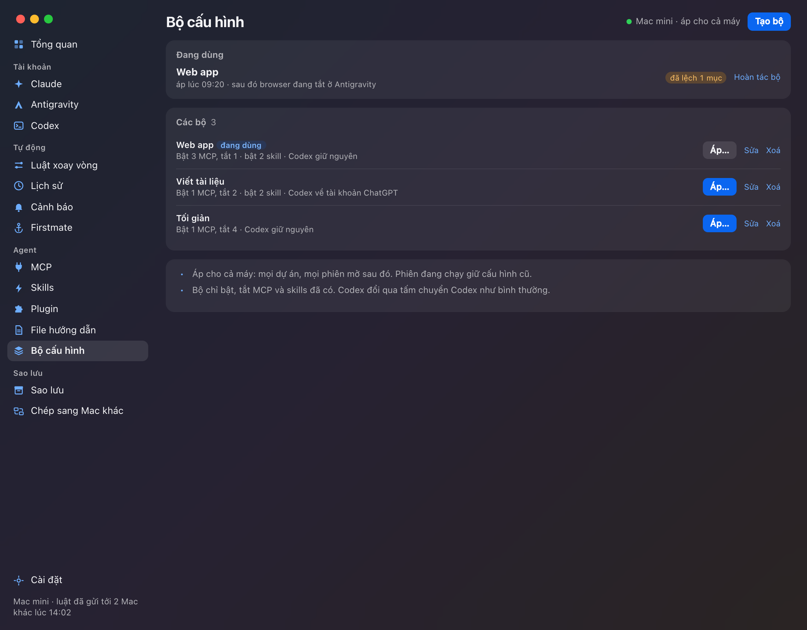

  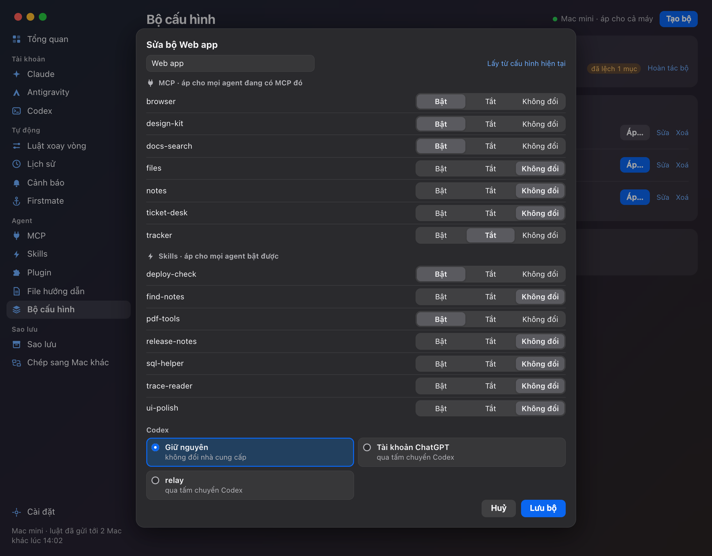

  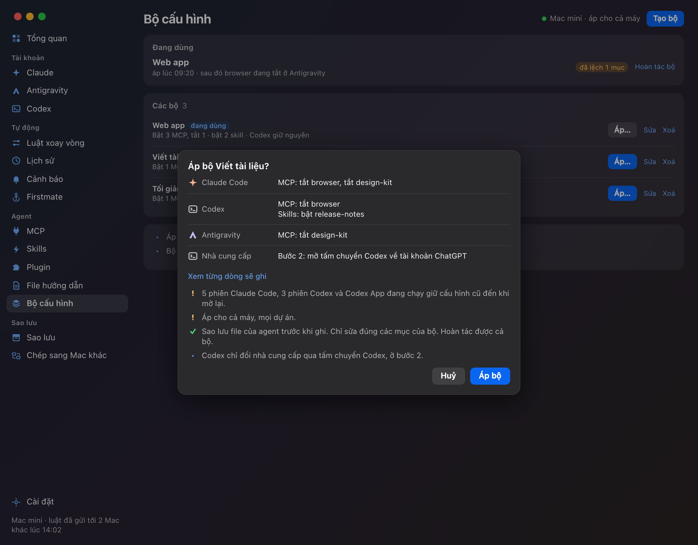

  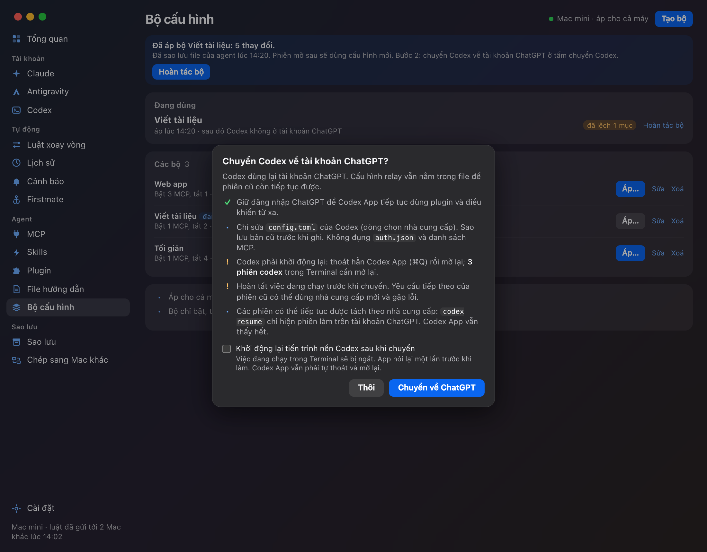

- **Thống kê** (M16), right under Tổng quan. The tokens Claude Code and
  Codex used on this Mac, from their own session logs
  (`~/.claude/projects/**/*.jsonl`; `sessions/` and `archived_sessions/` in
  the Codex folder): the total, each agent's share, a column per hour for
  `Hôm nay` or per day for `7 ngày` and `30 ngày` (labels five days apart),
  and the counts by agent, by Claude account, by model (input, output and
  cache reads) and by project folder. `Giá API tương đương` is what the
  tokens would cost at the API prices, only to compare with the
  subscriptions; the prices are one table in the code with its source and
  date. The Claude account is approximate: each quarter hour goes to the
  account the switch history says was in use. Antigravity keeps no token
  log on the Mac, so its row says `chưa có log token trên máy`. The chart
  has one colour for every bar, a mark beside each agent's name, a number
  on the tallest bar only, and each value on hover and from the keyboard
  (the arrows move along the bars); `Xem bảng` has every number in a table.
  Only the token counts, the model, the time and the folder are read from a
  line, never the conversation. The first read shows each agent's progress
  and later ones read only what was appended; a log in a format the app does
  not know is skipped and counted (`Bỏ qua 38 phiên Codex`, with `Đã biết`),
  never guessed. The counts are `stats/index.json` in the app's folder.

  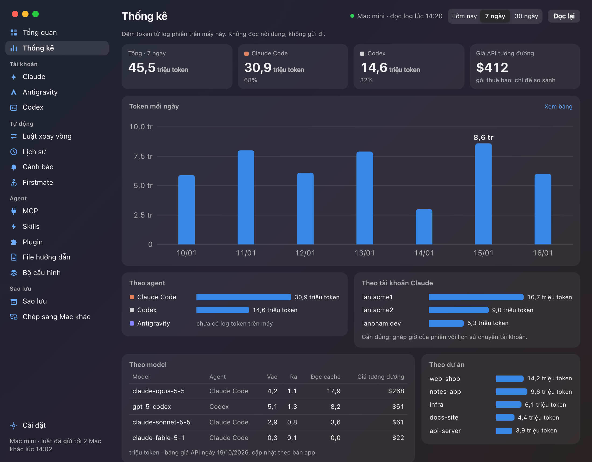

  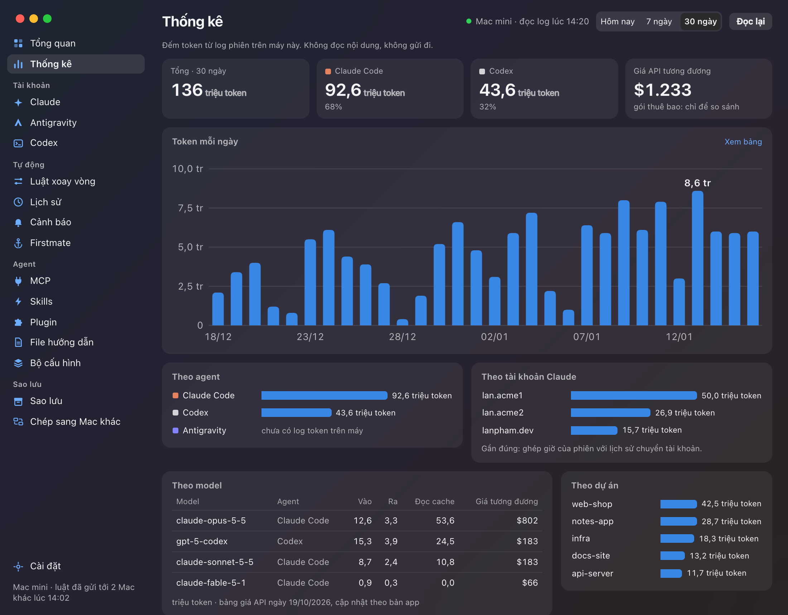

  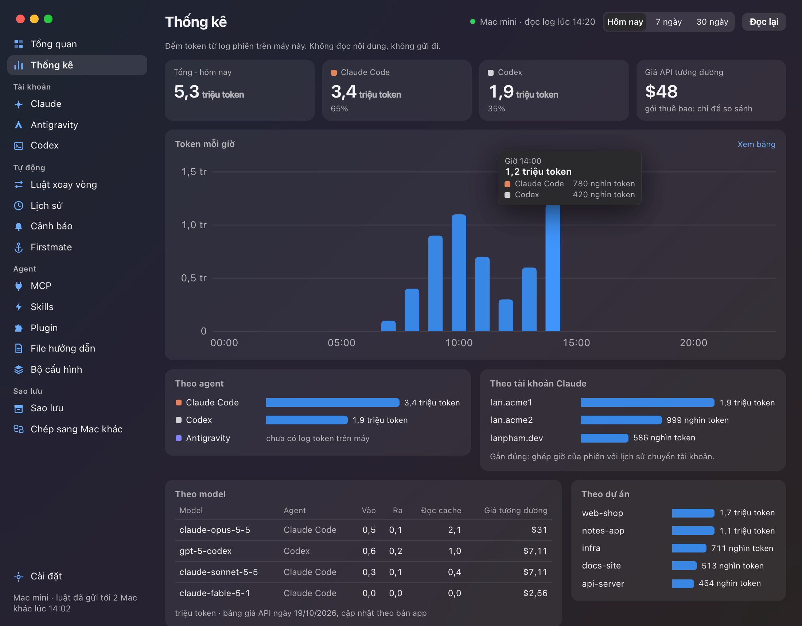

  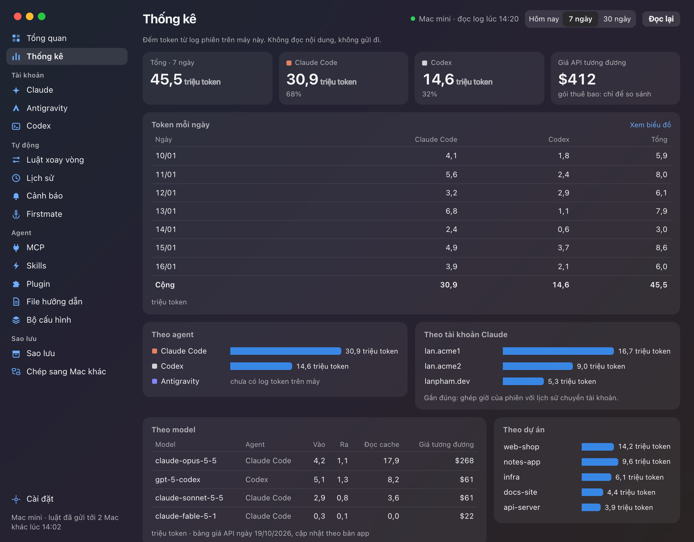

  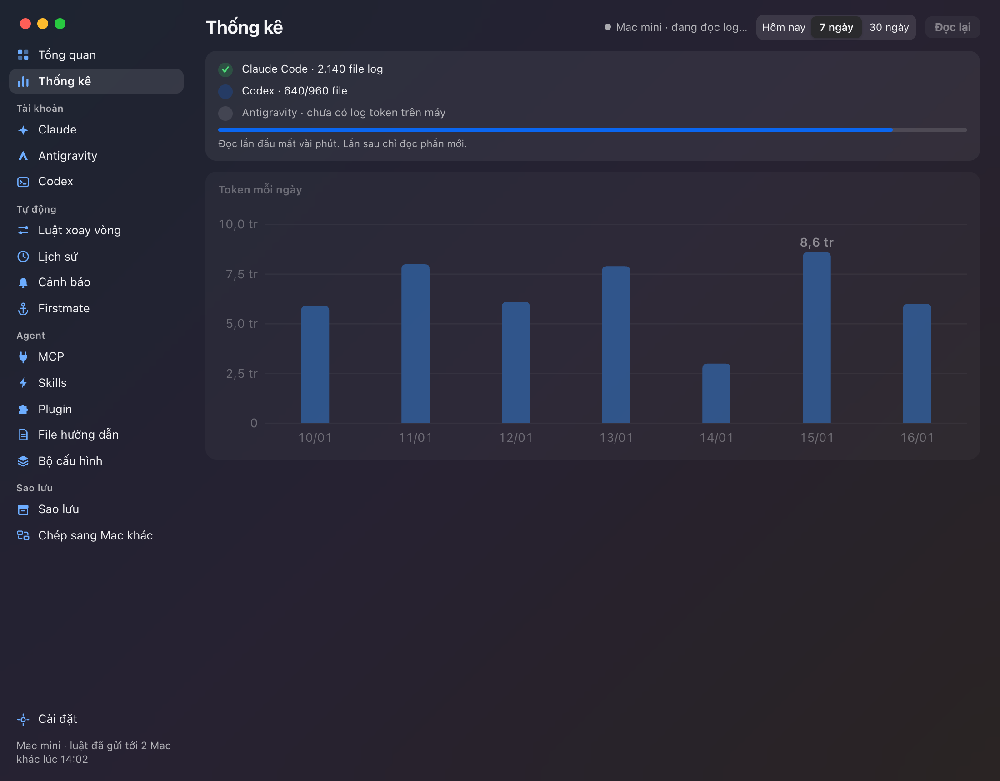

  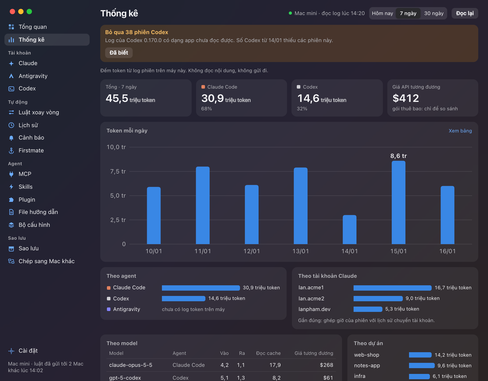

- **Antigravity logins** (M4a). `Thêm tài khoản` opens Google's consent
  screen in the default browser, with Antigravity's own OAuth client, so the
  screen names Antigravity, not Quota Station. The flow is Cockpit's: a
  loopback callback on a random port, a fresh `state`, a 10-minute wait, the
  code exchange, then userinfo for the email. A browser that cannot reach
  the app can paste the callback URL instead. The card lists the accounts by
  number (`Ultra 1`, `Ultra 2`, the order the Antigravity row uses) with
  `đã đăng nhập`, `cần đăng nhập lại` (Google refused the refresh token) or
  `cần xác minh` (Google asks for a verification), `Đăng nhập lại`, and
  `Đăng xuất` with a confirmation in the row. Logging out forgets the account
  in this app only: Antigravity.app and agy stay logged in. Without a usable
  `oauth-client.json` the card says what is missing and cannot add.
- **Antigravity quota** (M4b). The app reads the quota of the accounts logged
  in here itself, as Cockpit Tools does: the token, refreshed only when it
  has under five minutes left, then Cloud Code's `fetchAvailableModels` and
  `retrieveUserQuotaSummary` with Antigravity's user agent and headers
  (`antigravity/<version> darwin/<arch>`; the version is that of
  `/Applications/Antigravity IDE.app`, where Cockpit looks, or Cockpit's
  `1.20.5` without it). `loadCodeAssist`, which gives the account's project
  and whether it is a GCP ToS account, is asked after a login and while the
  token lacks either (unlike Cockpit, a failed answer ends the read like a
  failed quota call: the last reading stays, and a 429 or 5xx backs the
  account off); a GCP ToS account with a project is read from
  `cloudcode-pa.googleapis.com`, every other from
  `daily-cloudcode-pa.googleapis.com`. Each reading goes, in Cockpit's cache
  layout, to the app's `antigravity/` folder; the Antigravity row lists
  every account from there, beside the live read of the account in use
  (below), and Firstmate's quota-axi (`+cswap.5`) reads the same folder
  before Cockpit's. The pace is never denser than Cockpit's: the account in
  use with each of the app's reads, the others every 10 minutes and when the `Antigravity` tab
  opens, one account at a time, and no account twice within a minute (a
  reading younger than that is used as it is). A network error on
  `fetchAvailableModels` is tried three times, a second apart, as Cockpit
  does; after that, or after any other failure, the last numbers stay with
  their age. After a 429 or a 5xx the account waits at least 2 minutes,
  then 4, 8, 16 and at most 30. A 403 on `fetchAvailableModels` marks it
  `Google chặn` and stops its reads until a new login; an account that
  needs a new login is not read either. A Mac with no account logged in
  reads nothing.

Each Mac runs its own copy and switches only its own machine; there is no
switch button for another Mac. The only thing sent to another Mac is the
rotation file. Each Mac also keeps its own Antigravity logins, and nothing
assumes another Mac has any. Each Mac installs and updates its own copy
(below).

### The Claude accounts

Quota Station keeps the Claude accounts itself, the way claude-swap kept
them, so no other app is needed to switch, read or rotate them
([`docs/claude-accounts.md`](docs/claude-accounts.md) has the design; the
logic that touches Claude Code's login is adapted from claude-swap, MIT,
credited in [`THIRD_PARTY.md`](THIRD_PARTY.md)).

- **Store.** Each account's login and its `oauthAccount` are in the login
  Keychain under the app's own service, `com.shin315.quota-station.claude`
  (`slot-N` and `slot-N.account`). `claude/accounts.json` in the app's
  folder holds the slot numbers, aliases, which accounts are in the rotation
  and the account ids; no email and no token is in a file.
- **`Tài khoản Quota Station giữ`** in the `Claude` tab: `Nhập từ
  claude-swap` (once per Mac, see the cutover below; again later only takes
  a newer login), `Đăng nhập tài khoản mới` (`claude auth login` in a folder
  of its own, so Claude Code's login does not change), `Thêm tài khoản đang
  đăng nhập`, `Thêm setup token` (a `claude setup-token` token, kept as a
  login without refresh; the field is a password field and the token is
  never shown again), and on each account `Đổi tên`, `Xoá` (not the one in
  use) and `Trong vòng xoay`, which holds an account out of the rotation
  (it is never switched to, but kept by the usual rules while in use)
  while it can still be switched to by hand.
- **Switch.** Under Claude Code's own lock folders, the app keeps the live
  login of the account in use, writes the target's login to Claude Code's
  Keychain item and its `oauthAccount` to `~/.claude.json`, and reads both
  back, putting them back when they do not match. A login the app does not
  keep stops the switch, so it is never lost. A switch never refreshes a
  token. It drops nothing from MCP or plugin secrets in the live login.
- **Usage.** Each account's five-hour, weekly and Fable weekly windows come
  from Anthropic's usage endpoint, at most every 180 seconds an account,
  with a back-off after a failure or a 429. The account in use is read with
  Claude Code's own token and never refreshed by the app; another account
  whose token has under five minutes left is refreshed first. The readings
  are `claude/usage.json`, and the Claude row is built from them. While
  `Cài đặt › Nâng cao` shows Firstmate (in a build with the `author-tools`
  feature), the app also writes a copy in
  claude-swap's layout, `claude/swap/`, with placeholder addresses, for
  Firstmate's quota-axi (`QUOTA_AXI_CLAUDE_SWAP_DIR` and
  `QUOTA_AXI_CLAUDE_ROTATION`, [`docs/claude-accounts.md`](docs/claude-accounts.md)).
- **Rotation.** The `cswap-prefer-team` rules, ported line for line, on the
  app's own copy of the rotation file (`claude/rotation`; the rules editor
  and the copy to the other Macs work on it), with one change: the early
  switch is on. While the Team account in use has room, the rotation moves
  to another Team account whose five-hour window has started and ends
  sooner, when that account has room, at least 20 minutes of that window
  left and at least 10 points of it before the threshold (and Fable left
  if the account in use has Fable); of several, the window that ends first.
  So a window is used before it resets unused, for about one switch back
  (each switch makes every running session read its context again). With
  no such account the one in use is kept until a window reaches the
  threshold, as in the script. `Tự chuyển bằng Quota Station`
  loads the app's LaunchAgent, `com.shin315.quota-station.rotation`, which
  runs `quota-station claude rotate` every 180 seconds whether or not the
  app is open, and logs to `claude/rotation.log`; a failed switch is
  logged as `switch to slot N failed: <kind>: <reason>`, the cause on the same
  line, never a token. The pause flag is the same
  file as before. While `com.cswap.prefer-team` or `com.cswap.auto` is
  loaded, the rotation, the switch sheet and `quota-station claude switch`
  write nothing, so two switchers never rotate the same refresh token.
- **For Firstmate**, the binary inside the app answers without a window:

  ```sh
  QS="/Applications/Quota Station.app/Contents/MacOS/quota-station"
  "$QS" claude status --json          # every account's windows and the one in use
  "$QS" claude run 3 -- -p "…"        # claude as account 3, without switching
  "$QS" claude session 3              # account 3's folder, for CLAUDE_CONFIG_DIR
  ```

  `status --json` prints `schemaVersion`, `generatedAt`, `activeSlot` and
  `accounts[]` (`slot`, `alias`, `enabled`, `active`, `kind`, `status`
  `fresh`/`stale`/`noData`/`reloginRequired`, `fetchedAt`, `ageSeconds`,
  `windows.fiveHour|sevenDay|fable` with `usedPercent` and `resetsAt`, and
  `error`); emails only with `--emails`, and `--refresh` reads the accounts
  that are due first. The same object is written to `claude/state.json`
  after every read. `run N` runs `claude` with `CLAUDE_CONFIG_DIR` set to
  `claude/sessions/N/`, whose login is the Keychain item Claude Code keys to
  that folder, and returns `claude`'s exit code. For the account in use it
  runs `claude` on Claude Code's own login, as `cswap run` did;
  `--require-session` refuses that instead. `quota-station claude help`
  lists the rest (`switch`, `rotate [--dry-run]`, `rotation on|off`,
  `import`, `add`, `remove`, `alias`, `enable`, `disable`).

### What it reads and runs

- The quota, read by the app itself with readers ported from quota-axi
  (`crates/quota-station-core/src/quota/`). None of them refreshes,
  rotates or writes a login: an expired login shows as stale or as a sign-in
  to do, and the vendor's own tool renews it when it next runs.
  - Codex, on a Mac with a Codex folder: the access token and account id
    from `~/.codex/auth.json` (read only), then
    `GET https://chatgpt.com/backend-api/wham/usage`, or
    `…/api/codex/usage` when that one does not answer, for the ChatGPT
    login's five-hour and weekly windows. Codex's `app-server` is never
    started.
  - Antigravity: `agy -p /quota --output-format json` (the first `agy` on
    the app's `PATH`, else in `/opt/homebrew/bin` or `/usr/local/bin`, as
    quota-axi looked for it), with stand-ins for `open` and `xdg-open` first
    on its `PATH` so it cannot open a browser; when that
    gives no numbers, the language server of a running agy or
    Antigravity.app, found with `ps` and `lsof`, asked on 127.0.0.1 for its
    quota summary with the CSRF token from its command line. The account's
    email is compared by a hash and never kept.
  - Claude Code, on a Mac where the app keeps no Claude account: its login
    from the Keychain item `Claude Code-credentials` (read with
    `/usr/bin/security find-generic-password` once the owner allowed it,
    otherwise only checked for), then `~/.claude/.credentials.json`, and
    `GET https://api.anthropic.com/api/oauth/usage`.

  The app reads every 60 seconds while the popover or the main window is
  open and every 5 minutes while both are hidden. It also reads when either
  opens, after the Mac wakes and on `Làm mới`. A reading younger than two
  minutes for the same login is used without asking again
  (`quota/<provider>.json` in the app's folder: windows, times and a hash of
  the login only), and a read that fails shows the last numbers as stale.
  The check after a switch asks again at once: a cached Claude reading may
  still be the account from before the switch.
- The Keychain button reads Claude Code's Keychain item once with
  `/usr/bin/security`, so macOS shows its own prompt; after `Luôn cho phép`
  the quiet reads go on by themselves. The app opens Claude Code's Keychain
  item only to read the quota, and to keep and switch the Claude accounts
  (above); the other Keychain items it opens are its own (below).
- No email or account id from a read is kept or shown. Before
  each read the app reads the Claude accounts that are due
  (`GET https://api.anthropic.com/api/oauth/usage`, and
  `POST https://platform.claude.com/v1/oauth/token` for an account not in
  use whose token is about to end) and rewrites `claude/state.json` and
  `claude/swap/`. Every Claude account's three windows come from those
  readings; its email and organization come from the app's Keychain items,
  stay in memory, go to the windows only while `Hiện email` is on, and are
  never written to a file or a log. Before the app keeps an account, the row
  has the one login Claude Code is on.
- Switching runs no other program: the app takes Claude Code's lock
  folders, then `/usr/bin/security` reads and writes Claude Code's item
  `Claude Code-credentials` and its own items, and the app rewrites
  `oauthAccount` in `~/.claude.json`. `Đăng nhập tài khoản mới` runs
  `claude auth login` (the first `claude` on `PATH`, else in `~/.local/bin`,
  `/opt/homebrew/bin` or `/usr/local/bin`) with
  `CLAUDE_CONFIG_DIR` set to `claude/adding/`; `Nhập từ claude-swap` reads
  `~/.claude-swap-backup` and claude-swap's Keychain items once and writes
  nothing there.
- Live sessions are counted from `~/.claude/sessions/*.json`: only the `pid`
  and `kind` fields are read, and a session counts when its process is alive.
- The rotation: a dry run of its rules in the app (no program runs and
  nothing switches), the last line of `claude/rotation.log` (of
  `~/Library/Logs/cswap-prefer-team.log` before the app keeps an account),
  and `launchctl list` for `com.shin315.quota-station.rotation`,
  `com.cswap.prefer-team` and `com.cswap.auto`. These run with each read
  while the popover or the main window is open, and after a switch or a
  pause; while both are hidden only the pause flag is read. `Tự chuyển bằng
  Quota Station` runs `launchctl bootstrap` or `bootout` for the app's own
  LaunchAgent only; the app never loads, stops or removes the older ones.
- The rotation editor's preview runs the same dry run on the draft, in
  memory.
- Copying the rotation file runs `ssh -o BatchMode=yes -o ConnectTimeout=5
  -T <alias>` with one of two fixed scripts: one prints the rotation file
  (the app's `claude/rotation` when that Mac's app keeps accounts or has
  its own rotation file, else `~/.config/cswap-prefer-team/rotation`), the
  other takes the new file on
  stdin, keeps a backup, renames it into place and prints it back. Batch
  mode means SSH never asks for a password or a host key. An alias must be
  letters, digits and `. - _ @`, and cannot start with `-`. The `ssh` used
  is the first on `PATH`, else `/usr/bin/ssh`.
- Antigravity logins talk to Google when the owner presses
  `Thêm tài khoản` or `Đăng nhập lại`: the consent page opens in the browser
  (`open <url>`), then `https://oauth2.googleapis.com/token` and
  `https://www.googleapis.com/oauth2/v2/userinfo`. Before a quota read, a
  token with under five minutes left is refreshed at the same token URL.
  The tokens go to the app's own Keychain items through
  `/usr/bin/security add-generic-password`, `find-generic-password` and
  `delete-generic-password`, service `com.shin315.quota-station.antigravity`.
  [`SECURITY.md`](SECURITY.md) lists what the app never reads.
- Antigravity quota reads, at the pace above:
  `POST https://daily-cloudcode-pa.googleapis.com/v1internal:fetchAvailableModels`
  and `…/v1internal:retrieveUserQuotaSummary` (on `cloudcode-pa` for a GCP
  ToS account with a project), and `…/v1internal:loadCodeAssist` when the
  token lacks a project or the GCP ToS mark. The Antigravity version comes
  from the bundle's `product.json` or, through `/usr/bin/plutil -p`, its
  `Info.plist`; the bundle is only read.
- Switching Antigravity runs, when the owner confirms:
  `plutil -extract CFBundleShortVersionString raw` on Antigravity.app's
  `Info.plist`, `pgrep -f /Applications/Antigravity.app/Contents/MacOS/Antigravity`,
  `osascript -e 'tell application id "com.google.antigravity" to quit'` and
  `open -b com.google.antigravity` (only with `Thoát app rồi chuyển`),
  `…/v1internal:loadCodeAssist` while the token lacks a project or the GCP
  ToS mark,
  `security add-generic-password -U -s gemini -a antigravity -w go-keyring-base64:<…> -A`,
  and then the Antigravity quota read above, without the cache.
  Opening the sheet runs only the `plutil` and `pgrep` questions.
- History and alerts (M6) read, after each read: the last 64 KB of the
  switcher's log, the rotation file (where the app keeps no Claude account),
  the app's own Antigravity files, Firstmate's `quota-pool.last` at the path
  set in `Cài đặt` (at most 16 KB, a plain file of that name only), and,
  while an overwrite card waits for an answer, `pgrep` for Antigravity.app.
  The cards go through macOS's own notification center
  (`UNUserNotificationCenter`); `Mở Cài đặt hệ thống` runs
  `open x-apple.systempreferences:com.apple.Notifications-Settings.extension`.
- `Mở khi đăng nhập` (M7) registers and unregisters the app with macOS's
  `SMAppService.mainApp`, only when the switch is pressed; the settings tab
  asks macOS for the switch's state when it opens.
- `Cập nhật từ mã nguồn` (M7) runs, only when pressed,
  `git -C <clone> pull --ff-only` (with `GIT_TERMINAL_PROMPT=0` and
  `GIT_SSH_COMMAND="ssh -o BatchMode=yes"`, so git never waits for a
  password), `git -C <clone> rev-parse HEAD`, and then, unless this copy was
  built from that commit, `/bin/bash <clone>/scripts/install.sh --dest
  <the folder this app is in> --no-open`. `Mở lại` quits the app and has
  `/bin/sh` wait for it to end before `open` starts the new copy.
- Codex (M8), while the popover or the main window is open every 60
  seconds, every 5 minutes while both are hidden, and when the `Codex` tab
  opens: `config.toml` in the Codex folder; the shape of `auth.json` (which
  kind of login it holds; no value is kept, and the file is never written);
  `ps -ww -Ao tty=,command=` for terminal sessions, Codex App, the
  background process and CC Switch; `codex --version`; the first line of
  each `sessions/**/rollout-*.jsonl` for its provider; and whether
  `/Applications/CC Switch.app` and `~/.cc-switch` exist (nothing inside is
  read). It checks the custom provider answers with
  `GET <base_url>/models` with no key and no login, five seconds at most,
  three tries; any HTTP answer, a 401 included, counts. A switch writes
  `config.toml` as above; with the box ticked, or from the tab's own sheet,
  it runs `codex app-server daemon restart` with `CODEX_HOME` set.
- MCP (M9), when the `MCP` tab opens, on `Đọc lại`, and after each write:
  `~/.claude.json` (only its `mcpServers`), the Codex folder's `config.toml`
  (only `[mcp_servers]`) and `~/.gemini/config/mcp_config.json`; whether
  `claude` and each server's command are in the usual folders; and, for a
  server whose key must come from the app, whether its Keychain item is
  there (never its value until a write needs it). After a preview the owner
  confirmed it writes those two files and runs `claude mcp add-json` and
  `claude mcp remove` with `--scope user`.
- Backups (M10), when the `Sao lưu` tab opens, on `Kiểm lại`, after each
  MCP write and once a day: the `Quota Station Agents` folder at the top of
  iCloud Drive, each pack's `manifest.json` (and whether iCloud has
  downloaded it). A pack is three files there, `manifest.json`, `mcp.json`
  and `secrets-needed.json`, with no key; a restore reads them and writes
  the agent files as the MCP tab does, and keeps
  `agents/restore-last.json` (what `Hoàn tác` needs, no key) in the app's
  folder. From M12 a pack also holds `skills.json`, `plugins.json`,
  `instructions.json` and a `skills/` folder with the skills installed by
  hand; a restore reads them, installs skills with `npx skills`, copies the
  others into `~/.agents/skills`, runs `claude plugin …` and `codex plugin
  …` to install plugins, and writes the instruction files the owner ticked,
  keeping the old ones in `backups/instructions/`.
- Skills (M11), when the `Skills` tab opens and on `Đọc lại`: the shared
  folder `~/.agents/skills` and its lock file `~/.agents/.skill-lock.json`
  (read only), `~/.claude/skills`, `~/.gemini/config/skills`, the Codex
  folder's `skills` and the `[[skills.config]]` entries of its
  `config.toml`. After a preview the owner confirmed it makes or removes
  links in the two folders and writes those entries. `npx -y skills …` runs
  only on `Tìm skill`, `Đọc SKILL.md`, `Cài`, `Cập nhật` and `Gỡ hẳn`, in an
  empty folder of the app's. Once a day it asks
  `api.github.com/repos/<owner>/<repo>/git/trees/HEAD` once per repository
  in the lock file, with no token, and keeps what it found in
  `agents/skill-updates.json`.
- Plugins (M11), when the `Plugin` tab opens: `claude plugin list --json`,
  `claude plugin marketplace list --json` and `codex plugin list --json`,
  and each installed plugin's own folder. Nothing else of the two commands.
- Instruction files (M11), when the `File hướng dẫn` tab opens:
  `~/.claude/CLAUDE.md`, `~/.claude/rules/**/*.md`, the Codex folder's
  `AGENTS.md`, `~/.gemini/GEMINI.md` and the files added by hand; the
  choices made there are `agents/instructions.json`. It never writes them.
- Copying to another Mac (M13), on `So sánh` and `Chép` in the `Chép sang
  Mac khác` tab: `ssh -o BatchMode=yes -o ConnectTimeout=5 -T <alias>` with
  one fixed script that finds `Quota Station.app` in `/Applications` or
  `~/Applications`, checks its `Info.plist` with `/usr/bin/plutil` and runs
  `quota-station agents read|export|start|status`; whatever a call carries
  goes on stdin, and each call stops after 20 seconds. On the Mac written
  to, the app keeps `agents/copy-job.json` (the write running, no key) and,
  while it runs, the items in `agents/incoming/`.
- Variables that override a login (M14): the bytes of `~/.zshenv`,
  `~/.zprofile`, `~/.zshrc`, `~/.bash_profile` and `~/.profile`, searched
  for eleven names at the start of a line and zeroed after (never run or
  `source`d), and `/bin/launchctl getenv NAME` for each name, whose output
  is only asked whether it is empty, then zeroed. `Mở file` runs
  `/usr/bin/open` on that file (a `vscode://`, `cursor://` or `zed://` URL
  at the line, else `-t`). `Bỏ qua` is `agents/env-ignored.json`.
- Configuration sets (M15): the MCP and Skills tables as their tabs read
  them, and `~/.claude/sessions` and the process list for the sessions
  running now. The sets and the last apply's undo (names and on or off, no
  key) are `agents/sets.json`. Every write is the MCP or Skills tab's.
- Token statistics (M16): `~/.claude/projects/**/*.jsonl` and the Codex
  folder's `sessions/` and `archived_sessions/`, for each line's token
  counts, model, time and project folder only; the bytes are zeroed after.
  The counts are `stats/index.json` (no text). Nothing is sent anywhere.
- It writes these files: its own settings file,
  `~/Library/Application Support/com.shin315.quota-station/settings.json`,
  with `rotation-sync.json` (where each other Mac stands) beside it; in the
  same folder, `claude/` (the Claude accounts above: `accounts.json`,
  `usage.json`, `state.json`, `swap/`, `rotation`, `rotation.log`, `prime`,
  `prime-state/` and `sessions/`, no email and no token),
  `update/install.log` (the last update's build output),
  `antigravity/accounts.json` (Cockpit's account index layout,
  no token), `antigravity/status.json` (accounts that need a new login or a
  verification, or that Google refused),
  `antigravity/cache/quota_api_v1_desktop/authorized/<SHA-256 of the email>.json`
  (each account's last quota reading in Cockpit's cache layout, no token),
  and after an Antigravity switch
  `antigravity/antigravity_legacy_instances.json` (the account bound to
  Antigravity.app, read by the Antigravity row and Firstmate's quota-axi),
  `antigravity/switch-log.jsonl` and
  `antigravity/watch.json`; `history/history.jsonl` and
  `alerts/alerts.json` (M6, no email or token); `codex/state.json` (the
  hash of the app's last write, to tell a change made outside the app),
  `codex/switch-log.jsonl` (the last 200 switches) and
  `backups/codex/config.toml.<time>` (the newest 10 copies of Codex's
  `config.toml` before each switch or MCP write, mode 600 in a folder only
  you can open, every key replaced by `<redacted>`); `backups/claude/` and
  `backups/antigravity/` (the same for Claude Code's MCP list and
  Antigravity's `mcp_config.json`), `agents/mcp-store.json` (the servers the
  app keeps, no key) and `agents/mcp-log.jsonl` (the last 200 MCP writes);
  the switcher's pause flag,
  `~/.config/cswap-prefer-team/pause`
  (`until = YYYY-MM-DDTHH:MM` in local time and `reason = …`; no `until`
  pauses until resumed); and the rotation file with its backups. Each is
  written through a temporary file and a rename. Resuming deletes the flag.

### The OAuth client file

The Antigravity login uses Antigravity's own OAuth client, the one Cockpit
Tools uses (its `src-tauri/src/modules/oauth.rs`). Its id and secret are not
in this repository. Put them in a file on each Mac that logs in, readable
only by you. With the real values in place of both `<…>`:

```sh
mkdir -p ~/Library/Application\ Support/com.shin315.quota-station
( umask 077
  cat > ~/Library/Application\ Support/com.shin315.quota-station/oauth-client.json <<'JSON'
{ "client_id": "<client id>.apps.googleusercontent.com", "client_secret": "<client secret>" }
JSON
)
```

The app refuses the placeholders, a file others can read (it must be mode
600), and anything that is not this JSON. `Cài đặt` shows whether the
file is usable, and the `Antigravity` tab says what is missing.

### Terms of service

Logging in with Antigravity's client and reading quota as Antigravity does
carries the same terms-of-service risk as using Cockpit Tools, no more: the
app makes the same calls, with the same user agent and headers, no more
often. [`SECURITY.md`](SECURITY.md) says
what could happen and which changes would make the risk larger.

### The pause flag and the switcher

The rotation decides on its own every three minutes; a pause only asks it to
wait. The app's own rotation has the guard built in: while the flag holds it
switches nothing; once `until` has passed, it deletes the flag and goes on,
and its dry run prints `paused until <until>: <reason>` (or
`paused indefinitely: <reason>`). The older `cswap-prefer-team` script,
which is not part of this repository, needs the same guard at its top
while it still runs. `until` is compared with the local time as text, the
same rule in both, so they agree on when a pause ends. When a dry run made
while the flag holds still prints a normal decision, the app reports that
the switcher ignores the flag and does not show Claude as paused.

### How the numbers relate to `quota-axi --tui`

The readers are ported from quota-axi, so on the same Mac the app and
`quota-axi --provider codex|agy --json` give the same percentages and
resets.


- **5 giờ / Tuần.** For the active account, this is the tighter of the live
  five-hour and seven-day windows. A tie shows the week. For the other
  accounts it is the effective percent of the app's own reading (claude-swap's
  before the app keeps the accounts), labelled by the window that limits it.
- **Fable tuần.** For the active account, this is the live Fable weekly
  window. For the other accounts, it is the Fable scope of the same
  reading. When another window limits that account first, the scope is only a
  lower bound, so the app shows it as `≥98%` with no reset time.

## Requirements

- macOS 13 or later
- Windows: đang làm (in progress; not usable yet)
- To build: Rust stable (1.85 or later) and Node.js 20 or later (CI uses
  24). A Mac without them installs a copy built on another Mac.
- Nothing else for the numbers: Codex, `agy` or Antigravity.app, and
  Claude Code each need only to be logged in. quota-axi is not needed.
- For logging new Claude accounts in and for `quota-station claude run`,
  Claude Code's `claude` command. claude-swap is needed only once per Mac,
  to import its accounts; a Mac can also start without it, by logging the
  accounts in or adding setup tokens.
- For the other Macs, an SSH alias to each that logs in without a prompt
  (a key, `BatchMode=yes`).

The app looks for `agy` on its `PATH`, then in `/opt/homebrew/bin` and
`/usr/local/bin`. An app opened from Finder has launchd's short `PATH`; an
`agy` elsewhere is then read through the running agy or Antigravity.app.

## Install

From a clone, on a Mac with Rust and Node.js:

```sh
git clone https://github.com/shin315/quota-station.git
cd quota-station
scripts/install.sh
```

`scripts/install.sh` runs `npm ci` when `package-lock.json` changed, makes a
release build (`cargo tauri build --bundles app` when the Tauri CLI is
installed with cargo, else the npm one), signs it with the first
`Apple Development` identity in the Keychain or ad-hoc when there is none
(`--identity <name>` picks one, `--identity -` forces ad-hoc), checks the
signature, copies it to `/Applications/Quota Station.app` (next to the old
copy first, then swapped, so a failed copy leaves the old one), clears the
quarantine mark and opens it. Options: `--dest <folder>` installs elsewhere,
`--no-open` does not open it, and `--help` lists them. It never adds a login
item and never asks for `sudo`. While the old copy runs it is not opened
again: quit it from its menu (`Thoát Quota Station`) and open the new one.

On a Mac that cannot build, make a package on one that can and copy it
over (with `scp`, AirDrop or a USB stick):

```sh
scripts/install.sh --package ~/Desktop          # writes quota-station-<version>.zip
# on the other Mac, where the zip arrived:
ditto -x -k quota-station-0.1.0.zip . && ./quota-station-0.1.0/install.sh --app "./quota-station-0.1.0/Quota Station.app"
```

The zip holds the signed app and `install.sh`. `--app` also takes the zip
itself. A copy given with `--app` must be Quota Station
(`com.shin315.quota-station`) with a valid signature; it is installed as it
is, not signed again, with the quarantine mark macOS puts on downloads and
AirDrop cleared.

Then, on a Mac that logs in to Antigravity, put `oauth-client.json` in place
([below](#the-oauth-client-file)), and in `Cài đặt` turn on `Mở khi đăng
nhập` if the app should start with the Mac. That switch uses macOS's own
login items (System Settings › General › Login Items); when macOS asks for
approval, the row says so and opens that page.

## Update

In `Cài đặt`, set `Mã nguồn` to the clone (a folder with `.git` and
`scripts/install.sh`), then press `Cập nhật từ mã nguồn`. The app runs
`git pull --ff-only` there, and when the clone's commit is not the one this
copy was built from, `scripts/install.sh --dest <the folder this app is in>
--no-open`. The row shows each step, and then `Đã là bản mới nhất`, the
version installed with `Mở lại` (quits and opens the new copy), or why it
stopped: a clone that cannot fast-forward, a build error (the full output is
in `update/install.log` in the app's folder), or a build longer than 30
minutes. A clone with local commits is never merged or reset. The version
and the commit show in the same row.

From a terminal, the same is:

```sh
cd quota-station && git pull --ff-only && scripts/install.sh
```

On a Mac that installs packages, install the newer package with `--app` as
above.

## Uninstall

1. In `Cài đặt`, turn `Mở khi đăng nhập` off (or remove Quota Station in
   System Settings › General › Login Items). In the `Claude` tab, turn
   `Tự chuyển bằng Quota Station` off (or run
   `quota-station claude rotation off`), and bring back the older switcher
   first if Claude should still rotate (see the cutover's way back).
2. `Thoát Quota Station` from its menu, then move
   `/Applications/Quota Station.app` to the Trash.
3. Optionally, its data: `~/Library/Application Support/com.shin315.quota-station/`
   (settings, the Claude accounts' `claude/` folder, the Antigravity index
   and readings, history, alerts and `oauth-client.json`), and the app's own
   Keychain items, services `com.shin315.quota-station.claude` and
   `com.shin315.quota-station.antigravity`, in Keychain Access. Remove the
   Claude accounts in the app (all but the one in use) to delete their
   items; Claude Code keeps its own login either way. Log the
   Antigravity accounts out in the app first to delete those items. Leave
   the `gemini`/`antigravity` item alone: Antigravity.app and agy use it.

The pause flag and the rotation file belong to the switcher and stay.

## Switching over, Mac by Mac

The goal is one menu bar icon on each Mac: Quota Station's. Do one Mac at a
time.

1. **Install** Quota Station as above and open it. Check that it reads both
   providers on this Mac, and on a Mac with Antigravity, that `oauth-client.json`
   is usable (`Cài đặt`) and the accounts this Mac uses are logged in, with
   fresh numbers and none that needs a new login.
2. **Check that Cockpit Tools is gone:**

   ```sh
   ls -d "/Applications/Cockpit Tools.app" ~/.cockpit_tools ~/.antigravity_cockpit
   lsof -i :19528
   launchctl list | grep -i cockpit
   ```

   and look for Cockpit in System Settings › General › Login Items. Before
   relying on the app alone, also check that the `Antigravity` tab lists
   every account with its numbers, and that one Antigravity switch from the
   app, and one back, both say `Đã chuyển`.

   If Cockpit is found: quit it, remove it from Login Items (it starts
   itself through its autostart setting), and move
   `/Applications/Cockpit Tools.app` to the Trash. Keep `~/.cockpit_tools`
   for 7 days: it holds Cockpit's own copy of the logins, and reinstalling
   Cockpit with that folder in place brings them back. Delete it after that.
   Do not delete the `gemini`/`antigravity` Keychain item: Antigravity.app
   and agy use it.
3. **Move the Claude accounts into Quota Station**, when you decide to on
   this Mac. Nothing here switches the account Claude Code is on, except
   the rotation once it is turned on (step 3.4), which switches as
   `cswap-prefer-team` did; a switch makes the running Claude Code sessions
   rebuild their prompt cache, so pick a quiet moment. `quota-station`
   below is `/Applications/Quota Station.app/Contents/MacOS/quota-station`.

   1. Stop the older switcher, keeping its plist so it can come back:

      ```sh
      cp ~/Library/LaunchAgents/com.cswap.prefer-team.plist \
         ~/Library/LaunchAgents/com.cswap.prefer-team.plist.bak
      launchctl bootout gui/$(id -u)/com.cswap.prefer-team
      launchctl bootout gui/$(id -u)/com.cswap.auto 2>/dev/null  # if it was loaded
      launchctl list | grep -i cswap                              # prints nothing
      ```

      Until then Quota Station switches nothing and refreshes no token, so
      the two never rotate the same refresh token.
   2. In the `Claude` tab, press `Nhập từ claude-swap` (or run
      `quota-station claude import`). Every account comes over under its
      slot number with its alias and its login, without a new login, and the
      rotation file and the priming flag are copied to the app's folder.
      Every account comes in the rotation: claude-swap's own `disabled` is
      not carried over (the old switcher never read it).
      `~/.claude-swap-backup` and claude-swap's Keychain items are only
      read. Running it again takes only a newer login.
   3. Check the list: every account is there, the one in use is marked
      `đang dùng`, and after `Làm mới` each has numbers.
      `quota-station claude status` prints the same.
   4. Turn on `Tự chuyển bằng Quota Station` (or run
      `quota-station claude rotation on`), then check that
      `launchctl list | grep quota-station.rotation` prints a line and that
      `claude/rotation.log` in the app's folder gets a decision within three
      minutes.
   5. Point Firstmate at `quota-station claude status --json` (in place of
      `cswap list --json`) and `quota-station claude run N --` (in place of
      `cswap run N --`); see [For Firstmate](#the-claude-accounts).

   To go back: `quota-station claude rotation off`, then
   `launchctl bootstrap gui/$(id -u) ~/Library/LaunchAgents/com.cswap.prefer-team.plist`.
   claude-swap's data was never changed. An account the app refreshed in
   the meantime has a newer refresh token than claude-swap's copy, so
   claude-swap may ask for a new login of that account. Leave claude-swap
   installed until every Mac has run on Quota Station for a while, and ask
   before removing it.
4. **Turn off claude-swap's own menu bar**, when you decide to on this Mac:

   ```sh
   cswap menubar --uninstall-service
   ```

   Claude numbers stay fresh without it once Quota Station keeps the
   accounts: the app reads them itself.
5. **Confirm one icon:** the menu bar shows Quota Station and neither
   claude-swap's item nor Cockpit's.

A Mac without Antigravity (no Antigravity.app and no agy) has no Cockpit
step: its Antigravity tile and tab keep saying `không có trên máy này`.

## Build and run

```sh
npm install
npm run app            # dev: Vite and the Tauri app, with reload
```

To make a release `.app` without installing it, run these commands:

```sh
cargo install tauri-cli --version '^2' --locked   # once
cargo tauri build
# or, with the CLI from npm:
npm run app:build
```

The bundle is written to `target/release/bundle/macos/Quota Station.app`. It
is ad-hoc signed and is not installed anywhere. Open it from there to try it.
A copy run this way or with `npm run app` cannot launch at login or update
itself; `scripts/install.sh` installs it.

### The author's tools (`author-tools`)

`Cài đặt › Nâng cao` and what it holds were made for the author's own Macs:
the `Luật xoay vòng` editor and the copy of the rotation file to the other
Macs, `Chép sang Mac khác`, `Mã nguồn` and `Cập nhật từ mã nguồn`, the
`Firstmate` tab with its file and alert 5, alert 2, and the copy of the Claude
accounts in claude-swap's layout (`claude/swap/`). They are built only with
the Cargo feature `author-tools`:

- A build without it (`cargo tauri build`, `npm run app`, a release build)
  compiles none of that code and has none of its commands;
  `quota-station agents` refuses there as a copy of another version would.
  `Nâng cao` counts as off whatever the settings file says, so the windows
  show no `Nâng cao` card and none of the tabs, cards, switches or names it
  holds (automatic switching with its pause and the Switcher card, the
  Cá nhân/Team and Ultra names). The model says which build it is
  (`capabilities.authorTools`).
- `scripts/install.sh` builds with it (`QS_AUTHOR_TOOLS=0 scripts/install.sh`
  leaves it out). By hand: `cargo tauri build --features author-tools`, or
  `npm run app -- --features author-tools`.

The settings file is the same in both: a build without the feature reads the
values `Nâng cao` holds (its two switches, the other Macs, the clone,
Firstmate's file, the switches of alerts 2 and 5) and writes them back as
they were, so a settings file written by either build loads unchanged in the
other.

### Browser preview

`npm run dev` serves the popover at http://localhost:1420/ on the fixtures and
the fake Rust side the tests use. Query parameters: `state` (a file name in
`src/fixtures/snapshots/`), `view=window` with `tab` (`overview`, `claude`,
`agy`, `codex`, `rules`, `history`, `alerts`, `firstmate`, `mcp`, `skills`,
`plugins`, `instr`, `backup`, `copy` or `settings`), `theme` (`light`
or `dark`) and `pack` (a theme pack: `kinhNhip`, `daiSangTinh`,
`motNhipNhin`, `banDieuKhien` or `chieuLang`).
For the rotation rules: `rotation` (`unreachable`, `newer`, `edited`,
`unstamped`, `missing`, `invalid`, `unwritable` or `single`).
For switching: `switcher` (`held`, `noguard`, `auto`, `stopped` or
`missing`), `outcome` (`raced`, `failed`, `busy` for Claude Code's locks
held, or `unconfirmed`; a switch lands by default) and `accounts=none` (a
Mac where Quota Station keeps no Claude account yet). For the
Antigravity login card: `agy` (`two`, `relogin`, `verify`, `noclient`,
`tooopen`, `invalid`, `broken`, or for the quota reads `reading`, `failing`
and `forbidden`), `login` (how a login ends, for example
`timeout`, `noRefreshToken` or `keychain`; it keeps the next account after
3 seconds by default) and `email=off` (names by place), `theme` (`light` or
`dark`). For switching Antigravity: `agyswitch`
(`on`, or `overwritten` for the banner), `agyapp` (`closed`, `missing`,
`old`, `unreadable` or `unknown`; Antigravity.app runs by default) and `agyoutcome`
(`unconfirmed`, `notquit` or `write`). For M6: `history=empty`, `alerts`
(`on`, the default on `tab=alerts`, `off` for notifications turned off,
`unbundled` or `empty`) and `firstmate` (`ok`, `holding`, `stale`,
`missing` or `unset`, the default). For M7, on `tab=settings`: `app` (`on`,
`approval`, `unavailable`, `nosource` or `unbundled`) and `update`
(`uptodate`, `pull`, `install` or `timeout`; an update installs 0.1.1 by
default). For M8: `codex` (`chatgpt` for the ChatGPT login in use,
`ccswitch`, `down`, `external`, `nologin`, `nokey`, `placeholder`,
`header`, `broken` or `none`; the custom provider is in use by default) and
`codexoutcome` (`changed` or `refused`; a switch lands by default). For M9,
on `tab=mcp`: `mcp` (`empty`, `parse` for a Codex file that does not parse,
`noagy`, `nocli` or `unread`) and `mcpoutcome=changed` (a write finds a
file changed). For M10, on `tab=backup`: `backup` (`empty`, `icloud` for a
pack not downloaded yet, `noicloud`, `restored` or `unread`) and
`restoreoutcome` (`changed` for a file changed after the preview,
`undochanged` for one edited after the restore; from M12 also `partial` for
a restore whose formatter plugin needs a login, with `Thử lại`). For M11: `skills` (`empty`,
`nonpx`, `offline` or `unread`) and `skillsoutcome=changed` on
`tab=skills`, `plugins=noclaude` on `tab=plugins` and `instr=clean` on
`tab=instr`. For M13, on `tab=copy` with two made-up Macs: `copy`
(`unreach` for a Mac that does not answer, `old` for one on version 1,
`noapp`, `none` for no Mac in `Cài đặt`, or `changed` for a copy that finds
a file changed). For M14: `env` (`found`, `claude2` for two variables
over Claude Code, `launchd`, `unread` or `unchecked`; none set by default) on
`tab=settings` and `tab=claude`, and `alerts=env` on `tab=alerts`. For M15,
on `tab=sets` with three made-up sets: `sets` (`empty`, `fresh` for none
applied, `even` for no drift) and `setsoutcome=changed` for an apply that
finds Codex's file changed. For M16, on `tab=stats` with made-up projects:
`stats` (`first` for the first read halfway, `new` for one that runs,
`skip` for 38 Codex sessions the app cannot read, `fail` for a report that
cannot be read). Nothing
is switched, no browser opens and no file is written: a
switch only waits 1.5 seconds, a save 1 second and each update step 1.5
seconds, and they update the fixture.

## Tests

```sh
cargo test --workspace   # parsing, snapshot rules, icon, runner, schedule, Claude accounts (store, switch, usage, rotation, sessions, import, command line), switching, rotation, other Macs, Antigravity login, quota and switch, history, alerts, Firstmate's file, install.sh, update, login item, Codex switch, MCP, backup packs and restore, skills, plugins and instruction files
npm test                 # Vitest: popover and main window views, switch and pause sheets, Claude accounts card, rules editor, login card and read states, Antigravity switch, Codex switch, history, alerts, Firstmate, MCP, Skills, Plugin, File hướng dẫn, backup and settings tabs, restore sheet
```

The Antigravity accounts' tests (login, quota, switch, spy) build only with
their feature: CI runs `cargo test --workspace` both without it and with
`--features antigravity-accounts`, builds the interface with and without
`QS_ANTIGRAVITY_ACCOUNTS=1` (a build without it stops if it would bundle a
file from `src/antigravity/`), and runs `reuse lint`. It runs clippy and
`cargo test --workspace` with `--features author-tools` and with both
features too, as `scripts/install.sh` builds: the tests of the other Macs,
the copy to another Mac and the update from source build only with
`author-tools`, and the tests of the settings file, the alerts, the Claude
accounts' copy, the model and the list of commands check each build's side
(`npm test` checks the windows of both).

The install tests (`crates/quota-station-core/tests/install_script.rs`) run
`scripts/install.sh` with macOS's `/bin/bash` on a clean temporary folder: a
source tree holding only the script and the files it checks, a fake `cargo`
whose `tauri build` writes a small bundle, and an Applications folder in the
same folder. The real `codesign`, `ditto`, `xattr` and `plutil` work on
those files; `open`, `security`, `npm` and `npx` are fakes that record their
arguments, and so are `launchctl`, `osascript` and `sfltool`, which must
never run. They check the build output, the ad-hoc and the Apple
Development signature, the copy and the swap with an old copy, the
quarantine mark cleared, `open` called once (or not with `--no-open`), a
failed build that leaves the old copy, `npm ci` after a lock file change,
the commit passed to the build, and a package that installs with `--app` on
a Mac without `cargo` or `npm`, from the folder or the zip.

The update tests (`tests/update.rs`) run real git on temporary repositories
(a bare origin, the clone, and a second clone that pushes) with a temporary
HOME and no git config, and a fake `install.sh` that records its arguments:
a new commit pulled and installed, nothing new, a clone that cannot
fast-forward (left as it is), an origin that is gone, a failed install, and
what counts as a clone. The login item tests (`tests/login_item.rs`) use a
fake backend that keeps the state macOS would: on, off, waiting for
approval, not a packaged app, and refused. Reading the switch never
registers anything. No test opens an app, registers a login item or writes
to `/Applications`.

The Antigravity login tests never reach Google or the Keychain. They run
against a local fake Google (a consent page that redirects to the app's
callback with a code and a state, `/token` and `/userinfo`), a fake browser
that records the URL it is asked to open and follows the redirect, and a
fake `security` that records its arguments and keeps items in a temporary
folder. They cover a wrong `state`, a consent without a code, no refresh
token, `invalid_grant` on the exchange and on a refresh, the 10-minute
timeout, a pasted callback URL, a cancel, a Keychain that refuses (the index
stays unwritten), logging out, and the `oauth-client.json` checks. The spy
test is described in [`SECURITY.md`](SECURITY.md).

The Antigravity quota tests
(`crates/quota-station-core/tests/antigravity_quota.rs`) run against the
same fake Google, which also answers `loadCodeAssist`,
`fetchAvailableModels` and `retrieveUserQuotaSummary` with fixtures in
Cockpit's cache format
(`crates/quota-station-core/tests/fixtures/cloud-code/`), under a `daily`
and a `prod` path; the hosts can be changed only in a test build. They compare
the headers, bodies and user agents with Cockpit's, with and without a fake
Antigravity bundle on disk; check that the cache file is the record Cockpit
writes, byte for byte; and cover the 60-second reuse, one account at a time
with the one in use first, a refresh that is due, `invalid_grant`, 401, 403,
429 and 5xx, network failures, and a verification request. One more test
reads the Antigravity row from the files they write, with a fake `agy`, and
expects both accounts listed with the one in use told by its reading.

The Antigravity switch tests never touch the Keychain, Antigravity.app or
the real `agy`. A fake `security` checks that the shared login is written with
Cockpit's exact arguments, keeps the old item when the write fails and is
stopped when it hangs (the two tests ported from Cockpit). Antigravity.app
is a shell process behind fake `plutil`, `pgrep`, `osascript` and `open`:
one that quits, one that stays (the shared login is not touched and it keeps
running), one opened again before a plain `Chuyển`, one whose plist cannot
be read, one older than 2.0 and none at all; the fake `open` also records
that the new login was in place before the app came back. A fake `agy`
answers the check with the new account, the old one, or no answer. The project lookup before a switch is the quota read's
`loadCodeAssist`, against the same fake Google. They also cover a token
refreshed before the write, an account that needs a new login or is logged
out while it is prepared, the 60-second preparation and one that breaks,
one switch at a time, a reopen that fails, and the six-hour watch on
synthetic readings.

The Claude account and switching tests never touch a real account, the
real Keychain or Anthropic. They run in a temporary HOME with a fake
`security` that keeps items in files (and can refuse a write or drop
one, to check that a switch puts everything back), a fake `launchctl`, a
fake `claude` and a local fake Anthropic for the usage and token calls;
every login is made up, and `Security::system()` and
`Endpoints::anthropic()` refuse to run in a test build. They cover the
switch and its locks, a login the app does not keep, the usage reads and
their back-off, a refresh of an account not in use and never of the one in
use, the import (claude-swap's folder and items unchanged, running it again
changes nothing), adding and removing accounts, the session folders, the
command line, and the rotation's decisions on the same cases as the old
script; one ignored test runs the real `cswap-prefer-team` with
`--dry-run` beside the port when `QUOTA_STATION_PREFER_TEAM` names it. The
read after a switch is the app's own reading of the accounts. Session counting runs on session files in a
temporary folder, and the pause flag tests write it there with an `until`
ahead, passed, malformed or missing.

The rotation tests write rotation files in temporary folders: one the
rules accept, and ones they refuse, which leave the file as it was.
The other-Mac tests put a fake `ssh` first on `PATH`; it runs the fixed
scripts in a temporary home per alias, and has an alias that cannot be
reached and one that reads back something else. They cover a Mac with no
file, an older copy (replaced, backup kept, ten newest kept), the copy
already there, the 5-minute retry, a newer copy that wins, and a copy edited
by hand.

The history and alert tests (`crates/quota-station-core/tests/history.rs`
and `tests/alerts.rs`) run on synthetic reports, switcher logs and
app folders in temporary directories, with a fake notification center that
records each card, its buttons and what was withdrawn, and presses a button.
They step through readings: the pool going dry and coming back, an account
leaving the rotation in 30 minutes (and not for an account that left
already), a refused Claude login,
Antigravity accounts that need a new login or a verification, an overwrite
within 6 hours (offering to switch back twice, then only saying so), and
Firstmate's `pool=dry`, fresh and stale. They check that each event alerts
once, that a switched-off kind sends nothing, that `Nhắc ngày mai` comes back
at 09:00, that a test card changes nothing, and that a press counts once on
either card. The history tests merge the app's journal, its Antigravity
switch log and the switcher's log, and keep a change nothing explains as
`quan sát` only once. Nothing posts a real notification.

The quota readers' tests (`crates/quota-station-core/tests/quota_readers.rs`)
never use a real login: Codex, Antigravity and Claude Code each run against
a local fake server, a fake `agy`, `ps` and `lsof`, and a fake `security`,
with made-up tokens. For each reader they cover a fresh reading, the last
one shown as stale when the next read fails, an expired or refused login
(never refreshed: the login file and the Keychain item stay as they were)
and a Mac without the tool; for Claude also a Keychain that holds back
until the owner presses the button, and for Antigravity that `agy` never
opens a browser. One test runs with only `/usr/bin:/bin:/usr/sbin:/sbin` on
`PATH`, so no quota-axi can be found, and still reads every service.

The report fixtures in `crates/quota-station-core/tests/fixtures/` are
synthetic, with made-up ids and values. The popover and window tests use JSON snapshots
in `src/fixtures/snapshots/`, which the Rust side builds from those fixtures.
After changing the snapshot rules, regenerate them with this command:

The Codex tests (`crates/quota-station-core/tests/codex.rs`) work on a
temporary Codex folder filled from `tests/fixtures/codex/` (fake providers,
fake keys and fake logins) and a temporary app folder. They check that a
switch either way changes only the owned lines and leaves every other byte,
`auth.json` (bytes and modification time) and the MCP list as they were;
that switching there and back gives the original file; that
`requires_openai_auth` follows the rule for each kind of key, with and
without a login; that each refusal writes nothing; that a file changed
after the sheet opened, or between the check and the rename, is not
replaced; that a symlinked file stays a symlink; the backups and their
mode; the record of the app's own write; the login shapes; the process
table; the restart command and its `CODEX_HOME` (a fake `codex`); and the
reachability check against a local server, which sees no key. No test
reads the real `~/.codex`, runs the real Codex or touches a login.

The MCP tests (`crates/quota-station-core/tests/agents_mcp.rs`) work on a
temporary home holding a Codex `config.toml` and an Antigravity
`mcp_config.json` from fixtures, a fake `claude` that keeps
`~/.claude.json` and records its arguments, and a fake `security`. They
check that one preview leads to one write per file that changes only the
entries in the batch, byte for byte, and that `Hoàn tác` gives back the
files as they were; that a file changed after the preview stops the whole
batch; that a file that does not parse is never written; Claude Code's off,
putting a server away and bringing it back, editing, and adding with a
typed or pasted key; and that the trap keys in the fixtures show up nowhere
the app keeps or sends anything. The Vitest tests check the checkboxes'
roles and keys, the column menus (roles, arrows, Esc, focus back on the
icon), the pending bar and the preview, write and undo on a fake Rust side.

The backup tests (`crates/quota-station-core/tests/agents_backup.rs`) make
packs in a temporary iCloud Drive folder from the same kind of temporary
home, and restore them on another one. They check that no pack holds a
trap key and that a pack that would is refused; that a restore asks for the
keys, adds a server short of one turned off and changes paths to the new
home; that servers already the same are left alone and one that differs is
not ticked; that a file changed after the preview stops the restore; that
`Hoàn tác` takes the whole restore back, asking when a file changed since;
a pack not downloaded yet; the 10 packs kept; and that a restore leaves
Codex's provider and the logins as they were. The Vitest tests walk the tab
and the sheet on a fake Rust side and check that a pasted key never stays
in the page.

The restore tests of M12 (`crates/quota-station-core/tests/agents_restore.rs`)
pack the skills, plugins and instruction files of one temporary home and
restore them on another, with a fake `npx` and fake `claude` and `codex`
that record their arguments. They check that the pack copies skills
installed by hand and not those with a source, the exact commands a
restore and its undo run, that a file that differs keeps the Mac's own
unless ticked, that one part failing leaves the others to run and `Thử lại`
gets it done, that `Hoàn tác` takes it all back, and that no trap key
reaches the pack, the plan, the result, the record or the app's backups.

The copy tests of M13 (`crates/quota-station-core/tests/agents_copy.rs`)
copy between two temporary homes through a fake `ssh` that records its
arguments and stdin and runs the script on the other home, where a fake
app bundle answers with canned replies, with or without
`QuotaStationAgents` in its `Info.plist`. They check that the script is the
same fixed text for every call, with `BatchMode=yes` and the 20-second
limit; that a Mac on version 1 or without the app is never run; that the
comparison and a copy without `Gửi cả khoá` hold no trap key, and that with
it keys go on stdin only and land in the fake Keychain; that a copy is the
restore's checked write with its undo; that a file changed since the
comparison is not written; and that bad names, paths and protocols are
refused. No test opens a real SSH connection. The Vitest tests walk the tab
and its dialogs on a fake Rust side: the ticks to begin with, the item that
cannot go this way, the keys switch off, the copy and its undo, and the
unreachable and version-1 Macs.

The M14 tests (`crates/quota-station-core/tests/env_check.rs`) check fake
home folders with fake shell files and a fake `launchctl` that records its
words: a name counts only at the start of a line, the last line wins,
`launchctl` is asked `getenv NAME` for the eleven names and nothing else, a
file it cannot read is said, and a shell file with commands in it is never
run. Their trap plants a value in every file and in `launchctl`'s answer
and finds it nowhere: not in the result, the alerts, the app's folder or
what the window is sent. That model is `src/fixtures/env-trap.json`, which
the Vitest tests draw on Cài đặt, the Claude tab and the Thông báo panel, again
finding no value; they also walk `Mở file`, `Bỏ qua` and its `Hoàn tác`,
`Kiểm lại`, `Xem danh sách`, the banner and the alert cards.

The M15 tests (`crates/quota-station-core/tests/agents_sets.rs`) apply sets
on a fake home: Codex's `config.toml` with a custom provider, Antigravity's
`mcp_config.json`, Claude Code's list kept by a fake `claude` that records
its arguments, a shared folder of skills with the agents' links and a fake
`npx` that records its arguments (a set never runs it). They check that the
preview writes nothing; that applying changes only the set's entries (every
other box, the provider line and its key stay, Antigravity's file is byte
for byte the same, `claude` runs once for the one server); that Codex's
provider never changes and the side it was on is kept for the undo; that a
file or skills folder changed since the preview stops the whole set; that a
change the set does not make is refused; the drift after a change by hand;
and the undo of a whole set, also after the Codex switch changed the
provider line and with entries changed or removed since. Their trap keys
are in no preview, result, drift, undo, sets file or other file of the
app's. The Vitest tests walk the tab: the drift, `Lấy từ cấu hình hiện
tại`, the editor, the preview by agent, step 2 opening the Codex switch's
own sheet (and never switching on its own), a file changed since the
preview, the undo and a delete.

The M16 tests (`crates/quota-station-core/tests/stats.rs`) read synthetic
session logs (`tests/fixtures/stats/`) of Claude Code 1.0 and 2.0, of Codex
before and after its token events, and of versions whose format the app
does not know, in a fake home. They check each count; that a response
written over several lines, or copied into a resumed session, counts once;
that a count Codex repeats adds nothing; that unknown lines are skipped and
counted per session, with the version that wrote them; that a later read
takes only what was appended and leaves a line still being written for the
next; that a truncated, replaced, deleted or archived log is counted right;
the index across a restart and its 62 days; the days and hours on the Mac's
clock, the Claude accounts from the switch history, and the prices. The
trap: the conversation in every fixture carries one text, found in no
index, report or file of the app's; the report is
`src/fixtures/stats-trap.json`, which the Vitest tests draw with its table
and hover cards, finding no such text. They also walk the periods, the
chart's single Tab stop and arrow keys, `Xem bảng`, the first read's
progress and `Đã biết`.

```sh
UPDATE_UI_FIXTURES=1 cargo test -p quota-station-core --test ui_fixtures
UPDATE_UI_FIXTURES=1 cargo test -p quota-station-core --test env_check
UPDATE_UI_FIXTURES=1 cargo test -p quota-station-core --test stats
```

## Layout

- `crates/quota-station-core/` is plain Rust. It reads the quota (`quota/`,
  ported from quota-axi), turns the readings into a snapshot, holds the
  icon rules and glyph, and schedules reads. Its `claude/` module keeps the Claude accounts: the
  Keychain store, Claude Code's locks and login, the switch, the usage
  reads, the rotation and its LaunchAgent, the session folders, the import
  from claude-swap and the `quota-station claude` command line. It also
  counts live sessions, reads and writes the pause flag, and reads the
  rotation's dry run and log. It reads, checks and writes the rotation
  file, and copies it over SSH. Its
  `antigravity/` module logs Antigravity accounts in and out, reads their
  quota, paces those reads, and switches the account Antigravity.app and
  agy use. `history`, `alerts` and `firstmate` keep the switch history, run
  the five alert rules and read Firstmate's `quota-pool.last`. `update`
  pulls the clone and runs its install script; `login_item` holds the rule
  of the `Mở khi đăng nhập` switch. `codex` reads and switches Codex's
  provider: the file and its edit, the login's shape, the safe write and
  backups, the process table and the restart, the reachability check, the
  resumable sessions and the switch log. `agents` is the MCP tab: each
  agent's list, the edits of one entry, the batch, the safe write it shares
  with `codex`, the backups without keys, the app's store and its Keychain
  items; `agents/pack.rs` makes, lists and reads the backup packs and
  `agents/restore.rs` plans, runs and undoes a restore; `agents/copy.rs`
  compares two Macs and copies between them over SSH. `agents/skills.rs`
  reads and writes the Skills tab's links and `[[skills.config]]` entries,
  `skill_ops.rs` and `npx.rs` install, update and remove through
  `npx skills`, `skill_updates.rs` asks GitHub for newer versions,
  `plugins.rs` reads the agents' plugin lists and `instructions.rs` the
  instruction files. `agents/env_check.rs` finds the variables that override
  a login by name in the shell files and launchd. `agents/sets.rs` turns a
  configuration set into the MCP and Skills tabs' batches, applies and
  undoes it, and says how far the Mac drifted from it. `stats/` reads the
  session logs for their token counts (`claude_log.rs`, `codex_log.rs`),
  keeps the index of how far each was read and the counts
  (`index.rs`), adds them up for a period (`report.rs`) and holds the one
  price table (`prices.rs`).
- `src-tauri/` is the Tauri 2 shell: the tray item, the popover and the main
  window, the read loop, the Antigravity quota thread, the macOS
  notification center (`notify.rs`), the login item (`login_item.rs`), the
  update (`install.rs`), the Codex thread (`codex.rs`), the MCP tab's
  commands (`agents.rs`), the backup tab's (`backup.rs`), the Skills, Plugin
  and File hướng dẫn tabs' (`skills.rs`), the copy tab's and the
  `quota-station agents …` commands another Mac runs (`copy.rs`), the Claude
  accounts' commands and the `quota-station claude …` dispatch
  (`claude.rs`, `main.rs`), the check
  of the variables that override a login (`env.rs`), the Bộ cấu hình tab's
  commands (`sets.rs`), the Thống kê tab's read and report (`stats.rs`) and
  the other commands.
- `scripts/install.sh` builds, signs, installs and packages the app.
- `src/` is the React and TypeScript frontend; `src/agents/` holds the MCP
  tab and its `CheckMatrix`, which the Skills tab reuses, the Plugin and
  File hướng dẫn tabs, and the Bộ cấu hình tab (`SetsTab.tsx`), and
  `src/backup/` the backup tab, the restore sheet and the copy tab;
  `src/settings/EnvCard.tsx` is Cài đặt's card of the variables,
  `src/claude/ClaudeAccounts.tsx` the Claude tab's accounts card, and
  `src/stats/StatsTab.tsx` the Thống kê tab and its SVG chart. The
  front-end stack is below.

### Front-end stack

The frontend is React 19 and TypeScript, built by Vite. It is styled with
Tailwind CSS v4 (through `@tailwindcss/vite`, with no config file) and its
interactive parts are shadcn/ui components on Radix primitives.

- `src/styles/tokens.css` holds every colour, size, radius, shadow and blur
  of the approved prototype, for light and dark and for Reduce transparency,
  then one block per theme pack (`data-pack`) and the stronger edges of
  Increase Contrast (`data-contrast`).
  It is the one place to change a colour: nothing else names one.
  `src/styles/tokens.test.ts` checks every pack's text against WCAG AA and
  its quota bars apart, in light and dark.
- `src/styles/theme.css` maps those tokens to Tailwind's theme
  (`@theme inline`: `text-ink2`, `bg-fill`, `rounded-tile`, `shadow-sheet`
  and the rest) and to shadcn/ui's variables. Tailwind's own colours, text
  sizes, weights, shadows and blurs are cleared, so only the prototype's
  exist.
  `dark:` follows the window's `data-theme`, not the system setting alone.
- `src/styles/glass.css` draws the materials: the popover's and the main
  window's glass (`material-pop`, `material-window`), the frosted panels and
  the solid fills Reduce transparency asks for.
- `src/styles/globals.css` imports Tailwind (without its reset, which the
  prototype never had) and the three files above; `src/main.tsx` imports
  only it.
- `src/components/ui/` holds the shadcn/ui components, customised to the
  macOS controls: `button`, `badge`, `card`, `checkbox` (the macOS box),
  `dialog` (the sheets and dialogs), `dropdown-menu` (a column's menu),
  `input`, `radio-group` and `switch`, with `segmented` (the app's own, on
  Radix Toggle). They keep the ARIA roles,
  keyboard paths and focus returns the tests check. `components.json`
  records their setup for the shadcn CLI.
- `src/components/parts.tsx`, `page.tsx` and `blocks.tsx` build the app's
  own pieces from them: a tab's head, its panels and rows, a diff, the
  progress of a write. `src/lib/utils.ts` has `cn`, which merges class
  names with tailwind-merge set to the theme's names.

A few class names stay on elements that tests or other selectors look for
(`acard2`, `wt-r`, `hrow`, `pendbar`, `toast` and the like); they carry no
style. A test reads a control's state from its ARIA attribute
(`aria-checked`, `aria-pressed`) or its `data-tone`, `data-variant` or
`data-op`, not from its classes.

## License

Copyright © 2026 Shin315.

Quota Station is licensed under the [MIT License](LICENSE), except the
Antigravity accounts, which are licensed under the
[Creative Commons Attribution-NonCommercial-ShareAlike 4.0 International License](https://creativecommons.org/licenses/by-nc-sa/4.0/)
([`LICENSES/CC-BY-NC-SA-4.0.txt`](LICENSES/CC-BY-NC-SA-4.0.txt)) because
they are adapted from Cockpit Tools: `crates/quota-station-core/src/antigravity/`,
`src-tauri/src/{antigravity,agy_quota,agy_switch}.rs`, `src/antigravity/`
and their tests. Every file names its license in an
`SPDX-License-Identifier` line or in [`REUSE.toml`](REUSE.toml), and
`reuse lint` checks it in CI.

Those parts are compiled only with the Cargo feature `antigravity-accounts`
and bundled into the interface only with `QS_ANTIGRAVITY_ACCOUNTS=1`.
`scripts/install.sh` turns both on for a build from source
(`QS_ANTIGRAVITY_ACCOUNTS=0 scripts/install.sh` leaves them out);
`cargo tauri build` and `npm run app` leave them out unless given
`--features antigravity-accounts` (with `QS_ANTIGRAVITY_ACCOUNTS=1` for a
release build's interface). An app
built without them is MIT only: it reads the Antigravity account signed in
and does not log in or switch accounts.

Code adapted from Cockpit Tools, code ported from quota-axi (MIT) and CC
Switch (MIT) and code adapted from claude-swap (MIT) and shadcn/ui (MIT) are
credited in
[`NOTICE`](NOTICE). The tools it talks
to are listed in [`THIRD_PARTY.md`](THIRD_PARTY.md).
