# Quota Station

[English](README.md) · **Tiếng Việt**

Ứng dụng trên thanh menu macOS cho biết hạn mức Claude Code, Codex và
Antigravity của bạn đã dùng bao nhiêu, chuyển qua lại giữa các tài khoản, và giữ
gọn MCP server, skill cùng file hướng dẫn của các agent. Giao diện có tiếng Việt
và tiếng Anh.

<p align="center">
  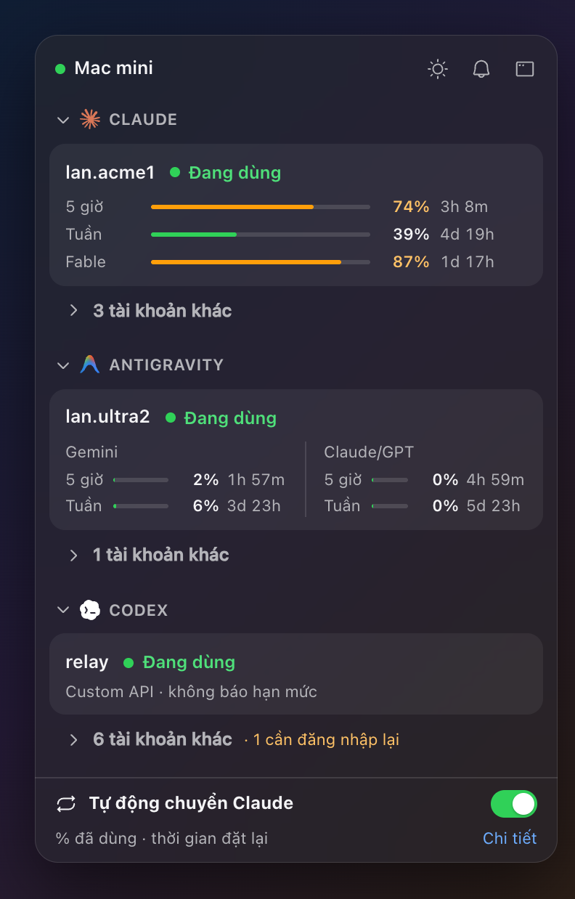
</p>

<p align="center">
  
</p>

Quota Station tự đọc hạn mức ngay trên máy bạn, bằng các bộ đọc chuyển từ
[quota-axi](https://github.com/kunchenguid/quota-axi); không cần chương trình
nào khác để có số. Mọi hình trong trang này dùng dữ liệu thử bịa ra, không bao
giờ là tài khoản thật.

> **Tình trạng.** macOS 13 trở lên. GitHub chưa có bản phát hành nào, nên bạn
> cài [từ mã nguồn](#cài-đặt). Bản Windows đang làm và chưa dùng được.

## Mục lục

- [Ứng dụng làm gì](#ứng-dụng-làm-gì)
- [Riêng tư và an toàn](#riêng-tư-và-an-toàn)
- [Yêu cầu](#yêu-cầu)
- [Cài đặt](#cài-đặt)
- [Cập nhật](#cập-nhật)
- [Gỡ cài đặt](#gỡ-cài-đặt)
- [Tài liệu](#tài-liệu)
- [Điều khoản dịch vụ](#điều-khoản-dịch-vụ)
- [Giấy phép](#giấy-phép)

## Ứng dụng làm gì

### Thanh menu và popover

Thanh menu hiện một đồng hồ nhỏ cùng tài khoản đang dùng và phần trăm đã dùng,
ví dụ `lan.acme1 74%`. Bạn chọn dịch vụ mà nó theo (Claude, Gemini hoặc Codex)
và cửa sổ hạn mức nó hiện (5 giờ, tuần, Fable tuần, hoặc cửa sổ dùng nhiều
nhất). Nhấp trái mở popover: mỗi dịch vụ một phần, mở ra ở tài khoản đang dùng
với mọi cửa sổ hạn mức và giờ đặt lại, các tài khoản khác chỉ cách một lần
nhấp. Thanh chuyển vàng từ 70 % và đỏ từ 90 %. Nhấp phải mở một menu ngắn.

### Cửa sổ chính

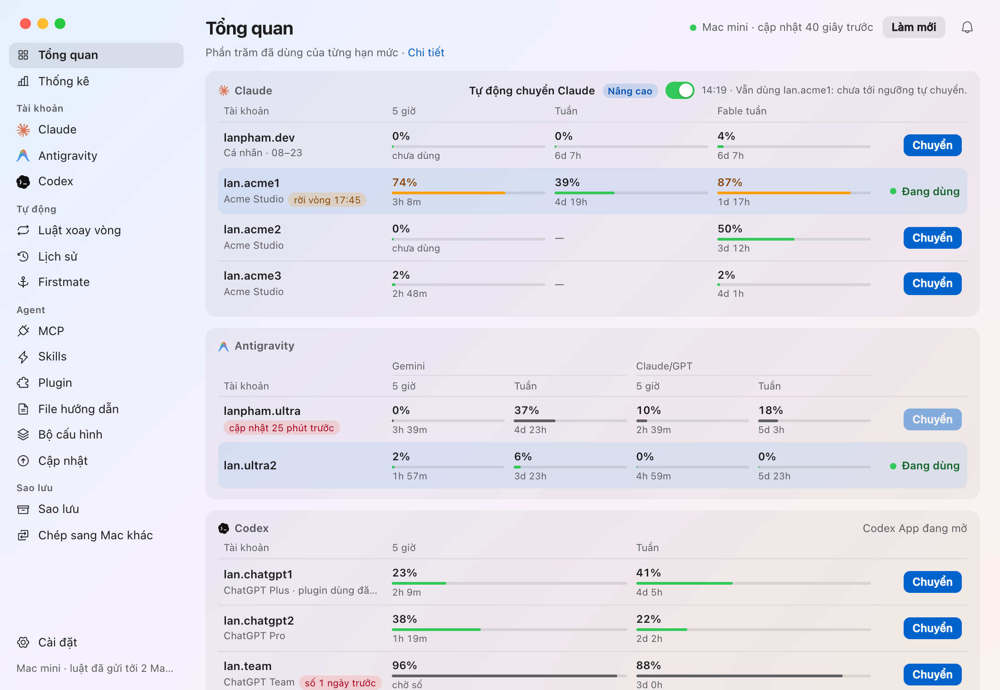

`Tổng quan` gom mọi tài khoản của ba dịch vụ vào một chỗ, với `Chuyển` trên mỗi
tài khoản chưa dùng. Thanh bên chia phần còn lại: `Thống kê`, tài khoản
`Claude`, `Antigravity` và `Codex`, `Lịch sử`, các công cụ cho agent (`MCP`,
`Skills`, `Plugin`, `File hướng dẫn`, `Bộ cấu hình`, `Cập nhật`), `Sao lưu` và
`Cài đặt`. Cái chuông ở góc trên bên phải mỗi trang giữ các thông báo.

### Tài khoản Claude

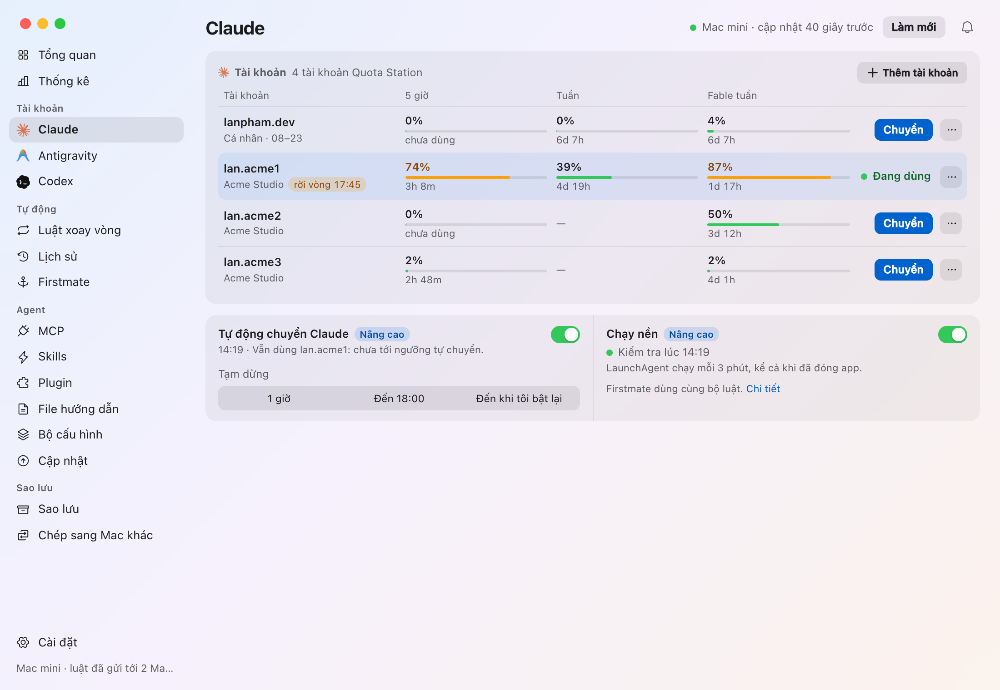

Quota Station tự giữ nhiều tài khoản Claude và tự chuyển Claude Code giữa
chúng: thêm tài khoản bằng cách đăng nhập trong trình duyệt, lấy tài khoản
Claude Code đang đăng nhập, hoặc dán setup-token. Trước khi chuyển, app cho biết
bao nhiêu phiên Claude Code đang chạy sẽ phải dựng lại prompt cache, rồi kiểm
tra lại là đã chuyển xong. Vòng xoay tự động giữa các tài khoản Team, có tạm
dừng, là một trong [các công cụ của tác giả](#dành-cho-máy-của-tác-giả).

### Codex

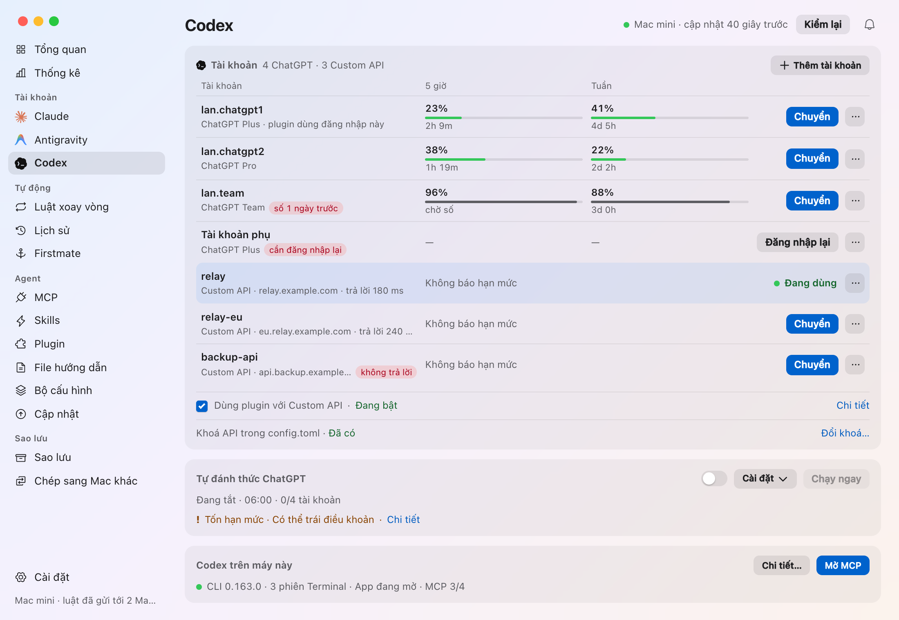

Giữ nhiều tài khoản ChatGPT cho Codex, cùng các nhà cung cấp Custom API trong
`config.toml` của nó, và chuyển qua lại; đăng nhập ChatGPT vẫn ở nguyên chỗ nên
plugin của Codex App vẫn chạy khi đi qua Custom API. Mỗi lần chuyển đều cho xem
trước những gì thay đổi, ghi đúng một file kèm bản lưu, và không bao giờ gửi
đăng nhập của bạn cho nhà cung cấp. `Tự đánh thức ChatGPT` có thể khởi động sớm
cửa sổ 5 giờ của một tài khoản theo lịch bạn đặt.

### Antigravity

Dòng Antigravity hiện hạn mức Gemini và Claude/GPT của tài khoản đang đăng nhập.
Bản dựng có phần tài khoản Antigravity còn đăng nhập được nhiều tài khoản Google
và chuyển tài khoản mà Antigravity.app và `agy` dùng (xem
[Giấy phép](#giấy-phép)).

### MCP server, skill, plugin và file hướng dẫn

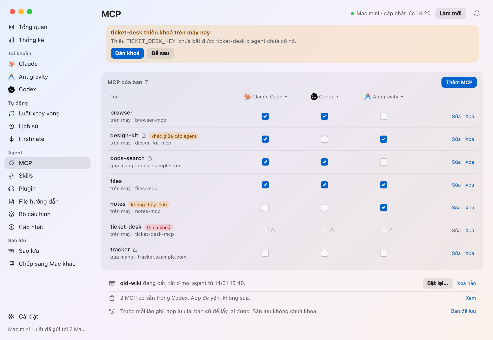

Một bảng cho mọi MCP server của Claude Code, Codex và Antigravity, mỗi agent một
ô đánh dấu. Các thay đổi được gom lại, cho xem trước một lần, ghi một lần kèm
bản lưu, và hoàn tác được. Khoá nằm trong Keychain và không bao giờ hiện ra.

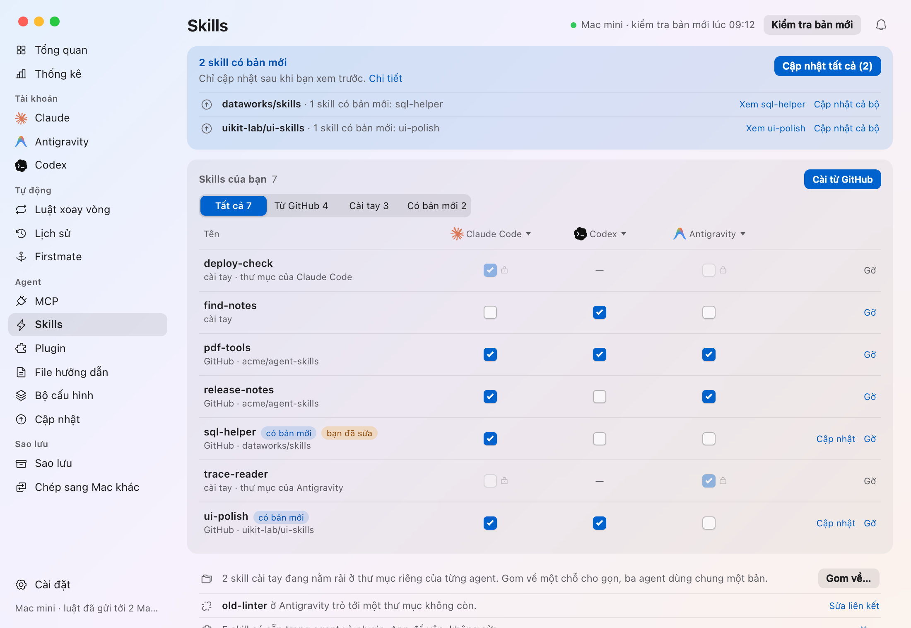

Tab `Skills` làm như vậy cho skill, cài skill từ GitHub và báo khi một skill có
bản mới. `Plugin` liệt kê những gì mỗi agent đã cài, còn `File hướng dẫn` theo
dõi CLAUDE.md, AGENTS.md và GEMINI.md.

### Bộ cấu hình

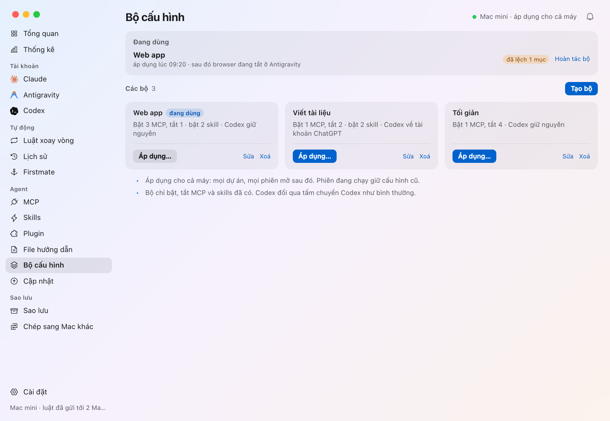

Một bộ bật hoặc tắt một nhóm MCP server và skill đã chọn cho cả máy trong một
lần, sau một lần xem trước, và có thể chuyển cả Codex. App báo khi máy đã lệch
khỏi bộ, và hoàn tác được.

### Sao lưu và khôi phục

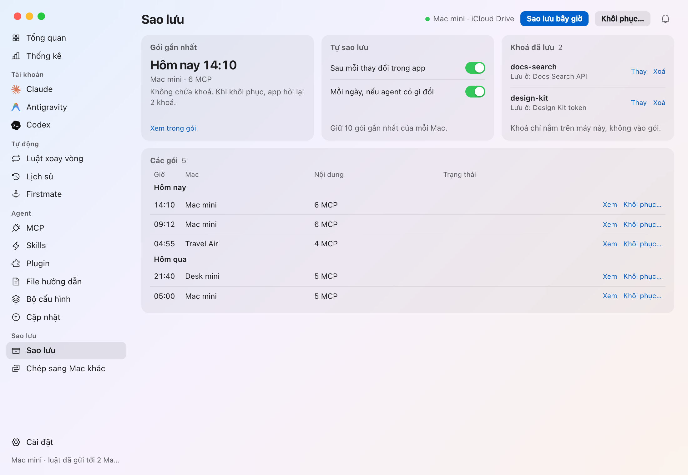

Sao lưu MCP server, skill, plugin và file hướng dẫn lên iCloud Drive (hoặc thư
mục bạn chọn) rồi khôi phục trên bất kỳ máy Mac nào của bạn, từng mục một. Gói
sao lưu không bao giờ chứa khoá: lúc khôi phục app hỏi lại.

### Thống kê

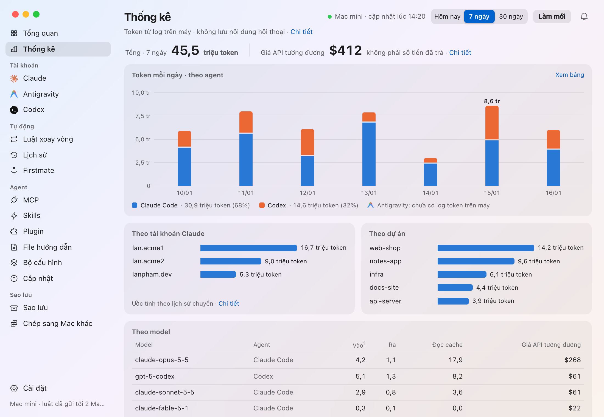

Số token Claude Code và Codex đã dùng trên máy này, đọc từ log phiên của chính
chúng (chỉ đọc con số, không bao giờ đọc nội dung hội thoại): theo ngày hoặc
giờ, theo tài khoản Claude, dự án và model, kèm giá nếu tính theo giá API.

### Cập nhật Agent

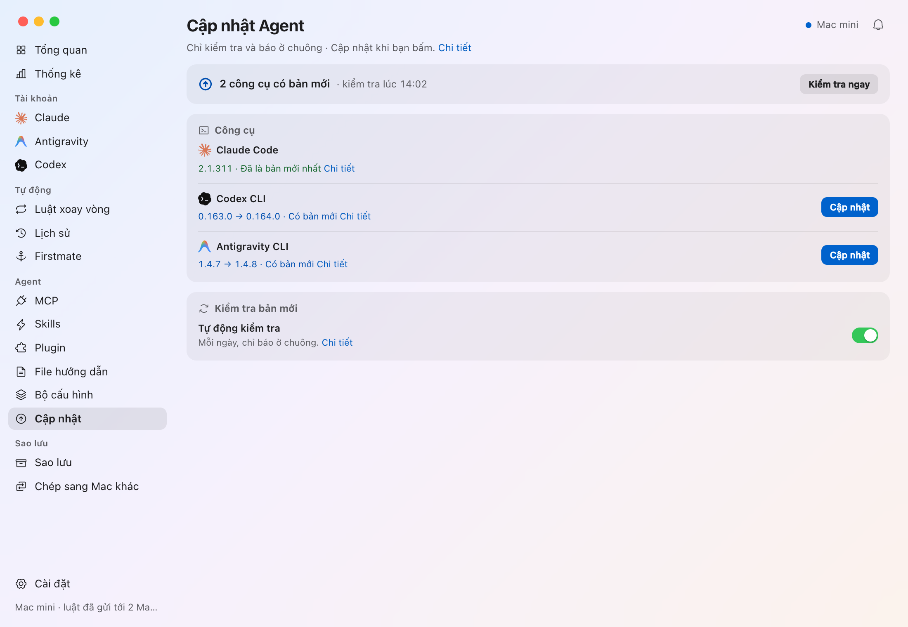

Kiểm tra Claude Code, Codex CLI và Antigravity CLI đã là bản mới nhất chưa, và
chỉ chạy lệnh cập nhật của chính công cụ đó khi bạn bấm `Cập nhật`.

### Thông báo

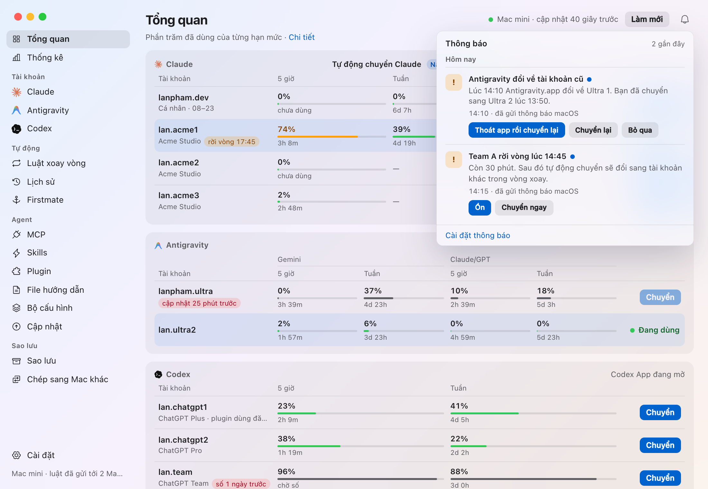

Thông báo khi hạn mức trong vòng xoay sắp cạn, khi một tài khoản cần đăng nhập
lại, khi lần chuyển Antigravity bị ghi đè, khi skill hay công cụ có bản mới, và
khi một biến môi trường (như `ANTHROPIC_API_KEY` trong `~/.zshrc`) đè đăng nhập
của agent. Mỗi thông báo đến một lần, dưới dạng thẻ macOS có nút bấm, và nằm lại
dưới cái chuông.

### Cài đặt, chủ đề và ngôn ngữ

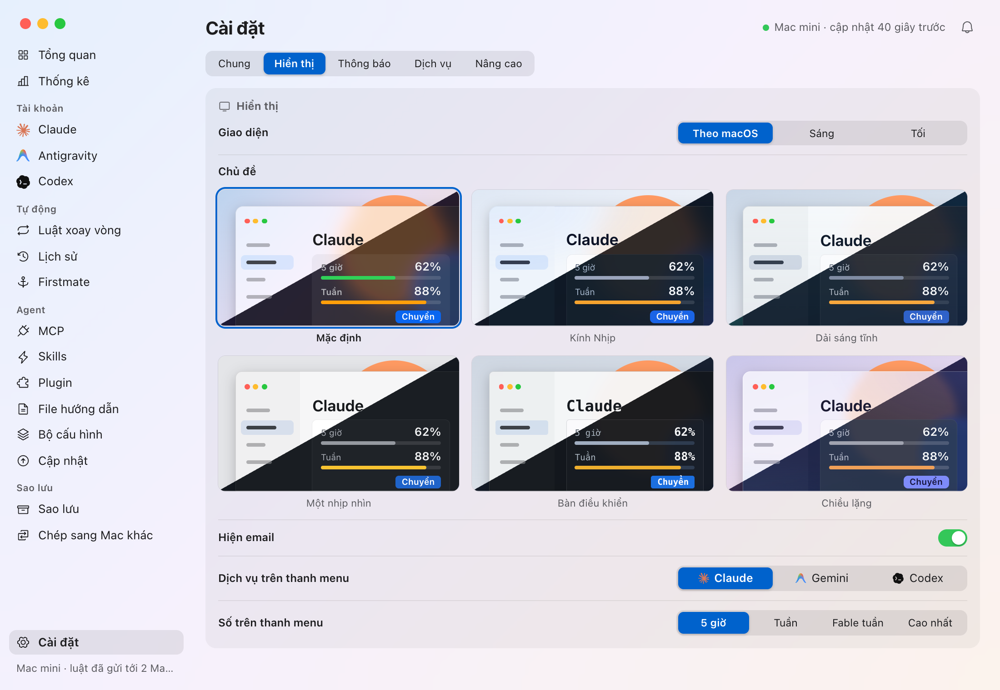

Cài đặt có năm tab: `Chung` (ngôn ngữ, mở khi đăng nhập, thư mục sao lưu, cập
nhật app), `Hiển thị` (sáng hoặc tối, sáu chủ đề, thanh menu), `Thông báo`,
`Dịch vụ` và, ở bản dựng của tác giả, `Nâng cao`. Tắt `Hiện email` thì tài khoản
được gọi theo vị trí hoặc số thứ tự, tiện để chụp màn hình.

### Lần chạy đầu

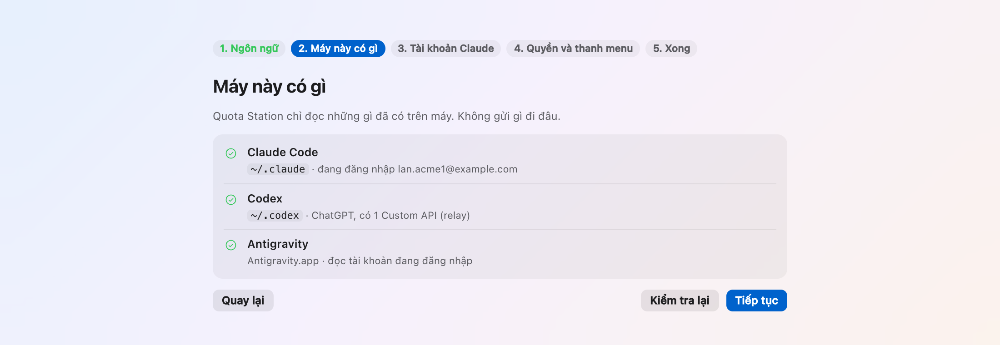

Bản cài mới mở ra một phần thiết lập ngắn: ngôn ngữ, máy này có gì, tài khoản
Claude, quyền và thanh menu, xong.

### Thêm nữa

- **Lịch sử** mọi lần chuyển tài khoản trên máy này.
- **Cập nhật app**: app hỏi GitHub Releases xem có bản mới không và báo cho bạn;
  app không bao giờ tự cài.

### Dành cho máy của tác giả

Một số công cụ làm cho chính các máy Mac của tác giả, chỉ được dựng khi bật
feature `author-tools` (bật trong `scripts/install.sh`, tắt ở bản phát hành),
rồi hiện ra qua `Cài đặt › Nâng cao`: vòng xoay Claude tự động cùng tạm dừng và
trình sửa luật, gửi luật sang các máy Mac khác qua SSH, `Chép sang Mac khác`,
`Firstmate`, và cập nhật từ bản clone mã nguồn.

Mọi phần được mô tả đầy đủ trong [docs/features.md](docs/features.md) (tiếng
Anh, kèm nhãn tiếng Việt).

## Riêng tư và an toàn

- Con số được đọc ngay trên máy bạn, từ endpoint hạn mức của chính từng dịch vụ
  bằng đăng nhập của chính các agent, và không gửi đi đâu khác. Không tài khoản,
  không telemetry, không máy chủ riêng của app.
- Không gì được ghi vào file của agent nếu chưa có bước xem trước hoặc xác nhận,
  mỗi lần ghi đều giữ bản lưu, và một file đã đổi sau lúc xem trước sẽ chặn lần
  ghi.
- Khoá và đăng nhập mà app giữ nằm trong Keychain của macOS (các tài khoản
  ChatGPT phụ nằm trong thư mục chỉ bạn mở được). Khoá không bao giờ hiện trong
  cửa sổ, log hay gói sao lưu, và chỉ sang máy Mac khác khi bạn đánh dấu `Gửi cả
  khoá qua SSH`.

[SECURITY.md](SECURITY.md) có chi tiết, và
[docs/how-it-works.md](docs/how-it-works.md) liệt kê mọi thứ app đọc, chạy và
ghi (tiếng Anh).

## Yêu cầu

- macOS 13 trở lên.
- Để dựng app: Rust stable (1.85 trở lên) và Node.js 20 trở lên. Máy không có
  chúng vẫn cài được bản dựng trên một máy Mac khác.
- Để có số, không cần gì thêm: Codex, `agy` hoặc Antigravity.app, và Claude Code
  chỉ cần đã đăng nhập. Không cần quota-axi.
- Để đăng nhập tài khoản Claude mới, và cho `quota-station claude run`: lệnh
  `claude` của Claude Code.
- Để đăng nhập tài khoản Antigravity (bản dựng có phần tài khoản Antigravity):
  [file OAuth client](docs/how-it-works.md#the-oauth-client-file).
- Cho các công cụ của tác giả cần tới máy Mac khác: một SSH alias tới từng máy,
  đăng nhập không cần hỏi (dùng khoá, `BatchMode=yes`).

## Cài đặt

Từ một bản clone, trên máy Mac có Rust và Node.js:

```sh
git clone https://github.com/shin315/quota-station.git
cd quota-station
scripts/install.sh
```

Script dựng app, ký (bằng định danh `Apple Development` của bạn, hoặc ad-hoc),
chép vào `/Applications/Quota Station.app` và mở lên. Script không bao giờ thêm
mục đăng nhập và không bao giờ đòi `sudo`. Nó dựng kèm phần tài khoản
Antigravity và các công cụ của tác giả; `QS_ANTIGRAVITY_ACCOUNTS=0` hoặc
`QS_AUTHOR_TOOLS=0` bỏ bớt một phần. `scripts/install.sh --help` liệt kê các
tuỳ chọn.

Trên máy không dựng được, hãy tạo gói trên một máy dựng được rồi chép sang:

```sh
scripts/install.sh --package ~/Desktop          # ghi ra quota-station-<version>.zip
# trên máy kia, nơi file zip được chép tới:
ditto -x -k quota-station-0.1.0.zip . && ./quota-station-0.1.0/install.sh --app "./quota-station-0.1.0/Quota Station.app"
```

Sau đó, trên máy đăng nhập tài khoản Antigravity, đặt
[file OAuth client](docs/how-it-works.md#the-oauth-client-file) vào chỗ, và bật
`Cài đặt › Chung › Mở khi đăng nhập` nếu muốn app chạy cùng máy.

Đang chuyển từ claude-swap hoặc Cockpit Tools? Làm theo
[docs/cutover.md](docs/cutover.md).

## Cập nhật

Từ Terminal, trong thư mục clone:

```sh
git pull --ff-only && scripts/install.sh
```

Ở bản dựng có các công cụ của tác giả, `Cài đặt › Nâng cao` làm được việc này:
đặt `Mã nguồn` là thư mục clone rồi bấm `Cập nhật`. App kéo mã mới, dựng và cài
khi bản clone có commit mới, rồi đề nghị `Mở lại`; bản clone có commit riêng
không bao giờ bị merge hay reset, và lần dựng quá 30 phút thì dừng.

## Gỡ cài đặt

1. Trong `Cài đặt › Chung`, tắt `Mở khi đăng nhập` (hoặc bỏ Quota Station trong
   System Settings › General › Login Items). Nếu app đang chạy vòng xoay Claude,
   tắt nó trong tab `Claude` (hoặc chạy `quota-station claude rotation off`), và
   bật lại bộ tự chuyển cũ trước nếu Claude vẫn cần xoay vòng
   ([docs/cutover.md](docs/cutover.md)).
2. Thoát Quota Station từ menu của nó, rồi kéo
   `/Applications/Quota Station.app` vào Thùng rác.
3. Tuỳ chọn, xoá dữ liệu của app:
   `~/Library/Application Support/com.shin315.quota-station/` (cài đặt, thư mục
   tài khoản Claude, chỉ mục và số đọc Antigravity, lịch sử, thông báo và
   `oauth-client.json`), và các mục Keychain riêng của app, service
   `com.shin315.quota-station.claude` và
   `com.shin315.quota-station.antigravity`, trong Keychain Access. Xoá các tài
   khoản Claude trong app (trừ tài khoản đang dùng) để xoá mục của chúng; Claude
   Code vẫn giữ đăng nhập của nó. Đăng xuất các tài khoản Antigravity trong app
   trước để xoá các mục đó. Đừng đụng vào mục `gemini`/`antigravity`:
   Antigravity.app và agy dùng nó.

Cờ tạm dừng và file luật xoay vòng thuộc về bộ tự chuyển, nên vẫn ở lại.

## Tài liệu

Các trang trong `docs/` viết bằng tiếng Anh.

| Trang | Nội dung |
|---|---|
| [docs/features.md](docs/features.md) | Mọi phần của app, đầy đủ |
| [docs/how-it-works.md](docs/how-it-works.md) | Các bộ đọc hạn mức, tài khoản Claude và Antigravity, dòng lệnh, những gì app đọc, chạy và ghi, file OAuth client |
| [docs/cutover.md](docs/cutover.md) | Chuyển một máy Mac khỏi claude-swap và Cockpit Tools |
| [docs/development.md](docs/development.md) | Dựng app, các feature khi dựng, bản xem trước trên trình duyệt, kiểm thử, cấu trúc mã |
| [docs/claude-accounts.md](docs/claude-accounts.md) | Thiết kế phần tài khoản Claude |
| [docs/themes.md](docs/themes.md) | Sáu chủ đề |
| [docs/ui-guidelines.md](docs/ui-guidelines.md) | Cách viết chữ trên giao diện, tiếng Việt và tiếng Anh |
| [docs/brand-icons.md](docs/brand-icons.md) | Biểu tượng app và thanh menu |
| [SECURITY.md](SECURITY.md) | Khoá, token, những gì không bao giờ đọc, và cách báo lỗi bảo mật |

## Điều khoản dịch vụ

Đăng nhập tài khoản Antigravity bằng OAuth client của chính Antigravity, và đọc
hạn mức theo cách Antigravity đọc, mang cùng rủi ro về điều khoản dịch vụ như
khi dùng Cockpit Tools, không hơn: app gọi đúng những lệnh đó, cùng user agent
và header, không dày hơn. `Tự đánh thức ChatGPT` gửi yêu cầu theo lịch, điều mà
điều khoản của OpenAI không nói tới: chỉ dùng với tài khoản của chính bạn.
[SECURITY.md](SECURITY.md) nói điều gì có thể xảy ra và thay đổi nào sẽ làm rủi
ro lớn hơn.

## Giấy phép

Copyright © 2026 Shin315.

Quota Station theo [giấy phép MIT](LICENSE), trừ:

- **Phần tài khoản Antigravity** (đăng nhập nhiều tài khoản Antigravity, đọc
  hạn mức của chúng và chuyển giữa chúng) dựa một phần trên
  [Cockpit Tools](https://github.com/jlcodes99/cockpit-tools) và theo giấy phép
  [Creative Commons Attribution-NonCommercial-ShareAlike 4.0 International](https://creativecommons.org/licenses/by-nc-sa/4.0/)
  ([`LICENSES/CC-BY-NC-SA-4.0.txt`](LICENSES/CC-BY-NC-SA-4.0.txt)): chỉ dùng cá
  nhân, phi thương mại. Đó là `crates/quota-station-core/src/antigravity/`,
  `src-tauri/src/{antigravity,agy_quota,agy_switch}.rs`, `src/antigravity/`,
  cùng các bài kiểm thử và fixture của chúng, như [`NOTICE`](NOTICE) liệt kê.
  Chúng chỉ được biên dịch khi bật Cargo feature `antigravity-accounts` và chỉ
  được gói vào giao diện khi có `QS_ANTIGRAVITY_ACCOUNTS=1`; `scripts/install.sh`
  bật cả hai, còn `cargo tauri build` và `npm run app` bỏ chúng ra nếu không được
  yêu cầu. App dựng không có chúng chỉ theo MIT: nó đọc tài khoản Antigravity
  đang đăng nhập, không đăng nhập hay chuyển tài khoản.
- **Phông Inter** (`src/assets/fonts/InterVariable-vi.woff2`) theo
  [SIL Open Font License 1.1](LICENSES/OFL-1.1.txt).

Mỗi file ghi giấy phép của nó trong một dòng `SPDX-License-Identifier` hoặc
trong [`REUSE.toml`](REUSE.toml), và CI kiểm tra bằng `reuse lint`. Mã chuyển
thể từ Cockpit Tools, mã chuyển từ quota-axi (MIT) và CC Switch (MIT), và mã
chuyển thể từ claude-swap (MIT) và shadcn/ui (MIT) được ghi công trong
[`NOTICE`](NOTICE). Các công cụ app làm việc cùng, cùng biểu tượng, logo và
phông chữ đi kèm app, được liệt kê trong [`THIRD_PARTY.md`](THIRD_PARTY.md).
