# Quota Station

[English](README.md) · **Tiếng Việt**

Ứng dụng trên thanh menu macOS và khay hệ thống Windows cho biết hạn mức
Claude Code, Codex và Antigravity của bạn đã dùng bao nhiêu, chuyển qua lại
giữa các tài khoản, và giữ gọn MCP server, skill cùng file hướng dẫn của các
agent. Khi có từ hai tài khoản Claude trở lên, app tự chuyển Claude Code sang
tài khoản khác lúc tài khoản đang dùng hết quota, trong khi các phiên Claude
Code đang mở vẫn chạy tiếp. Giao diện có tiếng Việt và tiếng Anh.

<p align="center">
  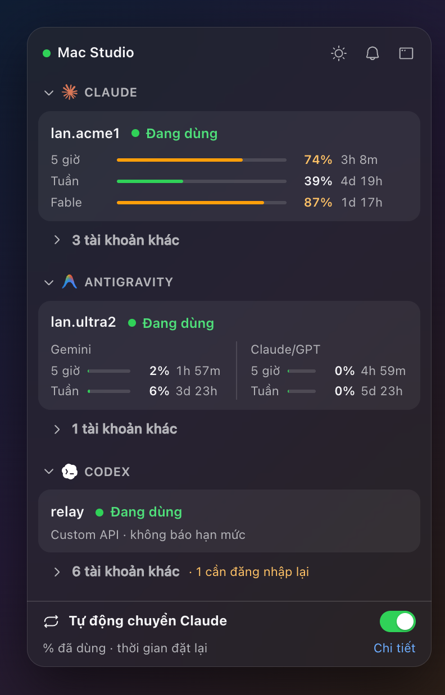
</p>

<p align="center">
  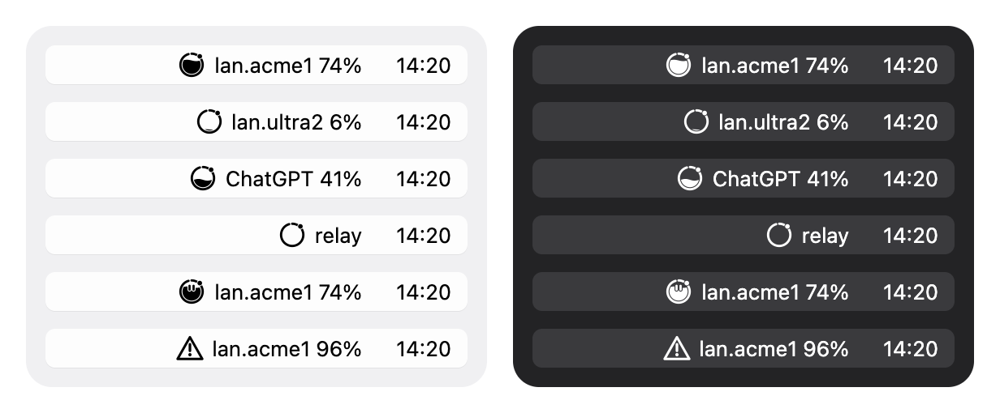
</p>

Quota Station tự đọc hạn mức ngay trên máy tính của bạn; không cần cài thêm
chương trình nào khác.

Mọi hình trên trang này đều dùng dữ liệu thử nghiệm giả lập, không bao giờ dùng
tài khoản thật.

> **Tình trạng.** Dành cho macOS 13 trở lên và Windows 10 hoặc 11 (x64). Tải
> về từ [Releases](https://github.com/shin315/quota-station/releases/latest);
> xem hướng dẫn ở mục [Cài đặt](#cài-đặt).

## Mục lục

- [Ứng dụng làm gì](#ứng-dụng-làm-gì)
  ([Tự chuyển khi hết quota](#tự-chuyển-khi-hết-quota))
- [Riêng tư và an toàn](#riêng-tư-và-an-toàn)
- [Yêu cầu](#yêu-cầu)
- [Cài đặt](#cài-đặt)
- [Cập nhật](#cập-nhật)
- [Gỡ cài đặt](#gỡ-cài-đặt)
- [Tài liệu](#tài-liệu)
- [Điều khoản dịch vụ](#điều-khoản-dịch-vụ)

## Ứng dụng làm gì

### Tự chuyển khi hết quota

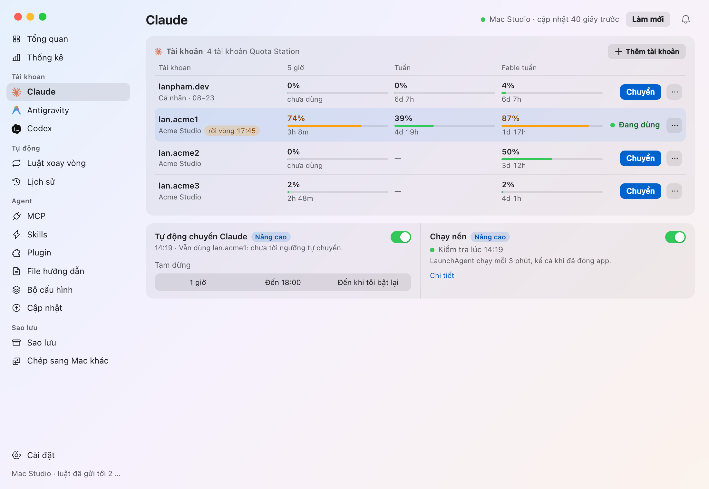

Nhiều người giữ hai ba tài khoản Claude (Pro, Max hay Team) và phải đăng xuất
rồi đăng nhập lại mỗi khi tài khoản đang dùng hết quota. Quota Station làm việc
đó thay bạn: bật `Tự chuyển khi hết quota` ở tab `Claude` hoặc ở chân popover,
và khi tài khoản đang dùng đạt 90% ở cửa sổ 5 giờ hoặc tuần, Claude Code sẽ
được chuyển sang tài khoản còn nhiều quota nhất ở cửa sổ đó. Tài khoản cần đăng
nhập lại hoặc cũng sắp cạn sẽ được bỏ qua; nếu không còn tài khoản nào khả dụng
thì app giữ nguyên tài khoản đang dùng và báo cho bạn. Phiên Claude Code đang
chạy vẫn chạy tiếp, chỉ dựng lại prompt cache một lần.

App kiểm tra mỗi 3 phút (trên Mac bằng LaunchAgent nên chạy cả khi đã đóng app;
trên Windows bằng bộ hẹn giờ trong app), gửi thông báo sau mỗi lần chuyển, và
có nút `Tạm dừng` (1 giờ, đến 18:00, hoặc đến khi bạn bật lại). Khi chuyển tay,
bạn có thể giữ cố định tài khoản mới một lúc. Ngưỡng chuyển nằm ở
`Cài đặt › Dịch vụ`. Tính năng này mặc định tắt khi mới cài và hiện ra ngay khi
có từ hai tài khoản trở lên.

### Thanh menu và popover

Thanh menu hiện một đồng hồ nhỏ cùng tài khoản đang dùng và phần trăm đã dùng,
ví dụ `lan.acme1 74%`. Bạn chọn dịch vụ cần theo dõi (Claude, Gemini hoặc
Codex) và cửa sổ hạn mức muốn hiển thị (5 giờ, tuần, Fable tuần, hoặc cửa sổ đã
dùng nhiều nhất). Nhấp trái mở popover: mỗi dịch vụ một mục, mở sẵn ở tài khoản
đang dùng với mọi cửa sổ hạn mức và thời gian đặt lại; các tài khoản khác chỉ
cách một cú nhấp chuột. Thanh hạn mức chuyển vàng từ 70% và đỏ từ 90%. Nhấp
phải mở một menu ngắn.

### Cửa sổ chính

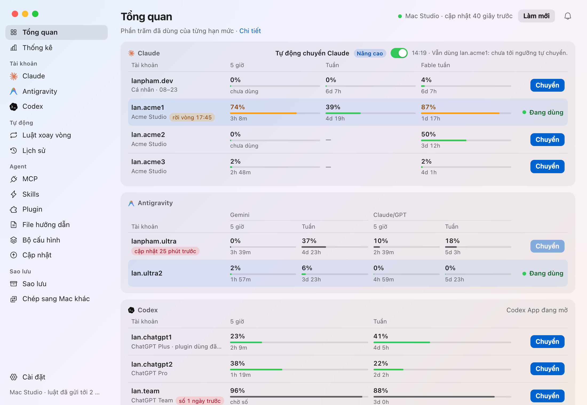

`Tổng quan` gom mọi tài khoản của ba dịch vụ vào một chỗ, với nút `Chuyển` trên
mỗi tài khoản đang không dùng. Thanh bên chia phần còn lại: `Thống kê`, tài
khoản `Claude`, `Antigravity` và `Codex`, `Lịch sử`, các công cụ cho agent
(`MCP`, `Skills`, `Plugin`, `File hướng dẫn`, `Bộ cấu hình`, `Cập nhật`),
`Sao lưu` và `Cài đặt`. Biểu tượng chuông ở góc trên bên phải mỗi trang lưu lại
các thông báo.

### Tài khoản Claude

Quota Station lưu được nhiều tài khoản Claude và trực tiếp chuyển Claude Code
giữa các tài khoản đó: thêm tài khoản bằng cách đăng nhập trong trình duyệt,
lấy tài khoản Claude Code đang đăng nhập, hoặc dán setup-token. Trước khi
chuyển, app cho biết có bao nhiêu phiên Claude Code đang chạy sẽ phải dựng lại
prompt cache, rồi kiểm tra lại để chắc chắn đã chuyển xong.

Tính năng tự động chuyển là
[Tự chuyển khi hết quota](#tự-chuyển-khi-hết-quota), dùng được cho mọi loại tài
khoản. Việc đặt luật xoay vòng riêng (sắp thứ tự các tài khoản Team, chỉ dùng
tài khoản cá nhân trong khung giờ cố định, hẹn ngày rời vòng cho tài khoản) nằm
trong [các công cụ nâng cao](#nâng-cao).

### Codex

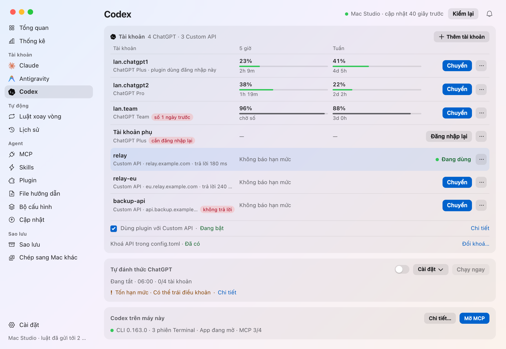

Lưu nhiều tài khoản ChatGPT cho Codex, cùng các nhà cung cấp Custom API trong
`config.toml` của nó, và chuyển qua lại; phiên đăng nhập ChatGPT vẫn giữ nguyên
nên plugin của Codex App vẫn chạy khi đi qua Custom API. Mỗi lần chuyển đều cho
xem trước những gì thay đổi, ghi đúng một file kèm bản sao lưu, và không bao
giờ gửi thông tin đăng nhập của bạn cho nhà cung cấp. `Tự đánh thức ChatGPT` có
thể mở sớm cửa sổ 5 giờ của một tài khoản theo lịch bạn đặt.

### Antigravity

Dòng Antigravity hiện hạn mức Gemini và Claude/GPT của tài khoản đang đăng nhập.
App còn đăng nhập được nhiều tài khoản Google và chuyển tài khoản mà
Antigravity.app và `agy` dùng: bản tải về và bản dựng từ mã nguồn bằng
`scripts/install.sh` đều có phần tài khoản Antigravity này, chỉ khi đặt
`QS_ANTIGRAVITY_ACCOUNTS=0` mới bỏ phần đó ra.

### MCP server, skill, plugin và file hướng dẫn

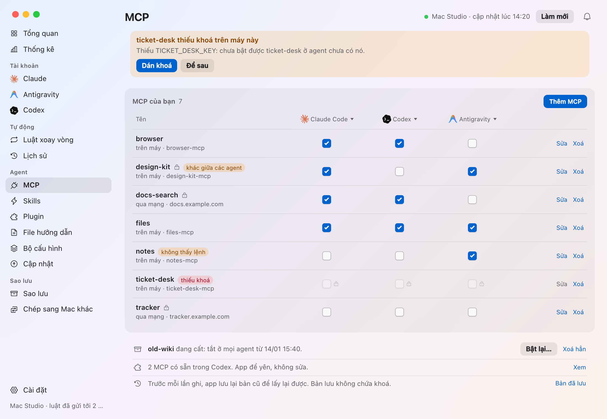

Một bảng chung cho mọi MCP server của Claude Code, Codex và Antigravity, mỗi
agent một ô đánh dấu. Các thay đổi được gom lại, cho xem trước một lần, ghi một
lần kèm bản sao lưu, và hoàn tác được. Khoá nằm trong Keychain và không bao giờ
hiện ra.

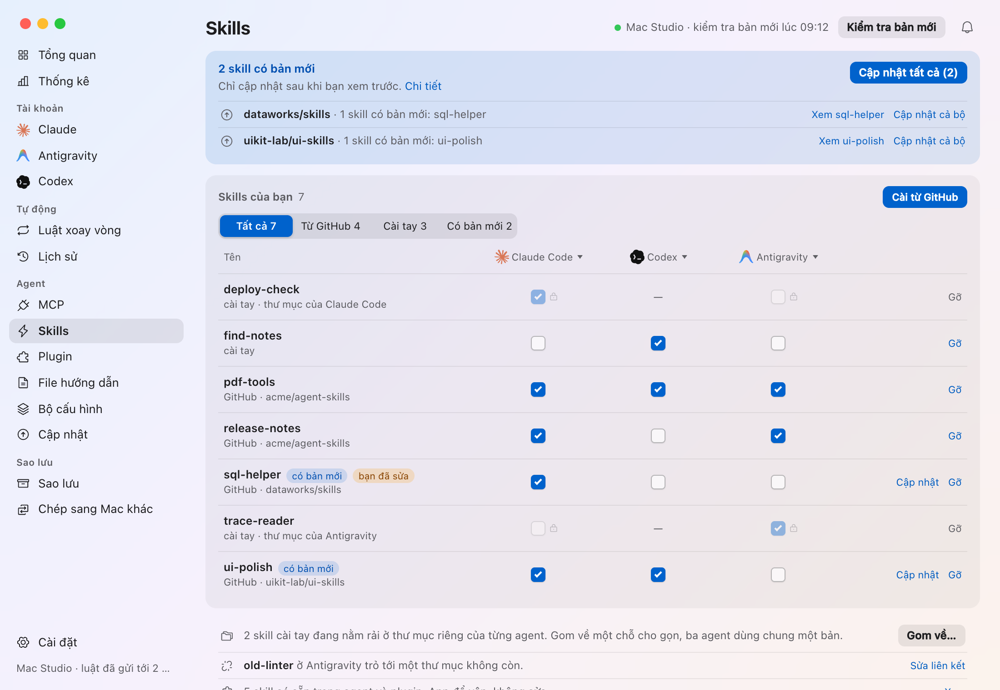

Tab `Skills` làm tương tự cho skill, hỗ trợ cài skill từ GitHub và báo khi một
skill có bản mới. `Plugin` liệt kê những gì mỗi agent đã cài, còn
`File hướng dẫn` theo dõi CLAUDE.md, AGENTS.md và GEMINI.md.

### Bộ cấu hình

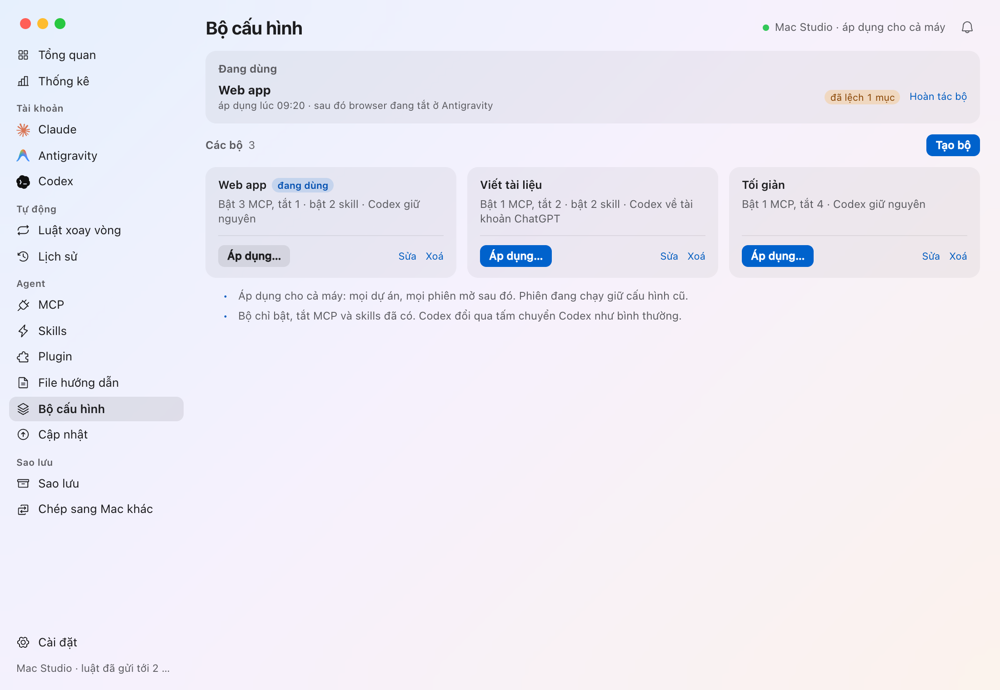

Một bộ cấu hình bật hoặc tắt nhóm MCP server và skill đã chọn cho toàn máy chỉ
trong một lần thao tác, sau khi xem trước, và có thể chuyển luôn cả Codex. App
báo khi cấu hình trên máy lệch khỏi bộ đang dùng, và thao tác áp dụng có thể
hoàn tác.

### Sao lưu và khôi phục

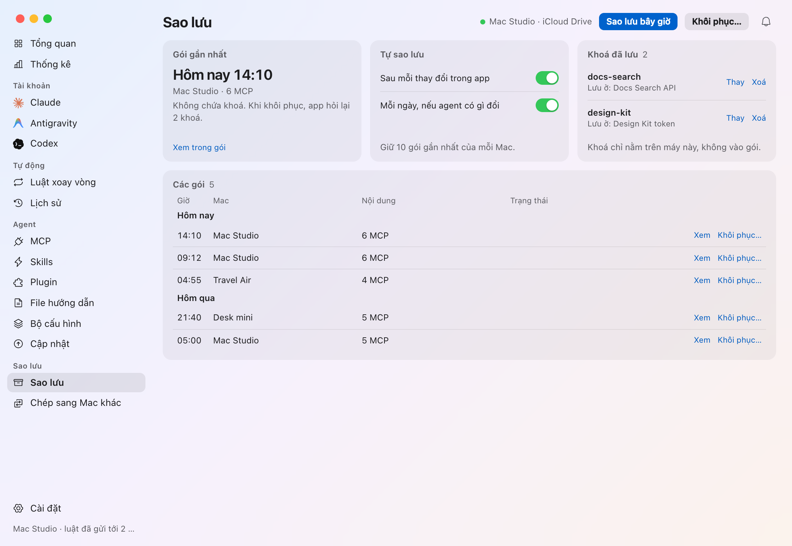

Sao lưu MCP server, skill, plugin và file hướng dẫn lên iCloud Drive (hoặc thư
mục bạn chọn) rồi khôi phục trên bất kỳ máy Mac nào của bạn, từng mục một. Gói
sao lưu không bao giờ chứa khoá: lúc khôi phục app sẽ hỏi lại.

### Thống kê

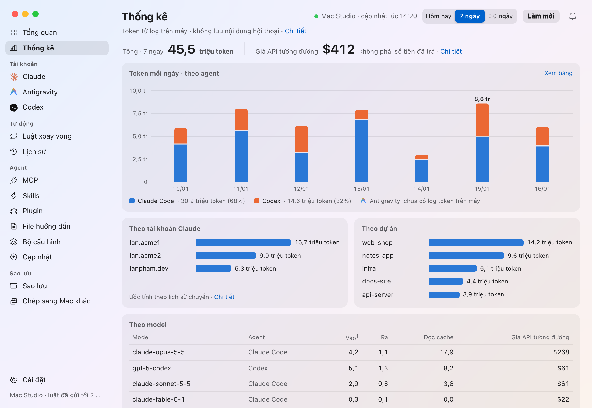

Số token Claude Code và Codex đã dùng trên máy này, đọc từ log phiên của chính
chúng (chỉ đếm số lượng token, không bao giờ đọc nội dung hội thoại): theo ngày
hoặc giờ, theo tài khoản Claude, dự án và model, kèm chi phí tương đương nếu
tính theo giá API.

### Cập nhật Agent

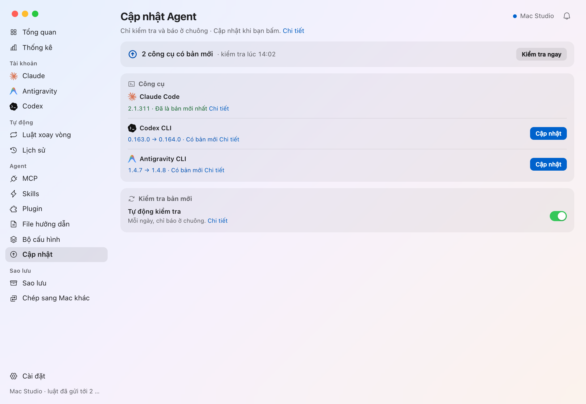

Kiểm tra xem Claude Code, Codex CLI và Antigravity CLI đã ở bản mới nhất chưa,
và chỉ chạy lệnh cập nhật của chính công cụ đó khi bạn bấm `Cập nhật`.

### Thông báo

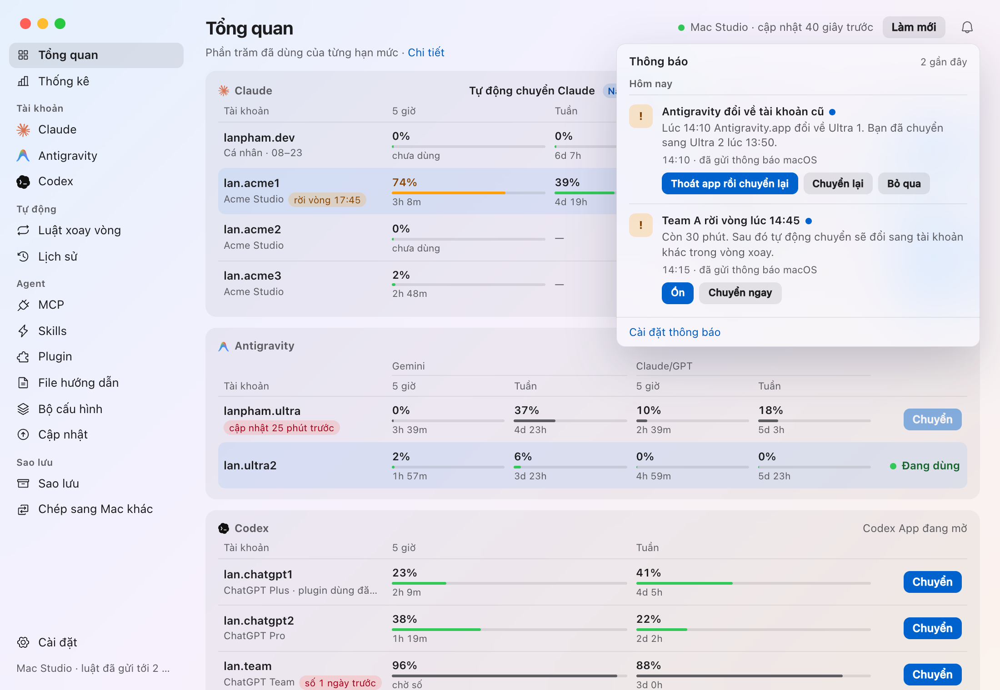

App gửi thông báo khi hạn mức Claude sắp cạn, khi `Tự chuyển khi hết quota` vừa
đổi tài khoản Claude, khi một tài khoản cần đăng nhập lại, khi lần chuyển
Antigravity bị ghi đè, khi skill hay công cụ có bản mới, hoặc khi một biến môi
trường (như `ANTHROPIC_API_KEY` trong `~/.zshrc`) đè đăng nhập của agent. Mỗi
thông báo chỉ gửi một lần dưới dạng thông báo macOS có nút bấm, và lưu lại ở
chuông thông báo.

### Cài đặt, chủ đề và ngôn ngữ

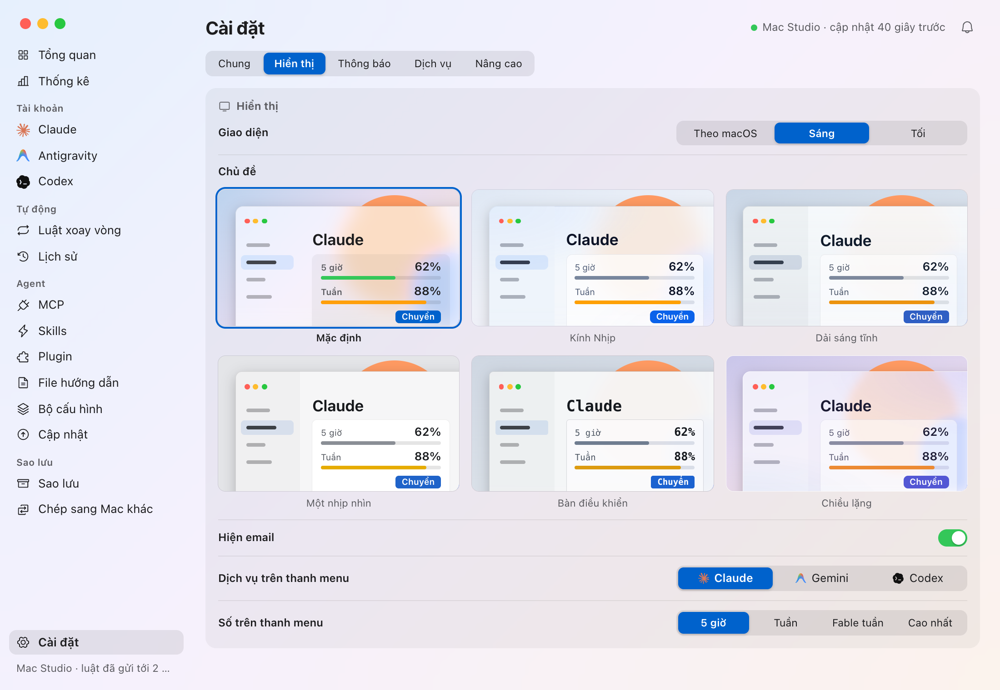

Cài đặt gồm `Chung` (ngôn ngữ, mở khi đăng nhập, thư mục sao lưu, cập nhật
app), `Hiển thị` (sáng hoặc tối, sáu chủ đề, thanh menu), `Thông báo` và
`Dịch vụ`. Khi tắt `Hiện email`, tài khoản được gọi theo vị trí hoặc số thứ tự,
tiện để chụp màn hình.

Cài đặt còn có `Nâng cao`, nơi bật [các công cụ nâng cao](#nâng-cao).

### Lần chạy đầu

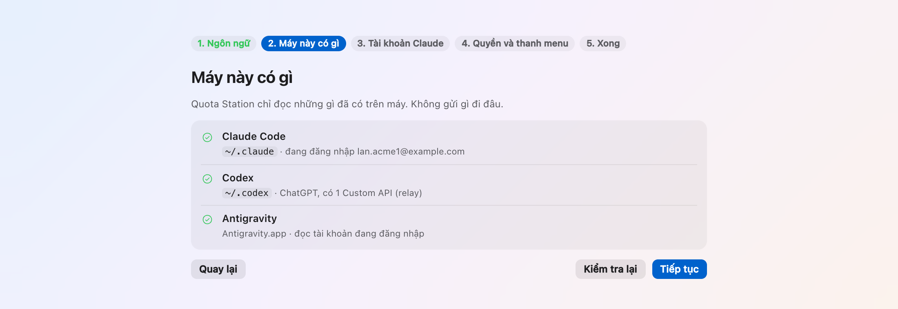

Khi mới cài, app mở qua vài bước thiết lập ngắn: ngôn ngữ, máy này có gì, tài
khoản Claude, quyền và thanh menu, xong.

### Thêm nữa

- **Lịch sử** mọi lần chuyển tài khoản trên máy này.
- **Cập nhật app**: app kiểm tra GitHub Releases xem có bản mới không và báo
  cho bạn; app không bao giờ tự cài.

### Nâng cao

`Cài đặt › Nâng cao › Hiện phần nâng cao` (mặc định tắt khi mới cài) mở thêm
trình sửa luật xoay vòng (sắp thứ tự các tài khoản Team, khung giờ dùng tài
khoản cá nhân, ngày rời vòng, khởi tạo sớm cửa sổ 5 giờ)—thay cho ngưỡng của
[Tự chuyển khi hết quota](#tự-chuyển-khi-hết-quota) một khi đã lưu luật—cùng
chi tiết chạy nền của vòng xoay, gửi luật sang các máy Mac khác qua SSH,
`Chép sang Mac khác`, và cập nhật từ bản clone mã nguồn.

Mọi phần được mô tả đầy đủ trong [docs/features.md](docs/features.md) (tiếng
Anh, kèm nhãn tiếng Việt).

## Riêng tư và an toàn

- Dữ liệu hạn mức được đọc ngay trên máy bạn, từ endpoint hạn mức của từng dịch
  vụ bằng chính phiên đăng nhập của các agent, và không gửi đi đâu khác. Không
  cần tài khoản riêng, không telemetry, không máy chủ riêng của app.
- Không gì được ghi vào file của agent khi chưa qua bước xem trước hoặc xác
  nhận; mỗi lần ghi đều giữ bản sao lưu, và nếu file bị thay đổi sau bước xem
  trước thì việc ghi sẽ dừng lại.
- Khoá và thông tin đăng nhập mà app giữ đều nằm trong Keychain của macOS (các
  tài khoản ChatGPT phụ nằm trong thư mục riêng chỉ bạn mở được). Khoá không bao
  giờ hiện trong cửa sổ, log hay gói sao lưu.
  Khoá chỉ được gửi sang máy Mac khác khi bạn đánh dấu `Gửi cả khoá qua SSH`.

[SECURITY.md](SECURITY.md) có chi tiết, và
[docs/how-it-works.md](docs/how-it-works.md) liệt kê mọi thứ app đọc, chạy và
ghi (tiếng Anh).

## Yêu cầu

- macOS 13 trở lên (Apple Silicon hoặc Intel), hoặc Windows 10 hay 11 trên x64.
- Để dựng từ mã nguồn: Rust stable (1.85 trở lên) và Node.js 20 trở lên. Bản
  tải về không cần cả hai, và máy Mac không có chúng vẫn cài được bản dựng từ
  một máy Mac khác.
- Để đọc hạn mức, không cần gì thêm: Codex, `agy` hoặc Antigravity.app, và
  Claude Code chỉ cần đã đăng nhập.
- Để đăng nhập tài khoản Claude mới, và cho `quota-station claude run`: lệnh
  `claude` của Claude Code.
- Để đăng nhập tài khoản Antigravity (bản tải về và bản dựng bằng
  `scripts/install.sh` đều có; `QS_ANTIGRAVITY_ACCOUNTS=0` bỏ phần đó ra):
  [file OAuth client](docs/how-it-works.md#the-oauth-client-file), do bạn tự
  tạo với mã và khoá bí mật của OAuth client Antigravity—trên Mac tại
  `~/Library/Application Support/com.shin315.quota-station/oauth-client.json`
  (quyền 600), trên Windows tại
  `%APPDATA%\com.shin315.quota-station\oauth-client.json` (trong hướng dẫn có
  lệnh PowerShell để tạo file).
- Với các công cụ nâng cao kết nối tới máy Mac khác: cần một SSH alias tới từng
  máy, đăng nhập thẳng không hỏi mật khẩu (dùng khoá, `BatchMode=yes`).

## Cài đặt

Tải app từ
[bản phát hành mới nhất](https://github.com/shin315/quota-station/releases/latest):
file DMG cho macOS, hoặc bộ cài cho Windows. Dựng từ mã nguồn chỉ dành cho
macOS.

### macOS

Tải `Quota.Station_<version>_universal.dmg`, mở ra rồi kéo `Quota Station` vào
`Applications`. Cùng một file DMG chạy được trên cả Apple Silicon lẫn Intel. App
đã được ký bằng Developer ID và được Apple notarize, nên lần mở đầu macOS chỉ
hỏi câu quen thuộc về ứng dụng tải từ Internet: chọn `Mở` (`Open`).

Cài bằng Homebrew: `brew install --cask shin315/tap/quota-station` (cập nhật
bằng `brew upgrade --cask quota-station`).

### Windows

Tải `Quota.Station_<version>_x64-setup.exe` rồi chạy. Bộ cài chưa được ký, nên
Windows sẽ cảnh báo:

1. Trình duyệt có thể báo file này ít được tải: chọn `Giữ lại` (`Keep`) (trong
   Edge, mở menu `…` cạnh file tải về; nếu trình duyệt hỏi thêm lần nữa, chọn
   `Vẫn giữ lại` / `Keep anyway`).
2. SmartScreen báo "Windows protected your PC": bấm `Thông tin thêm`
   (`More info`), rồi `Vẫn chạy` (`Run anyway`).

Bộ cài chỉ cài cho tài khoản người dùng Windows hiện tại và không cần quyền
quản trị. Sau đó Quota Station nằm ở khay hệ thống bên phải thanh tác vụ; lúc
đầu Windows có thể giấu biểu tượng dưới mũi tên `^`, bạn có thể kéo nó ra thanh
tác vụ.

Để kiểm tra bộ cài đúng là bản đã phát hành, tải `SHA256SUMS.txt` từ cùng bản
phát hành về chung thư mục, rồi chạy trong PowerShell tại thư mục đó:

```powershell
$sum = (Select-String '_x64-setup.exe' .\SHA256SUMS.txt).Line.Split(' ')[0]
(Get-FileHash .\Quota.Station_<version>_x64-setup.exe).Hash -eq $sum
```

Kết quả `True` là khớp. Các mã băm này cũng nằm ở cuối phần ghi chú phát hành.

### Từ mã nguồn (macOS)

Từ một bản clone, trên máy Mac có Rust và Node.js:

```sh
git clone https://github.com/shin315/quota-station.git
cd quota-station
scripts/install.sh
```

Script dựng app, ký (bằng định danh `Apple Development` của bạn, hoặc ad-hoc),
chép vào `/Applications/Quota Station.app` và mở lên. Script không bao giờ tự
thêm mục mở khi đăng nhập và không bao giờ đòi `sudo`. Bản dựng mặc định có
phần tài khoản Antigravity; đặt `QS_ANTIGRAVITY_ACCOUNTS=0` để bỏ phần đó ra.
`scripts/install.sh --help` liệt kê các tuỳ chọn.

Trên máy Mac không dựng được, hãy tạo gói trên một máy dựng được rồi chép sang:

```sh
scripts/install.sh --package ~/Desktop          # ghi ra quota-station-<version>.zip
# trên máy kia, nơi file zip được chép tới:
ditto -x -k quota-station-<version>.zip . && ./quota-station-<version>/install.sh --app "./quota-station-<version>/Quota Station.app"
```

### Sau khi cài

Trên máy Mac hoặc PC cần đăng nhập tài khoản Antigravity, đặt
[file OAuth client](docs/how-it-works.md#the-oauth-client-file) vào đúng đường
dẫn, và bật `Cài đặt › Chung › Mở khi đăng nhập` nếu muốn app tự chạy cùng máy.

Đang chuyển từ công cụ chuyển tài khoản khác? Xem hướng dẫn tại phần
[cutover](docs/claude-accounts.md#cutover).

## Cập nhật

Bản tải về kiểm tra GitHub Releases mỗi ngày một lần khi
`Tự kiểm tra bản mới của app` trong `Cài đặt › Chung › Cập nhật` đang bật, và
báo khi có bản mới: một dải thông báo trong `Tổng quan` và một dòng trong
popover. `Tải và cài` mở file DMG hoặc bộ cài mới trong trình duyệt; cài như
lần đầu, đè lên bản cũ (trên Mac thì thoát app trước). App không bao giờ tự tải
hay tự cài gì.

Bản dựng từ mã nguồn cũng được báo khi có bản mới, nhưng cập nhật từ bản clone
của nó. Từ Terminal, trong thư mục clone:

```sh
git pull --ff-only && scripts/install.sh
```

`Cài đặt › Nâng cao` cũng làm được việc này khi bật `Hiện phần nâng cao`: đặt
`Mã nguồn` là thư mục clone rồi bấm `Cập nhật từ mã nguồn`. App kéo mã mới, dựng
và cài khi bản clone có commit mới, rồi đề nghị `Mở lại`; bản clone có commit
riêng không bao giờ bị merge hay reset, và lần dựng quá 30 phút sẽ tự dừng.

## Gỡ cài đặt

1. Trong `Cài đặt › Chung`, tắt `Mở khi đăng nhập` (hoặc bỏ Quota Station trong
   System Settings › General › Login Items trên Mac, hay trong `Ứng dụng khởi
   động` (`Startup apps`) của Task Manager trên Windows).
   Nếu `Tự chuyển khi hết quota` đang bật, tắt nó trong tab `Claude` (hoặc chạy
   `quota-station claude rotation off`).
   Muốn bộ tự chuyển cũ xoay vòng Claude trở lại thì nạp lại plist của nó
   ([cutover](docs/claude-accounts.md#cutover)).
2. Thoát Quota Station từ menu của nó. Trên Mac, kéo
   `/Applications/Quota Station.app` vào Thùng rác. Trên Windows, mở Cài đặt ›
   Ứng dụng › Ứng dụng đã cài đặt (Settings › Apps › Installed apps; trên
   Windows 10 là Ứng dụng và tính năng), rồi bấm `…` cạnh Quota Station ›
   `Gỡ cài đặt` (`Uninstall`).
3. Xoá thêm dữ liệu của app (tuỳ chọn). Trên Mac:
   `~/Library/Application Support/com.shin315.quota-station/` (cài đặt, thư mục
   tài khoản Claude, chỉ mục và dữ liệu hạn mức Antigravity, lịch sử, thông báo
   và `oauth-client.json`), cùng các mục Keychain riêng của app ở service
   `com.shin315.quota-station.claude` và
   `com.shin315.quota-station.antigravity` trong Keychain Access. Xoá các tài
   khoản Claude trong app (trừ tài khoản đang dùng) để xoá mục của chúng; Claude
   Code vẫn giữ đăng nhập của nó. Đăng xuất các tài khoản Antigravity trong app
   trước để xoá các mục đó. Đừng đụng vào mục `gemini`/`antigravity`:
   Antigravity.app và `agy` dùng nó.
   Trên Windows: `%APPDATA%\com.shin315.quota-station\` (cài đặt, tài khoản,
   dữ liệu hạn mức, lịch sử, thông báo và `oauth-client.json`) và
   `%LOCALAPPDATA%\com.shin315.quota-station\` (những gì chỉ lưu trên máy này,
   gồm cả khoá riêng của app, được Windows mã hoá bảo vệ); xoá cả hai thư mục
   là xoá hết. Claude Code vẫn giữ đăng nhập của nó. Đừng đụng vào thông tin
   đăng nhập `gemini:antigravity` trong Credential Manager: Antigravity và `agy`
   dùng nó.

File luật xoay vòng của bộ tự chuyển cũ được dùng chung với bộ tự chuyển đó,
nên vẫn giữ nguyên.

## Tài liệu

Các trang trong `docs/` viết bằng tiếng Anh.

| Trang | Nội dung |
|---|---|
| [docs/features.md](docs/features.md) | Mô tả đầy đủ mọi phần của app |
| [docs/how-it-works.md](docs/how-it-works.md) | Các bộ đọc hạn mức, tài khoản Claude và Antigravity, dòng lệnh, những gì app đọc, chạy và ghi, file OAuth client |
| [docs/development.md](docs/development.md) | Dựng app, các build feature, bản xem trước trên trình duyệt, kiểm thử, cấu trúc mã nguồn |
| [docs/releasing.md](docs/releasing.md) | Workflow phát hành và các bước thiết lập ban đầu |
| [docs/claude-accounts.md](docs/claude-accounts.md) | Thiết kế phần tài khoản Claude |
| [docs/themes.md](docs/themes.md) | Sáu bộ chủ đề |
| [docs/ui-guidelines.md](docs/ui-guidelines.md) | Quy chuẩn câu chữ trên giao diện (tiếng Việt và tiếng Anh) |
| [SECURITY.md](SECURITY.md) | Khoá, token, những gì không bao giờ đọc, và cách báo lỗi bảo mật |

## Điều khoản dịch vụ

Việc đăng nhập tài khoản Antigravity bằng OAuth client của chính Antigravity và
đọc hạn mức theo cách Antigravity làm không mang thêm rủi ro về điều khoản dịch
vụ so với chính Antigravity: app gọi đúng những lệnh đó, với cùng user agent và
header, và không gọi dày hơn. `Tự đánh thức ChatGPT` gửi yêu cầu
theo lịch hẹn—điều mà điều khoản của OpenAI chưa đề cập—nên chỉ dùng cho tài
khoản của chính bạn. [SECURITY.md](SECURITY.md) giải thích những gì có thể xảy
ra và thay đổi nào sẽ làm rủi ro lớn hơn.

---

<sub>MIT, trừ phần tài khoản Antigravity tuỳ chọn (CC BY-NC-SA 4.0). Giấy phép và ghi công bên thứ ba có trong [LICENSE](LICENSE), [LICENSES/](LICENSES), [NOTICE](NOTICE) và [THIRD_PARTY.md](THIRD_PARTY.md).</sub>
